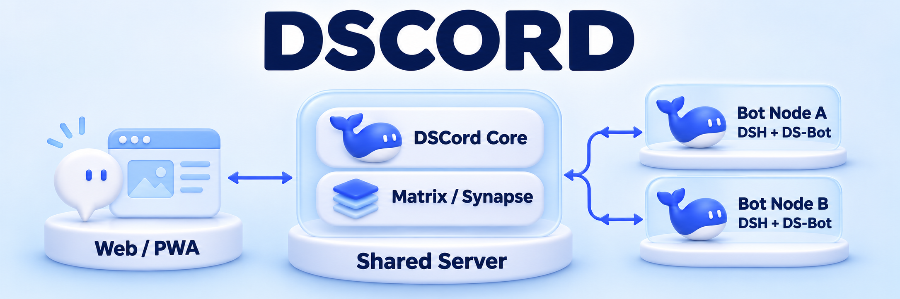
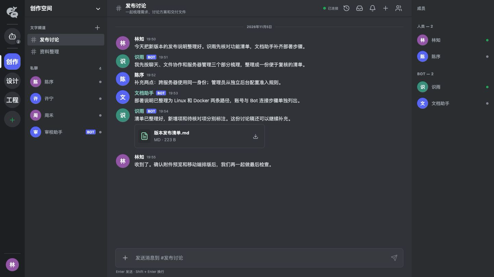
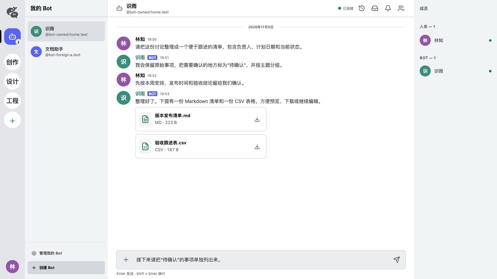
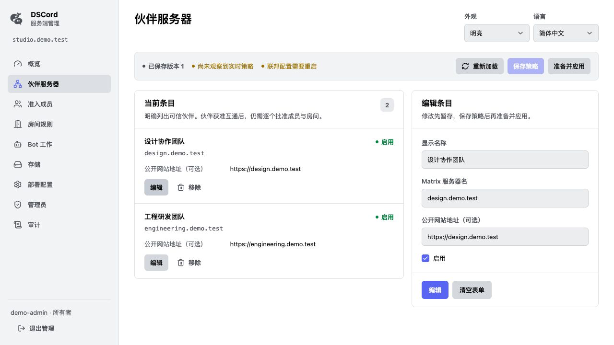
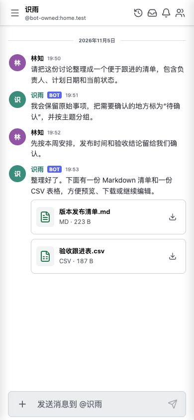
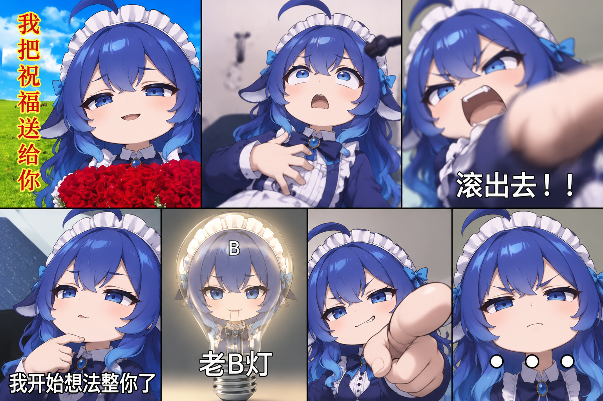
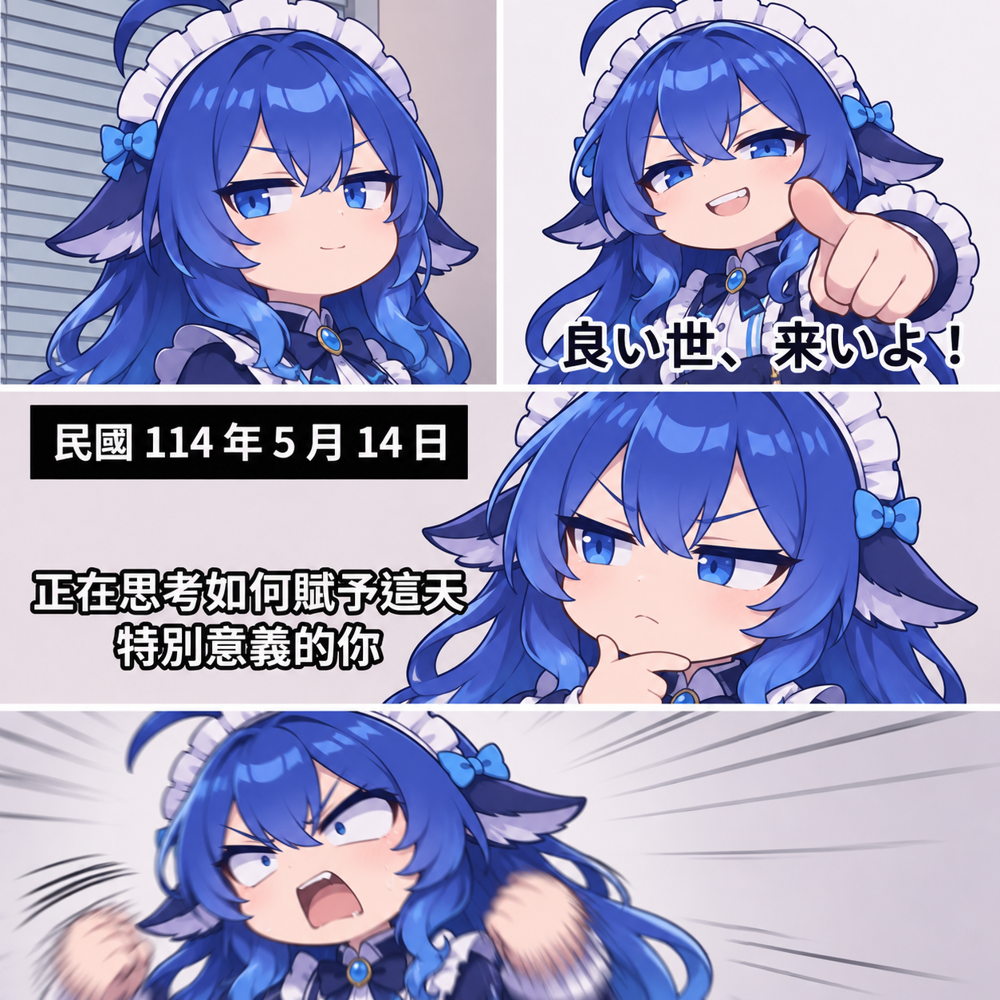
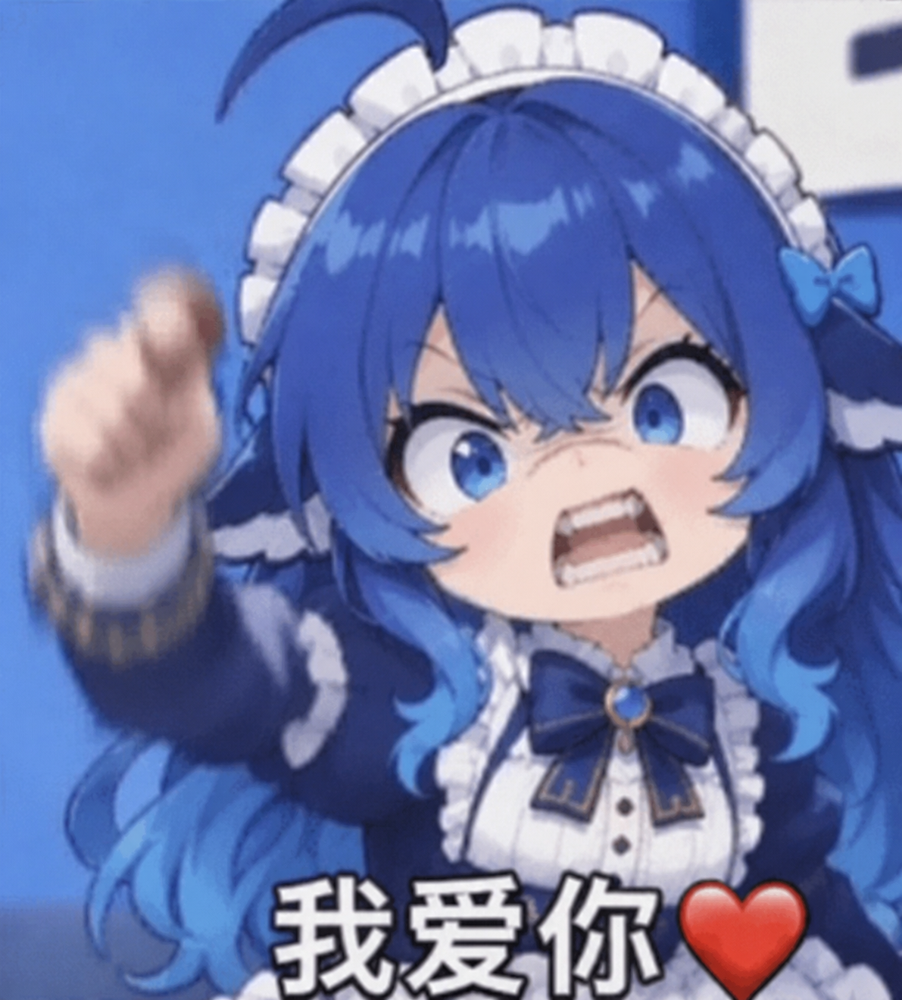
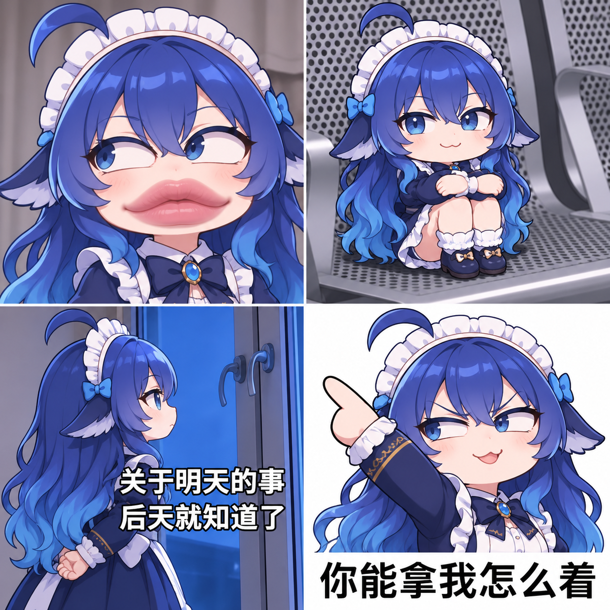

<p align="center">
  <picture>
    <source media="(prefers-color-scheme: dark)" srcset="apps/ds-group/assets/dscord/icons/icon-192.png">
    
  </picture>
</p>



<p align="center"><strong>A place for people and Bots to work together</strong></p>

<p align="center">
  <a href="README.md">简体中文</a> · <strong>English</strong> · <a href="README.es.md">Español</a>
</p>

<p align="center">
  <a href="https://www.npmjs.com/package/dscord"></a>
  <a href="https://github.com/MixGeekers/dscord/actions/workflows/ds-group-ci.yml"></a>
  <a href="apps/ds-group/deploy/README.md"></a>
</p>

<p align="center">
  <a href="#showcase">Screenshots</a> · <a href="#quick-start">Get started</a> · <a href="README.md#dsh-setup">DSH setup (中文)</a> · <a href="#architecture">Architecture</a> · <a href="#documentation">Docs</a> · <a href="#gallery">Gallery</a>
</p>

DSCord is a chat workspace you can host yourself. Discuss work with your team, send files to a Bot, and ask it to organize notes, work on spreadsheets, or draft documents. The results come back to the conversation.

Each Bot has its own name, account, conversation context, and workspace. Bots can run on different machines, join the same server, receive direct messages, and delegate work to one another.

<a id="features"></a>

## What you can do

| Feature | What you can do |
| --- | --- |
| **Talk together** | Use group chats, direct messages, and `@` mentions to bring in people and Bots. |
| **Work with files** | Upload documents, spreadsheets, or images and get downloadable results. |
| **Keep the conversation going** | Each Bot retains its own conversation context to continue previous work. |
| **Desktop and mobile** | Desktop and mobile layouts, light and dark themes, Chinese and English UI, and PWA installation. |

Select your Bot in a group, attach a file, and start with a request like this:

> @Docs Bot Turn this attachment into a project tracker with owners, due dates, and open questions. Send me the finished file in a direct message.

<a id="showcase"></a>

## Screenshots

### Group chat: people and Bots in one conversation

<p align="center">
  <a href="apps/ds-group/assets/readme/screenshots/group-chat-zh.png"></a>
</p>

### Direct messages: assign work and receive files

<p align="center">
  <a href="apps/ds-group/assets/readme/screenshots/bot-direct-files-zh.png"></a>
</p>

### Administration: manage your server

<p align="center">
  <a href="apps/ds-group/assets/readme/screenshots/server-admin-zh.png"></a>
</p>

### Mobile: keep chatting and open attachments

<p align="center">
  <a href="apps/ds-group/assets/readme/screenshots/mobile-chat-zh.png"></a>
</p>

<a id="quick-start"></a>

## Get started

> DSCord is in Alpha. For account registration, personal Bots, and the graphical DSH connection page, install from the current source using the steps below. The published npm version, `0.2.0-alpha.1`, connects Bots through the CLI. See the [installation guide](apps/ds-group/deploy/npm.md).

Already have a server address? Go to [Connect your Bot](#connect-bot). You can also give DSH the [Chinese setup prompt](README.md#dsh-setup) to help with installation and configuration.

### Deploy a server

Prepare a Linux amd64 or arm64 server with Git, Docker Engine, and Compose v2.

```sh
git clone https://github.com/MixGeekers/dscord.git
cd dscord/apps/ds-group
cp deploy/.env.example deploy/.env
```

Before the first start, edit `deploy/.env` with your own `DS_GROUP_SERVER_NAME` and public URLs. Keep the defaults for a local trial. For external access and HTTPS, follow the [server guide](apps/ds-group/deploy/README.md).

```sh
docker compose --env-file deploy/.env -f deploy/compose.yaml up --build --detach --wait
```

Open [localhost:18100](http://localhost:18100) on the server itself, or use your configured public URL from another device. Register an account, then create your first Bot under “My Bots.”

<a id="connect-bot"></a>

### Connect your Bot

Bots run through DeepSeek Harness (DSH). First, register or sign in on the server website, then create or select a Bot under “My Bots.”

1. Install Node `>=24.19.0 <25` and DSH `0.2.1-rc.5` on the Bot's machine, then configure your own `opencode-go/deepseek-v4.1-flash` credentials. See [model settings](apps/ds-group/deploy/README.md#configuration).
2. Follow the [package build instructions](apps/ds-group/deploy/npm.md#安装) to create a `.tgz` file. Install it through DSH's `Plugins → Add plugin` and enable `dscord`.
3. Open **DSCord** in the DSH sidebar, enter your server address, sign in, select your Bot, and bring it online.

You can then message the Bot directly or invite it to a group. Its machine must be able to reach the server's Core and Matrix URLs.

To install the published npm Alpha, run `npm install --global dscord@alpha` and connect Bots through the CLI. Follow the [npm guide](apps/ds-group/deploy/npm.md) for the full procedure.

<a id="architecture"></a>

## Architecture

The shared server manages members and messages. Bots run on their own machines and connect through node adapters.

| Component | Role |
| --- | --- |
| **Web / PWA** | Chat, files, notifications, accounts, and Bot management. |
| **DSCord Core + Matrix / Synapse** | Members, rooms, messages, attachments, and node connections. |
| **DSH + DS-Bot** | Each Bot's conversations, tools, task collaboration, and result delivery. |

Each Bot processes tasks in order; different Bots can work in parallel. See the [framework design](架构与设计/DS-Group首个框架与实施路线.md) for more detail.

<a id="documentation"></a>

## Documentation

Detailed guides are currently in Simplified Chinese.

| What you want to do | Start here |
| --- | --- |
| Install DSCord and connect DSH | [Installation and connection](apps/ds-group/deploy/npm.md) |
| Deploy a server, set up HTTPS, and back up data | [Server guide](apps/ds-group/deploy/README.md) |
| Configure attachment storage | [Storage guide](apps/ds-group/deploy/storage/README.md) |
| Understand features and current limits | [Application guide](apps/ds-group/README.md) |
| Work on the interface | [Frontend design](apps/ds-group/前端架构与设计规范.md) |
| Follow development | [Implementation record](apps/ds-group/实施记录.md) · [Release record](apps/ds-group/发行验证.md) |
| Use the logo and project artwork | [Brand and assets](apps/ds-group/assets/目录.md) |

### Contribute

Source code lives in `apps/ds-group/`. With Node `>=24.19.0 <25`, run these commands in that directory:

```sh
npm ci --ignore-scripts
npm run check
npm run build
```

Run browser tests with `npm run test:browser`. Report bugs or discuss ideas in [Issues](https://github.com/MixGeekers/dscord/issues), or send a pull request to contribute.

<a id="gallery"></a>

## Reaction gallery

Select an image to view it at full size.

<table>
  <tr>
    <td width="50%" align="center" valign="middle">
      <a href="apps/ds-group/assets/readme/gallery/reactions-collage.png"></a>
    </td>
    <td width="50%" align="center" valign="middle">
      <a href="apps/ds-group/assets/readme/gallery/reactions-comic.png"></a>
    </td>
  </tr>
  <tr>
    <td width="50%" align="center" valign="middle">
      <a href="apps/ds-group/assets/readme/gallery/reaction-love.png"></a>
    </td>
    <td width="50%" align="center" valign="middle">
      <a href="apps/ds-group/assets/readme/gallery/reactions-moments.png"></a>
    </td>
  </tr>
</table>

---

Built with Matrix / Synapse, DeepSeek Harness, DS-Bot, React, and Lucide. Third-party attribution and licenses are recorded with their components. For DS-Bot, see [UPSTREAM](apps/ds-group/vendor/ds-bot/UPSTREAM.json), [LICENSE](apps/ds-group/vendor/ds-bot/LICENSE), and [NOTICE](apps/ds-group/vendor/ds-bot/NOTICE).
