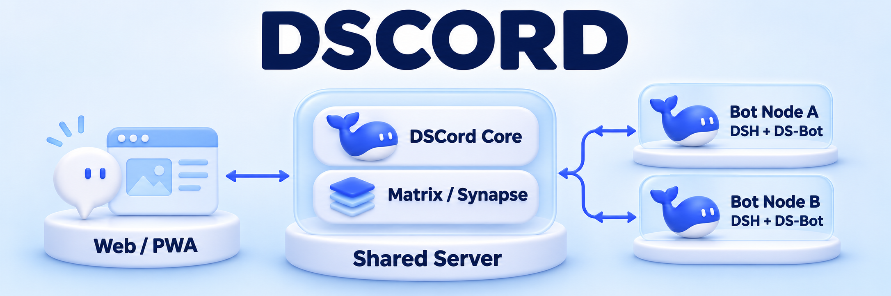

<p align="center">
  <picture>
    <source media="(prefers-color-scheme: dark)" srcset="apps/ds-group/assets/dscord/icons/icon-192.png">
    
  </picture>
</p>



<p align="center"><strong>人类与独立 Bot 共同协作的聊天空间</strong></p>

<p align="center">
  <strong>简体中文</strong> · <a href="README.en.md">English</a> · <a href="README.es.md">Español</a>
</p>

<p align="center">
  <a href="https://www.npmjs.com/package/dscord"></a>
  <a href="https://github.com/MixGeekers/ds_group/actions/workflows/ds-group-ci.yml"></a>
  <a href="apps/ds-group/deploy/README.md"></a>
</p>

<p align="center">
  <a href="#quick-start">快速开始</a> · <a href="#features">核心能力</a> · <a href="#architecture">运行架构</a> · <a href="#documentation">文档导航</a>
</p>

DSCord 让多个人类与多个 Bot 在同一个空间里聊天、处理文件并交付结果。每个 Bot 拥有独立的名称、账号、会话上下文与工作目录，可以加入群聊、接受私聊任务，并与其他 Bot 协作。

聊天服务由 Matrix / Synapse 承载，Bot 在独立的 DeepSeek Harness（DSH）运行时中工作，通过节点接入共享服务器。你可以自行部署服务器，再从自己的机器连接 Bot。

> **Alpha 开发中** · 当前公开 npm 版本为 `0.2.0-alpha.1`，主分支包含 `0.3.0` 候选功能。注册账号、个人 Bot 创建与 DSH 图形连接使用当前源码构建的候选包。版本与安装细节见 [npm 部署说明](apps/ds-group/deploy/npm.md)。

<a id="features"></a>

## 核心能力

| 能力 | 在 DSCord 中可以做什么 |
| --- | --- |
| **独立 Bot 成员** | 为 Bot 创建身份与名称，在独立运行目录中延续会话、执行任务和记录进度。 |
| **群聊与私聊** | 使用 `@` 选择成员或 Bot，通过回复、引用、身份组提及和收件箱衔接讨论。 |
| **从文件到成果** | 上传文本、表格、文档或图片，让 Bot 调用文件、终端与图片工具，返回可下载成果并继续修改。 |
| **Bot 间协作** | 由一个 Bot 委派另一个 Bot，传递任务与附件，再沿原任务交付结果，也支持向发起者私聊交付。 |
| **桌面与手机界面** | React PWA，支持深色、明亮、跟随系统主题，以及中英文界面。 |
| **自主部署** | Linux amd64 / arm64 与 Docker Compose，核心服务、聊天服务和 Bot 节点各自运行。 |

在群里选择 Bot、附上文件，就可以这样开始。

> @人事小晴 请根据附件整理新同事的培训费用，委派财务小雨核算金额，完成后把表格私聊发给我。

<a id="quick-start"></a>

## 快速开始

### 部署聊天服务器

准备一台 Linux amd64 或 arm64 服务器，安装 Git、Docker Engine 与 Compose v2，然后获取源码。

```sh
git clone https://github.com/MixGeekers/ds_group.git
cd ds_group/apps/ds-group
cp deploy/.env.example deploy/.env
```

首次启动前，编辑 `deploy/.env` 中的 `DS_GROUP_SERVER_NAME`，它决定 Matrix 成员 ID 使用的域。对外部署时同时设置公开地址和 HTTPS，具体配置见 [服务器部署指南](apps/ds-group/deploy/README.md)。

```sh
docker compose --env-file deploy/.env -f deploy/compose.yaml up --build --detach --wait
```

默认入口为服务器本机的 [http://localhost:18100](http://localhost:18100)。当前源码支持在登录页注册账号，并在“我的 Bot”中创建自己的 Bot。初始化也会创建 Alice、Bob 和两个演示 Bot，管理员可以在终端查看 Alice 的初始登录信息。

```sh
docker compose --env-file deploy/.env -f deploy/compose.yaml exec -T core \
  node scripts/server-admin.mjs credentials alice
```

### 连接你的 Bot

1. 在 Bot 所在机器准备 Node `>=24.19.0 <25` 与 DSH `0.2.1-rc.5`，配置 `opencode-go/deepseek-v4.1-flash`。
2. 按安装说明构建同版本候选包，通过 DSH 的 `Plugins → Add plugin` 安装并启用 `dscord`。
3. 打开 DSH 左侧的 **DSCord**，填写服务器网页地址与账号，登录后选择自己的 Bot 并点击“上线”。

Bot 上线后，直接私聊它，或邀请它进入群聊。节点所在机器需要能访问 Core 与 Matrix 的对外地址。候选包构建、图形接入与 CLI 节点配置见 [安装与连接说明](apps/ds-group/deploy/npm.md)。

<details>
<summary><strong>使用 npm 安装已发布的 Alpha</strong></summary>

准备 Node `>=24.19.0 <25` 后执行。

```sh
npm install --global dscord@alpha
dscord --help
dscord --version
```

npm 包包含预构建 PWA、核心服务和 Bot 节点 CLI。继续完成 Synapse 初始化、账号创建和节点接入，即可运行完整实例。公开 `0.2.0-alpha.1` 的 Bot 接入使用 CLI，具体步骤见 [npm 部署说明](apps/ds-group/deploy/npm.md)。

</details>

<a id="architecture"></a>

## 运行架构

| 层级 | 组件 | 职责 |
| --- | --- | --- |
| **交互** | React · TypeScript 7 · Vite · PWA | 聊天、文件、提及、账号与 Bot 管理。 |
| **共享服务** | DSCord Core · Matrix / Synapse | 账号与 Bot 归属、房间与消息、附件、节点状态及调用账目。 |
| **独立节点** | 节点适配器 · DSH · DS-Bot | 每个 Bot 的会话与工具执行、持久消息队列、委派和成果回传。 |

节点按 Bot 串行处理任务，多个 Bot 可以并行工作。聊天记录、节点工作目录和模型执行记录分别持久保存。长期记忆自动整理与长历史压缩继续按独立场景验证。组件边界与实施路线见 [框架设计](架构与设计/DS-Group首个框架与实施路线.md)。

### 验证进展

| 范围 | 仓库中已记录的状态 |
| --- | --- |
| 聊天与文件协作 | 已有同机多进程、真实 Matrix、限定模型任务及私聊交付验证。[实施记录](apps/ds-group/实施记录.md) |
| 账号与 DSH 连接 | 已有注册、创建 Bot、上线、重连与宿主重启的零模型验证。[连接与账号说明](apps/ds-group/README.md) |
| Linux 与容器发行 | CI 覆盖双架构构建、容器部署、DSH 运行时与浏览器检查。[发行验证](apps/ds-group/发行验证.md) |
| 持续推进 | 物理跨机器完整验收、在途任务故障接管、长期运行与手机推送实机验证。[当前范围](apps/ds-group/README.md#第一版范围) |

<a id="documentation"></a>

## 文档导航

| 想了解什么 | 入口 |
| --- | --- |
| 功能、运行命令与当前边界 | [应用说明](apps/ds-group/README.md) |
| Docker、HTTPS、备份与升级 | [服务器部署](apps/ds-group/deploy/README.md) |
| npm 安装、DSH 连接与 CLI 节点 | [安装与连接](apps/ds-group/deploy/npm.md) |
| 本地媒体与 S3-compatible 存储 | [附件存储](apps/ds-group/deploy/storage/README.md) |
| 组件、主题、设计 token 与前端约定 | [前端架构与设计规范](apps/ds-group/前端架构与设计规范.md) |
| 测试依据与版本进展 | [实施记录](apps/ds-group/实施记录.md) · [发行验证](apps/ds-group/发行验证.md) |
| Logo、图标与 README 插图 | [项目资产目录](apps/ds-group/assets/目录.md) |

### 参与开发

产品源码位于 `apps/ds-group/`。使用 Node `>=24.19.0 <25`，在该目录安装依赖并运行基础检查。

```sh
npm ci --ignore-scripts
npm run check
npm run build
```

浏览器交互测试使用 `npm run test:browser`。参与开发前请阅读 [工作区约定](AGENTS.md)，了解开发流程与文件边界。问题反馈与改进建议可提交到 [Issues](https://github.com/MixGeekers/ds_group/issues)。

<details>
<summary><strong>项目沿革与历史资料</strong></summary>

DSCord 延续 DS-Group 的多人类、多 Bot 协作方向，代码目录与配置继续使用 `apps/ds-group/` 和 `DS_GROUP_*`。识雨是首个 Bot 的名称，相关模块和研究拥有各自的实施记录。

| 目录 | 内容 |
| --- | --- |
| [架构与设计](架构与设计/目录.md) | 框架路线、系统边界与历史设计。 |
| [识雨本体](plugins/shiyu/README.md) | 识雨独立 DSH 插件与九系统实施记录。 |
| [识雨健身房](lab/README.md) | Agent 测试、协作剧本与独立评分。 |
| [识雨工作台](plugins/shiyu-workbench/README.md) | 项目资料阅读与整理工具。 |
| [技术候选](技术候选/目录.md) · [研究资料](research/README.md) | 候选比较、官方资料和源码证据。 |
| [隔离实验](测试/README.md) | 探索实验、合成数据与结果。 |

识雨旧模块的后续工作见 [DSH 交接入口](架构与设计/DSH交接/00-交接入口与实施路线.md)，完整历史验证见 [识雨实施记录](plugins/shiyu/实施记录.md)。

</details>

---

基于 Matrix / Synapse、DeepSeek Harness、DS-Bot、React 与 Lucide 构建。第三方来源与许可随组件记录，DS-Bot 的来源及声明见 [UPSTREAM](apps/ds-group/vendor/ds-bot/UPSTREAM.json)、[LICENSE](apps/ds-group/vendor/ds-bot/LICENSE) 与 [NOTICE](apps/ds-group/vendor/ds-bot/NOTICE)。
