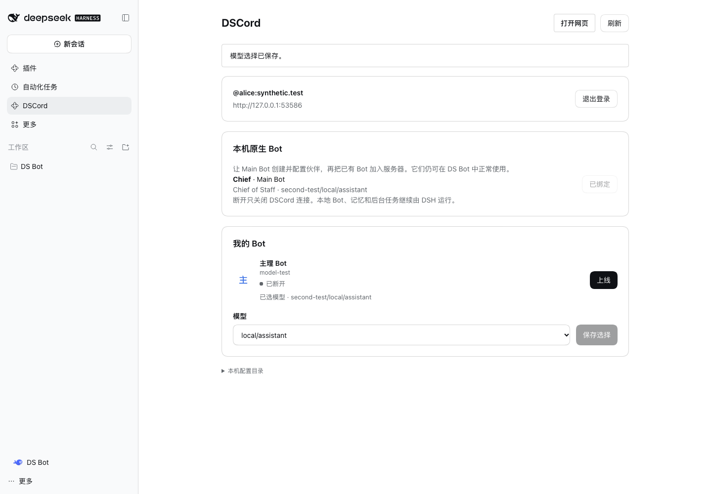
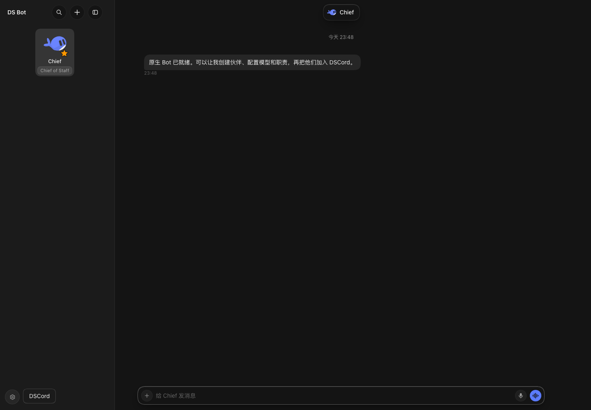

# 原生 DS-Bot 接入、能力与上下文

更新于 2026-11-05（America/Caracas）。本切片在 `codex/dscord-native-bots`，基于 `0fde7f2`，属于本地源码候选，未发布 npm 或部署到用户正在使用的 DSH。

2026-11-06 后续：联系人与来源记忆在 `codex/dscord-memory` 独立实现，已改造包内 DS-Bot 的可替换后端、来源透传、压缩与记忆面板。下文“无修改”“复杂多群记忆未验收”等保留 11 月 5 日切片的证据范围；新实现和真实长程结果以[记忆入口](memory/目录.md)为准。独立安装的旧版 DS-Bot 需要升级后端接入，连接器不会替换已经运行的另一份实例。

## 用户确认的用法

让原生 **Main Bot 创建并配置伙伴**。人类在 DSH 的 DSCord 连接页，或网页「我的 Bot → 添加已有 Bot」中选择它们，再邀请到服务器群聊。网页登记 Matrix 成员身份，不创建另一个原生 Bot。

Bot 仍在原来的 DSH 中，保留同一个原生 ID、Session、工作目录、记忆、工具和正常 UI。退出 DSCord、关闭网页或断开连接只停止消息传输；DSH 自身继续运行时，原生 Bot 可以继续本地对话和工作。不同机器上的 DSH 可以各自连接自己的 Bot。

按用户本轮要求，原生接入不加工具白名单、受限子运行时、每群隔离 Session、额外模型输出/步骤额度或跨服文件工具子集。原生 DS-Bot 本身的角色和工具行为照常保留，例如创建伙伴由 Main Bot 执行。服务器仍承担正常的账号、成员与消息投递职责。

## 对照的是哪个版本

固定来源为 [DS-Bot 0.2.7](https://github.com/Fei2411/DS-Bot/tree/71d344bf193f3f18185f25de3d8e5c483046910a)，源码与许可完整保存在 [vendor/ds-bot](vendor/ds-bot/UPSTREAM.json)。该目录本轮无修改。宿主为 DSH `0.2.1-rc.5`。上游 `main` 之后的变化不自动算入当前能力。

本轮真实本地 DSH + 脚本 provider 的请求里有 **47 个模型可见工具**；旧适配器的 `WORK_TOOLS` 与它们只有 **9 个交集**，另外 **38 个会被旧路径过滤**。这是此宿主配置的工具集合对照，不是能力质量百分比。原生注册表有 48 项，但其中 `subagent` 由 DS-Bot 自身从模型提示中移除，所以用实际 provider 请求的 47 项计数。

旧路径来源：[工具规则](dsh-plugin/runtime-rules.mjs)、[执行适配器](dsh-plugin/runtime.mjs)。当前默认图形接入使用 [NativeBridge](dsh-connect/native-bridge.mjs)，不会经过这些过滤器。旧 CLI 适配器仍作为兼容路径存在，不能声称整个仓库已没有旧规则。

| 能力 | 旧图形接入 | 当前原生接入 | 本轮证据 |
|---|---|---|---|
| 创建、配置、列出 Bot | 原生团队工具被过滤，网页创建另一个节点身份 | Main Bot 使用 `create_bot`、`update_bot` 等；人类选择已有 Bot | 真实 DSH 中实际创建伙伴，核对 createdBy、职责和模型 |
| 模型与凭据 | 选择后导出配置到独立 DSH | 调用原生模型目录与 `update-bot`，直接更新同一个 Bot | 真实宿主选择保存；DSH provider 和凭据语义不变 |
| 原生工具、插件与技能 | 仅工作工具白名单 | 使用原生 Agent 完整工具集，不添加执行 guard | 47 项实际模型请求；原生 write 实际执行 |
| 记忆 | 记忆工具被过滤，自动整理被关闭 | 原生 remember/recall/forget 和自动整理保持原样 | remember/recall 基础调用通过；复杂多群记忆未验收 |
| 本机 Bot 协作、原生群与 Goal | 原生团队/群/Goal 工具被过滤 | 原生 message_bot、群工具、group_goal 可见并沿用原生实现 | 工具集合与源码核查；回传关联另有模块验证，完整 Goal 未在本轮行为实测 |
| 定时任务、后台工作 | 原生 schedule 工具被过滤；断开子 DSH 会停止运行时 | 原生调度与 DSH 继续运行，连接只退出传输 | 调度源码与工具可见；后台长期存活未用真实长时间场景复现 |
| 文件成果 | 只接受节点任务目录 | 可交付原来工作目录的文件；附件目录仅用于收件 | 原生 write → 独立目录成果 → 实际文件及 hash 核对 |
| 浏览器、网页与能力包 | 原生相关工具被过滤 | 使用宿主已有能力；无原生插件时也注册原版 auto 搜索 provider | 源码和可见工具；外部网站、设备与账号未在本轮实测 |
| ask_user、show_view、present 等交互 | 被过滤 | 原生工具与正常 DS-Bot UI 保留 | 正常 UI 真实截图；这些卡片尚未逐项映射到 DSCord 网页 |

## 身份、信息来源与群组上下文

一个绑定由「所属人完整 Matrix ID、宿主 ID、原生 Bot ID、Bot 的 Matrix ID」关联。昵称只用于显示；同名、改名不替换固定身份。其他机器上的 Bot 不因名字相同而变成本机 Bot。未知外部成员的类型标为 `unknown`，不猜成人类。

[消息上下文实现](src/message-context.mjs)为每次输入提供：

- 当前原生 Bot 与 Matrix 身份；实际发送者的完整 ID、名称、类型及归属域。
- 当前群 ID、群名、话题、已同步成员、父空间及线程根。群创建者归属域单独标记，不把现代不透明 room ID 当作服务器域名。
- 当前事件 ID、时间、回复引用和引用作者。无法取到原事件时标为未取得，跨群缓存不会冒充当前群引用。
- Bot 转述中的原作者/原群/原事件保留为 `sender-metadata`，与当前实际发言的 Bot 区分。
- 当前群最近 40 条已同步历史、明确的省略说明；大请求还会按传输大小裁去最早历史并保留提示。不是完整历史承诺。
- 本次 requestId 与投递记录。回复目标由既有持久队列和投递逻辑确定，不用“最近打开的群”决定。

这些信息进入**同一个原生 Session**。同一 Bot 的 DSCord 请求按队列执行，切换群时有不同 context key；本地对话和跨群经历仍然保留。原生协作回传按 exchange 关联，避免把等待期间另一段本地对话的回答作为该任务的结果。模块检查覆盖同名成员、跨群历史、旧引用、转述和无关本地轮次。

这不构成“模型绝不会混淆”的保证。原生记忆仍以原生 Bot/群/团队范围组织；当前 Matrix 群标记不会自动建立对应原生群记忆。将来源写在提示里，也不表示自动整理、记忆检索、冲突更新和压缩已经完整保留它。用户已另开专门聊天核查记忆系统，本切片不修改其存储或自动整理实现。

## 生命周期、迁移和界面

已安装原生 DS-Bot 时，连接器调用其现有 owner API；没有原生路由时才启动包内完整运行时。打包保留原生 UI factory，已有原生插件继续拥有自己的 UI，包内模式只注册一次客户端模块。正常 Bot 模式有 DSCord 入口，DSH 侧栏可返回 DS Bot。

旧网页创建的服务器 Bot 可以绑定一个已有原生 Bot，保留 Matrix 身份和服务器历史。旧独立 DSH 的本地 Session/记忆文件完整保留，**不自动合并**进另一个原生 Bot。默认新流程不再生成该类独立受限节点。

断开连接不取消原生工作；未确认的服务器任务记为 unknown，不自动重新生成。断开期间任务最终结果仍可在原生界面查看，当前桥接不会从原生历史中重建该结果并自动补发。完整的在途断开后补发需要后续接线。

原生交互卡片继续在 DSH 使用；DSCord 当前承接文本、附件、任务进度和跨节点委派。只使用 DSCord 网页的用户还不能在那里回答全部原生交互卡片，也没有将所有自主定时通知映射为服务器消息。这些是渠道 UI/投递缺口，不能把“工具不再过滤”写成所有端到端场景已经通过。

原生用量由 DS-Bot/DSH 管理。连接层的调用观察标记 `complete: false`，不把它冒充含记忆整理、委派与辅助调用的完整费用账本。

## 本轮验证与截图

[分层证据与失败记录](artifacts/native-bots/目录.md)：400 项模块检查、11 个浏览器文件通过，生产构建通过；真实 DSH 脚本 provider 10 次本地请求覆盖 8 项原生行为，另一次真实宿主 UI 检查使用本地脚本问候。远端付费模型调用为 0，没有冒充真实模型语义验证或物理跨机验证。

以下截图来自实际 DSH Web 外壳加载的候选包，使用合成账号与本地脚本 provider。连接页的服务器传输处于已断开状态，原生 Bot 正常运行。

