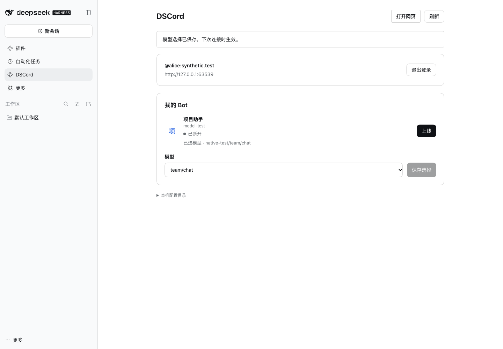
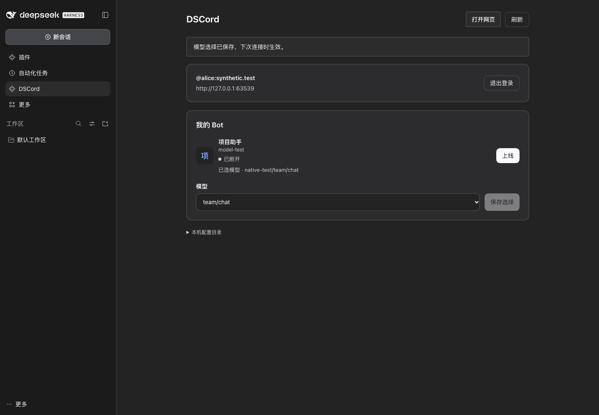

# Bot 模型选择与迁移

更新于 2026-11-05（America/Caracas），适用于当前 `0.3.0-alpha.1` 源码候选。

## 原生连接的模型选择

在 DSH 打开 **DSCord**，登录后选择已有原生 Bot。模型目录、服务商、凭据和思考设置全部由 DSH 管理；连接页只提供模型下拉选择。保存调用原生 `update-bot`，由 DS-Bot 应用到同一个 Bot，不复制 provider 或凭据、不另起 DSH、不额外套用 Core 模型白名单或输出上限。

连接页使用 DSH 原生控件和主题。原生 Bot 正常模式也保留，在两种模式之间可直接切换。断开 DSCord 只停止传输，不停止原生任务。自己的 Bot 在网页中由「添加已有 Bot」选择，创建与职责配置交给 Main Bot。

旧服务器账号可以绑定本机已有原生 Bot，保留 Matrix 身份。旧独立运行时的历史、记忆与 Session 原文件保留，不自动与另一个原生团队合并。[接入、能力与证据](原生DSBot能力对照.md)

原生模型用量由 DS-Bot/DSH 记录。连接层仅观察任务期间的部分调用，标为 `complete: false`；不会将其作为完整费用或写入旧 Core 模型预算账本。

## 以下为兼容 CLI 独立运行时

以下模型导出、凭据复制、输出上限、Core 额度和重连说明，限定在旧 `dsh-plugin/runtime.mjs` 路径。原生连接不使用这套执行适配器。

## CLI 节点

先在自己的 DSH profile 中配置可用模型。以下值需要替换为实际目录、profile 和目录中的完整模型引用，Bot 账号和端口按[部署说明](deploy/README.md#接入远端-bot)填写。

```sh
export DS_GROUP_DSH_SOURCE_HOME="/absolute/path/to/your/dsh-home"
export DS_GROUP_DSH_SOURCE_PROFILE="your-profile"
export DS_GROUP_MODEL="provider/team/model-id"
node scripts/service.mjs up "$BOT_ACCOUNT"
```

模型 ID 可以包含 `/`，第一个 `/` 前的部分为 provider。新节点省略 `DS_GROUP_MODEL` 时使用来源 profile 的默认模型，已有节点沿用其保存的选择。显式 `DS_GROUP_MODEL` 优先级最高。

节点输出上限由 `DS_GROUP_MAX_OUTPUT_TOKENS` 设置，默认 4096。`DS_GROUP_REASONING_EFFORT` 可为 CLI 节点设置原生模型支持的强度；沿用 DSH 默认模型时继承其默认强度。连接页保留节点已有的输出上限，直接选择模型即可。

模型配置读取复用已安装 DSH 的 bundle、profile、home 补丁合成逻辑及环境加载顺序。本轮适配 DSH 0.2.1-rc.5 的 `llm-pi-ai` 模型，包括内置 provider、自定义 OpenAI-compatible 路由、显式模型目录和 modelOverrides。额外 adapter 插件与动态 `!!js` 配置需要单独适配。

## 升级已有节点

1. 将 Core、DSH 连接插件和独立节点升级到同一候选版本。
2. 有任务运行时先处理当前任务，再断开对应 Bot。
3. 打开 DSH 的 DSCord 页面，检查迁移后的已选模型，按需重新选择并保存。
4. 上线后核对“当前运行”模型。模型不可用时检查来源 profile、凭据及服务器策略。

旧节点的 `node-config.json` 会提供首次迁移选择。原固定模型 `opencode-go/deepseek-v4.1-flash` 的旧配置沿用 `low` 强度。既有 `OPENCODE_API_KEY` 和 `DS_GROUP_OPENCODE_BASE_URL` 仍可供旧 CLI 部署使用，显式环境凭据仅用于该 provider。

节点继续使用已有 DS-Bot 身份、Session、数据目录与未知状态回执。切换模型时，原生 Session 的上下文适配由 DSH 承担。历史 `unknown` 账目继续留存。

## 服务器额度与账本

Core 默认接受节点选定的可用模型。管理员可在 `core-config.json` 中设置 `allowedModels`，值为完整模型引用数组。省略或 `null` 表示开放，空数组暂停模型请求。此策略在 Core 启动时读取，已有账本也会采用新策略。

连接页保存和上线时检查服务器模型策略及输出上限，运行时每次生成再检查。核心账本记录实际 `provider/model`。`GET /api/status` 的 `budget.allowedModels` 为当前策略，`models` 为历史账目出现的模型，`model` 在历史只有一种模型时为该引用，否则为 `null`。

调用次数与单次输出额度使用原有持久预算机制。新预算库从 `modelCallLimit` 和 `maxOutputTokens` 初始化，已有数据库继续使用其持久值。模型选择与策略更新均保留原有账目。

## 配置与凭据存放

DSH 当前 profile 是模型配置来源。节点准备复制所选 provider 的模型目录、modelOverrides、协议、端点、headers、兼容参数和重试策略。来源配置按只读方式访问。

连接页的 `connection.json` 按 Bot 保存模型引用与运行选项。凭据单独写入节点私有 `model-source.json` 和独立 DSH home 的 `.credentials.yaml`，文件权限为 `0600`。状态 API 仅返回模型和凭据可用状态。导出范围限于所选 provider 的引用凭据、原生认证记录及 DSH 声明的认证引用。

CLI 支持显式 `apiKeyEnv`、DSH 环境加载和所选 provider 的原生认证记录。使用原生环境认证时，需让节点进程拥有对应环境变量；图形连接会按 DSH 声明解析这些引用。节点现存的其他 provider 配置和本地记录按原文件保留。

## 先前模型适配切片验证（0fde7f2）

完整结果与源码哈希保存在[验证目录](artifacts/model-config/目录.md)。本轮覆盖模块与浏览器回归、真实 DSH 的目录读取和选择保存、原生 Session 重启与模型切换、两组本地脚本 provider 的文件工具闭环及核心账本核对。

远端付费模型调用为 0。脚本 provider 验证实际调用路由、工具和账本，真实模型的推理质量、服务商凭据有效性、缓存及完整费用仍需按具体服务商实测。DSH 的 provider 内部重试按原生配置执行，核心以一次 stream 为单位记账。

```sh
npm run check
npm run test:browser
npm run runtime:check
npm run runtime:work-check
node scripts/model-settings-smoke.mjs --screenshots
npm run npm:pack
```

以下截图来自真实 DSH 0.2.1-rc.5 Web 外壳中安装的发行包。使用隔离 profile、合成账号和本地模型目录，Bot 显示为已断开。




