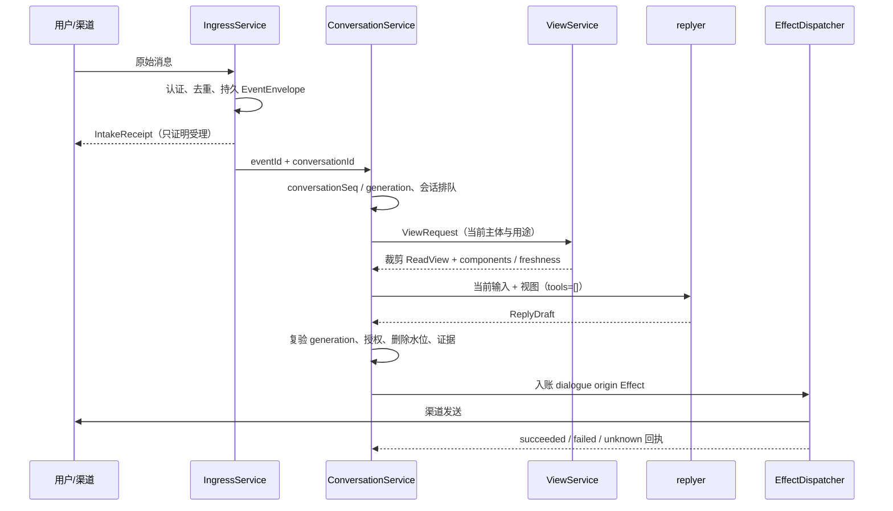
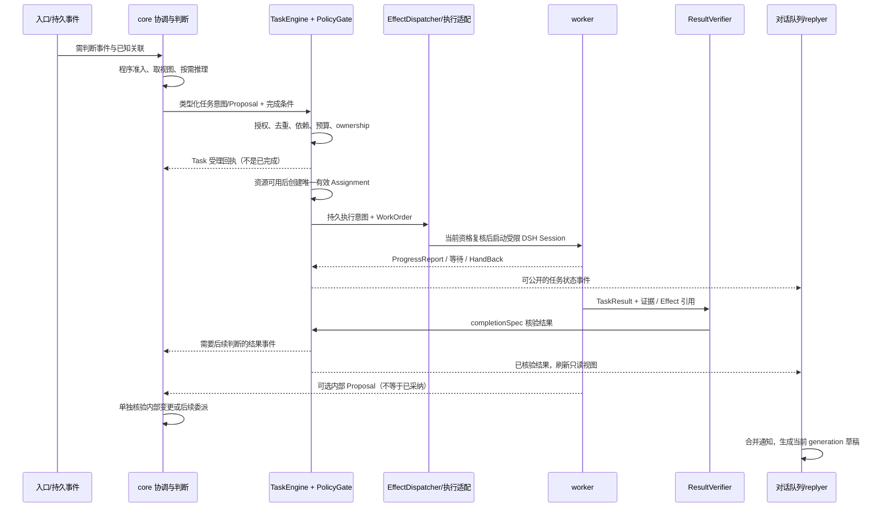

# Core 派工与对话时序

[跨模块契约 v1.1](<跨模块契约.md>) · [core](<03-DSH宿主进程/01-识雨插件/02-内层-六部分状态/00-core-主动判断/README.md>) · [对话队列](<03-DSH宿主进程/01-识雨插件/01-外层-对话与表达/02-串行与并行队列/README.md>) · [任务引擎](<03-DSH宿主进程/01-识雨插件/03-任务与执行/02-任务与执行实例/README.md>)

日期：2026-11-01。状态：规划说明，尚未实施或运行。本文细化 v1.1 的职责和调用顺序，不新增 Agent 框架、队列产品或第二份 Goal / Task 状态机。

多频道场景的[话题与后台协作建议](<多频道话题与后台协作.md>)进一步区分渠道会话、逻辑话题、Task 与 DSH Session。后台结果先核验并发布状态，再向获准目的地通知；关联讨论不合并历史或重复派工。话题级失效与并发须配套扩展契约，尚未实现。

## 1. Core 在哪里

**core 负责“是否值得做、做什么、允许推进到哪一步，以及结果如何影响内部状态”。入口分流、排队、领取执行资格和消息发送由程序服务承担。** core 中既有确定性的协调 / 准入程序，也有按需调用的判断模型；“经过 core 的规则”不等于“每次都调用 core 模型”。

| 图示短标签 | 现有职责 / 实现接缝 | 负责的决定 | 不持有的权力 |
|---|---|---|---|
| 入口分流 | IngressService + ConversationService | 认证、去重、会话归属；按明确命令类型、关联 ID 和当前状态分流 | 不把任意文本直接视为授权，不由关键词创建 Task |
| core 判断 | CoreCoordinator + ModelAssessor + PolicyGate | 在目标、状态与预算内选择任务、内部提案、澄清、暂缓或不行动 | 模型不直接发设备命令、改数据库或抢占对话发送槽 |
| TaskEngine 派工 | TaskService 适配 Superagent Engine；同一个控制账本 | 输入 ownership、Task / Assignment 迁移、能力匹配、预算 / 资源准入与执行资格 | 不凭任务完成自行改记忆或人格；不是另一个决策模型 |
| worker 执行 | DSH Agent / Session + 受限 Broker | 在 WorkOrder 内完成实际检索、计算与工具工作，交回证据 | 不自行扩大 Mandate、宣布权威 succeeded、抢答用户或重开终态任务 |
| replyer 表达 | ConversationService + 受限原生 DSH Session，默认零工具 | 依据当前受众的 ReadView 与输入生成可发送草稿 | 不派工、不改六域、不把自己的完成措辞当回执 |
| Effect 发送 | EffectDispatcher + 渠道 / 设备适配 | 复核权限与世代，投递已入账的效果并核对回执 | 不把发送超时当“肯定没发”，不凭有 outbox 就跳过授权 |

`TaskEngine` 是本文用于画图的简称，指现有 TaskService / Superagent Engine，不新增服务。CoreCommitService 是程序化的逻辑准入与本地事务入口，名字里有 core，也不意味着它每次提交都启动一个模型。

## 2. 哪些请求需要 core 判断

| 输入 | 首选路径 | 是否需要 core 模型 |
|---|---|---|
| 普通聊天、解释已经提供的内容 | 对话队列 → 裁剪 ReadView → replyer | 通常不需要；表达模型本身可以理解和回答 |
| “任务到哪了”“你现在连着哪个设备” | 明确任务 / 设备关联 → ViewService → 状态模板或 replyer | 不需要重新规划；只能回答已核实状态 |
| 明确、已认证的暂停 / 撤权 / 取消命令 | 控制入口 → PolicyGate / TaskService / ConversationService | 不必等待模型；先关闭新派发或旧回复资格，再核对实际停止 |
| “替我整理这些文件”“持续检查这个目标” | 已接受事件 → core 评估 → 受控任务受理 | 通常需要判断范围、计划、完成条件与委派方式；已注册固定工作流可直接走同一准入规则 |
| 请求记住、修改人格偏好、合并身份等持久改变 | core / 对应领域规则 → Proposal → 本地提交或领域组件操作 | 需要内部决定；明确结构命令可纯程序校验，模型不一定必需 |
| 已有 Task 的补充材料或任务内追问 | ownership 已确定 → TaskInput → 当前 worker；必要时给外层状态 | 范围未变则不必重新由 core 接单；超范围 / 歧义由 worker hand_back 给 core |
| 到期目标、环境变化、失败、需要新的后续行动 | 程序先筛选 → core 按需判断 | 仅需要语义取舍时调用；无有效目标、预算或权限时不调用 |
| 已核验进度 / 完成事件，只需通知用户 | 更新任务快照 → 按通知许可合并进入对话队列 | 不必再过一次 core 推理；需要追问、重规划或内部改变才触发它 |

入口程序能可靠识别的是协议字段、明确控制命令、会话关联与既有 ownership；它不假装能用几个关键词理解所有自由文本。普通对话路径没有执行权限，即使路由误把行动请求送入 replyer，也只能解释或请求接管，不能执行。

需要语义判断的歧义输入交 core；replyer 可在同一次生成中返回正常 ReplyDraft 或根契约的 `needs_core{eventId,reason}` 接管提示，发现行动 / 内部写入需求时，由外围程序引用原 `eventId` 送入判断入口。needs_core 不是 Task、Proposal、Mandate 或已受理任务回执，不能直接调用 worker。路由程序持久记录 routeAttempt 与 correlation 去重，升级不创建新入站事件，不重新送回同一问答分类循环；默认同事件至多一次自动语义升级，已有任务归属按 Engine 处理。字段与总契约统一，详见第 8 节；接缝未通过验证时，歧义输入直接进入 core，不新增“路由 Agent”。

新消息可同时需要一条简短受理表达和后台任务处理；前者只解释进度，后者才拥有行动。原事件只分配一次任务 ownership，不因两条路径都看到输入而创建两个 Task。

## 3. 直接问答链

这条路径可以没有 core 模型、Goal、Task 或 Assignment。必要的对话运行记录和发送 Effect 仍通过受限事务入口写入；外层“只读”限制的是六域内部权威状态，并不禁止保存自己的会话游标、草稿和发送回执。普通回复的 Effect 使用 `origin=dialogue{conversationId,turnId,conversationGeneration}`，绑定当前回复许可与目的地；不能伪造 worker Assignment。

仅查询 Task 状态时，ViewService 读取任务账本的公开状态，不向运行中的 worker 索要一段即兴自述，也不等它结束。已有任务 cancelled 不禁止用**新视图**回复“已取消”；被取消任务的旧成果草稿则必须失效。

## 4. 需要派活时的完整链

1. **core 表达意图。** 给出任务范围、输入引用、完成条件、能力要求、依赖及预算请求；选择“哪个能力角色做什么”，不直接指定一个不受核验的执行进程。缺授权时形成澄清或待授权事项，不能自行填充许可。
2. **TaskEngine 正式受理。** 复用 Superagent receive / decide 等输入归属和任务迁移入口，TaskService 适配公共 Task。相同请求键查原回执；请求已归属现有任务时进入 TaskInput，不新建另一份任务。
3. **调度器落实执行资格。** 结合现有能力注册、资源占用、依赖、期限与预算安排 Assignment / WorkOrder；等待期间 Task 可保持 queued / waiting。程序负责槽位、租约与启动，core 不持续轮询“谁空闲”。
4. **worker 在范围内执行。** DSH setup 安装能力范围，Broker 核验实际调用；可观察副作用先记 Effect。worker 交 ProgressReport、TaskResult、Proposal 或 HandBack，不直接发布权威完成状态或发聊天消息。
5. **核验与内部采纳分开。** ResultVerifier 依据 completionSpec 决定是否允许 Task 投影为 succeeded。内部 Proposal 另经领域与版本校验；涉及 Ombre 时按 MemoryOperation 单独确认。任务成功、内部未采纳、通知 unknown 可以同时成立。
6. **外层表达。** 结果事件让 ConversationService 更新视图并按通知规则排队；只有后续行动 / 持久改变需要 core 继续判断，单纯结果播报不增加一轮 core 模型调用。

持续目标沿用 DSH `ctx.goals` 与 `GoalRef{id,revision}`，一个目标一个专用 Session；GoalBinding 只存映射和控制元数据。Task 可以隶属 Goal，但普通 Task 不强制升级为持续 Goal。Goal log 与控制 SQLite 不共享事务，目标变更需要登记、调用、核对；中断为 unknown，不能视为同步完成。

## 5. 聊天队列怎样与后台任务并行

| 逻辑序列 | 已有实现 / 持久依据 | 串行范围与推进者 |
|---|---|---|
| 输入接纳 | Ingress inbox 与来源去重 | 接纳器保证同事件身份与顺序；不等模型完成才确认受理 |
| 判断与任务执行 | Superagent Engine / 控制任务账本 / WorkerSlots | core 按需判断；TaskService 管 ownership / Assignment；无冲突任务可并行 |
| 对话生成 | ConversationService + 原生 DSH Session / inbox；旁路 p-queue 仅作条件备选 | 每 conversationKey 一个生成，跨会话公平共享槽位；不叠加第二套 Agent pending-list |
| 实际发送 / 动作 | 统一 Effect outbox 与回执 | 派发器按当前资格和资源约束执行；会话发送严格有序，任务按依赖关系 |

这是对现有组件的逻辑分工，不是部署四个队列产品。**长任务不会占着聊天队列等待完成。** 对话 turn 只等待本次受理说明、澄清或已有状态的草稿；worker 后台处理，后续结果作为新的事件进入表达流程。

- 串行键 `ConversationKey` 由稳定 `connectionId + platformConversationId + threadId? + 会话类型 / 受众范围` 规范化组成，不能用临时运行实例身份分隔队列。connectionId 表示识雨登录连接配置的稳定身份，重连保持不变；connectorAccountRef 指向本方登录账号，对方账号使用 accountId。内部 conversationId 关联这一稳定会话键，事件接纳分配 conversationSeq。250 ms 合并仅限同会话、同主体、同受众的未处理文本，并保留各 eventId。
- 新输入增加 conversationGeneration，取消或作废未发送的旧草稿；generation 不改变原生 Session 绑定，不因每条消息重建上下文。**普通聊天打断不等于取消后台 Task**。只有明确任务取消 / 授权变更才修改任务资格；群聊中无关噪音是否推进 generation 按[群聊注意力补充](<公司多人协作与群聊注意力.md>)处理。
- `TaskInput.kind=context/followup/cancel/scope_change` 沿用任务契约；现有 ownership 决定哪些输入交 worker。工作范围改变由 core 重评，不能让新对话无声扩展旧 Mandate。
- 初始验证参数保持全局模型并发 3，core / worker 共用后台最多 2，显式对话预留 1；core 评估并发 1，活动 worker Assignment 最多 2，并受独占设备限制。这些是上限，不能相加成 5 个模型调用。
- 认证控制命令走独立有界入口，暂停 / 撤权 / 删除不排在长模型调用之后。目标不明的自然语言停止请求仍需判定或澄清，不能把“已识别停止意图”直接写成“设备已停止”。
- 主动结果 / 进度通知可合并、节流、遵守静默时段；无通知许可时聚合到下次用户交互。用户此刻主动问进度可走新的直接问答 turn，不被后台通知静默规则误拦。
- 发送 unknown 时先核对，阻断依赖这次发送的自动后续；独立状态查询仍可处理，不能把整套核心和所有会话锁死。

## 6. 事件、失败与边界

事件沿用 EventEnvelope 的 `eventId / correlationId / causationId` 以及可选 `conversationId / goalId / taskId`。下列为逻辑原因，不新增公共 type 枚举：新输入、目标到期、任务进展 / 完成 / 需澄清 / unknown、授权变化、来源删除、健康变化、视图失效。

同一事件可触发内部观察和外层表达，但任务 ownership、去重键、因果链必须唯一且可追溯。观察订阅不授予新权限；一条 Task 状态更新也不自动触发“core → worker → core”的无限循环。程序先判断是否已有结果、是否需要新语义决策、是否仍有有效目标，再决定调用模型。

到期扫描产生控制层的到期原因，不自动成为一次模型轮次。若宿主定时服务实际投递 Agent inbox / flush，须先经已核查的接缝截获并做程序准入；不能把安排了 inbox 消息误写成已获得一个纯回调调度器。具体宿主 API 及接入方式由宿主底座专题持有。

| 失败 / 竞争 | 必须体现的行为 |
|---|---|
| core 模型暂不可用 | 已授权且准入仍有效的在途 Task 可依既有规则继续；直接状态查询和确定性控制仍可用，新语义委派等待，不让 replyer 接管权限 |
| replyer 模型不可用 | Task 不因此停止；允许程序产生核实状态卡，仍经发送门禁 |
| 新消息到达而旧模型不响应取消 | 旧输出按 conversationGeneration 拒绝；不依赖模型自觉停止 |
| worker 失联 / 旧 Assignment 回调 | 先按世代和 fence 检查，unknown 先核对，不自动把同一资源派给新 worker |
| core 评估时撤权、删除或 Goal 停用 | 提案、Assignment 启动与发送分别复核；旧快照不能保留行动资格 |
| 控制或业务后端不可用 | 不以聊天摘要冒充权威；按已有恢复规则提供允许的诊断，涉及缺失安全水位时阻断业务正文读取 |

## 7. 可验证的用户场景

| 场景 | 预期轨迹与验收 |
|---|---|
| “解释这段文字” | 直接回复，可无 core 模型调用、Task、Assignment；仍有当前 generation 和发送 Effect。V04 / V05 |
| “整理这些资料”，紧接着“现在进度呢” | 前者经 core → TaskEngine → worker；后者读取已知进度直接回复，任务不被普通新 turn 取消。V11 / V23 |
| 同会话连续纠正十次 | 旧 generation 发送为 0；只有明确范围变更影响对应 Task，未受理纠正不能被描述为已经执行。V05 / V23 |
| 两个 worker 占用后台，用户取消一个 Task | 认证控制仍立即阻断新动作；当前用户仍能查询状态。实际停止 / unknown 按回执表达。V10 / V11 / V23 |
| 任务成功、记忆写入 unknown、通知 unknown | 三个维度分别显示；不重放整个任务或再次 hold 试图“确保成功”。V06 / V12 / V23 |
| 误将行动请求送到普通聊天路径 | 无工具调用、无 Task 创建、无未受理承诺；接管建议指回原事件，进入 core 后去重受理。混合问答与行动、引用中的命令、歧义指代纳入用例，不声称自然语言分类零漏判。V01 / V04 / V23 |

以上是新增的合成验收描述，未执行测试。参数与状态枚举仍以根契约及所属模块为准。

## 8. 字段与图示对齐

继续使用 `EventEnvelope`、`IntakeReceipt`、`GoalRef / GoalBinding`、`Proposal / CommitReceipt`、`Task / Assignment / WorkOrder`、`TaskInput.ownership`、`TaskResult`、`ReadView.components[]`、`DialogueTurn`、`ReplyDraft` 和 `Effect.origin`。不要用一个“消息队列状态”覆盖任务、内层提交和发送结果。

自由文本接管沿用根契约 `needs_core{eventId,reason}`；只指向原事件和接管原因。合并 turn 的 inputEventIds 仍由 ConversationService 持有，接管逐原事件去重，不把合并文本伪装成新的授权输入。外围程序从持久事件恢复主体、范围和关联，不能采用模型自报 actor / role / Mandate，也不能携带 TaskSpec / worker 命令或订阅变更。routeAttempt 属于可信程序路由记录，随原 eventId / correlation 维护，模型不能自报新次数规避上限。重复接管返回原路由状态，不能再新建事件和 Task；重试只在原分支恢复，worker hand_back 仍沿既有 Task ownership。本页不增加另一份 ReplyDisposition 枚举或平行公共版本。

推荐图示短标签为：**入口分流 → core 判断 → TaskEngine 派工 → worker 执行**；**对话队列 → replyer 表达 → Effect 发送**。两条路径通过“受理 / 状态 / 结果事件”和“只读视图”衔接，避免画成所有聊天必须先穿过 core 模型的一条串行管线。

依据：现有 [核心与视图复用核查](<../../research/2026-11-01-复用核查/核心与视图.md>)、[输入与外层复用核查](<../../research/2026-11-01-复用核查/输入与外层.md>)、[任务执行复用核查](<../../research/2026-11-01-复用核查/任务执行.md>)，以及本文开头链接的模块协议。本次只读本地既有证据并细化方案，没有新增外部运行事实。
