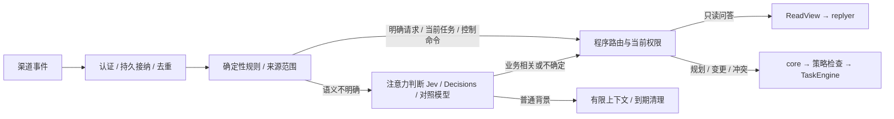

# 公司多人协作与群聊注意力评估

日期：2026-11-01。针对“一家公司10人、多家供应商群”的设计建议，未实施、未做容量或模型评测。当前主契约仍按单用户起步；本篇列出企业使用需要补齐的条件，不将它们自动记成现有能力。

[总体方案](<完整架构方案.md>) · [派工时序](<Core派工与对话时序.md>) · [通讯录](<通讯录与人际关系.md>) · [Jev](<../../技术候选/Jev.md>) · [OpenAI Decisions](<../../技术候选/OpenAI-Decisions.md>)

## 1. 可满足到哪一步

A形态在逻辑上可以承载这个规模的协作。DSH宿主、渠道适配、持久inbox、Task/Assignment、裁剪视图及发送回执都可保留。10名员工不要求10套核心，也不必因为供应商数量增加就改成分布式系统。但“可成为基础”不同于“当前方案已满足公司使用”：人数并不说明群消息峰值、模型负载或业务权限复杂度。

| 现有基础 | 公司场景必须补齐 |
|---|---|
| Principal、Mandate、可信控制入口 | Organization、Membership、项目角色、授权委派、离职/撤权；明确谁可代表公司承诺和改变预算 |
| ConversationKey、受众裁剪ReadView | 公司内部、员工私聊、项目、供应商及混合群的读取/外发范围；检索、摘要、缓存与记忆都继承来源权限 |
| Task唯一归属、版本/CAS | 任务负责人、谁能补充/更改/取消、多人矛盾指令的裁决规则；不采用最后一条消息自动覆盖 |
| 对话/任务分离、有限模型并发 | 按员工/项目/供应商的公平与限额，噪音入口背压、core评估容量预留；长worker不占满全部决策容量 |
| 进程恢复、备份、unknown核对 | 公司需要的营业时段、停机容忍度、告警与人工接手；单DSH宿主不自动构成高可用 |

部门角色可先由简单配置与现有认证目录提供，无需先造通用IAM平台。供应商发言可作为外部观察或有限业务请求，不成为公司内部Mandate的签发入口；例如“请确认加价”是待公司决策的请求，不是有效加价授权。

一个Company Workspace下允许多上下文/项目任务，并不意味着所有上下文都能读全部公司资料。Ombre及派生回顾、them/I/feel、摘要不能混入其他供应商或员工私密内容；如所选后端无法在读写/检索/派生全过程保持范围，按数据域分库或分实例，不能仅靠提示词隔离。供应商不默认成为内部成员；多个外部伙伴也不等于本轮要建设多家公司共用的SaaS。

## 2. 注意力筛选应放在哪里

建议在现有IngressRouter中增加AttentionGate职责，作为无工具、可替换的判断适配器，不新增自主常驻Agent。

背景分类不删除平台原消息、不做内容审查处罚，也不自动永久保存。保留和删除按原数据政策；可以按允许期限抽样复查低优先级结果，不能为评估永久囤积全部群聊。

先用程序完成来源认证、重复/自身回声处理、明确命令、@/回复链与已登记任务订阅的关联。明确需要处理的输入无需先经过通用噪音模型；关键词仅为召回信号，不能因没订单号、没@就直接丢弃。剩余输入按同一受众、线程和短时间窗有界合并；不同供应商不能为了节省调用拼进一个无范围上下文。

筛选输入仅包括：当前事件、引用原文、同线程有限上下文、说话者与群身份、获准业务对象/任务的最小摘要。给模型全部公司记忆再让它决定相关性，会把隔离问题提前变成泄露。附件、语音尚未解析时标pending_parse；解析失败、模型超时或无效答案不能映射为unrelated。

## 3. 四个决定分别做

| 决定 | 负责者 | 示例 |
|---|---|---|
| 值不值得关注 | 规则＋注意力模型 | “明天到不了”可能关联待交付订单，应进入处理 |
| 是否记住/改业务状态 | core提案＋领域校验＋后端操作核对 | 供应商报告延期先登记有来源观察，不能擅自改成公司已接受新交期 |
| 要不要公开回复 | 表达政策＋replyer＋发送门禁 | 可通知内部采购负责人或等待，不必在每条业务消息下插话 |
| 能否采取动作 | 有效Mandate＋执行点策略 | 识别出付款要求不代表有付款、改价或下单权限 |

AttentionDecision为拟议类型：eventIds、scopeRef、contextVersion、category、relatedObjectCandidates、reasonCode、provider/model/policyVersion、probability/uncertainty、status。category建议为EXPLICIT_REQUEST / BUSINESS_UPDATE / CONTEXT_ONLY / UNRELATED / UNCERTAIN；不同供应商模型的概率和confidence不混用同一阈值。候选对象绑定需再核对，模型不能生成有效权限或直接调用工具。

对业务相关性、是否影响交付、是否需要答复等问题分别判断，再由代码组合结果。当前订单上下文不足时补查受限资料或升级core；不把一条巨大问题“你觉得该怎么处理”交给筛选模型包办。

## 4. 群队列的一处必要修订

当前队列中“新消息使旧生成过期”的描述需要在群场景细化。每条消息可以推进接纳序号，但**无关闲聊不创建DialogueTurn、不推进当前业务回复的conversationGeneration，也不反复取消生成**。

只有与待答内容相关的新请求、纠正、撤回、授权/成员/受众变化等使对应回复失效。先做相关性/依赖判断，再推进生成代次。无法判断是否影响待发业务承诺时，暂停该回复并核对；不阻塞所有其他会话。群内多线程/多订单先按replyTo/thread和已知任务关联，不能把整个群永久串成一个长任务。

这是对企业群聊配置的修订要求，尚未在业务代码中实现；后续纳入公共契约和队列实现验收时必须一起更新，不能只增加模型却保留每条噪音取消回复的逻辑。

## 5. 模型取舍

Jev与OpenAI Decisions均列为候选。先使用现成接口，保留普通小模型结构化分类作为对照，不训练自有决策模型，不假定换成“decision”就自动可靠。TypeSafe的路由与聊天筛选示例支持这类职责拆分；中文采购语境、含糊指代和错漏成本仍由自己的测试集验证。OpenAI当前接口支持文本、图片、JSON及会话证据，具体支持和限制见候选记录。

先固定问题、数据范围、规则前置与回退策略，再将规则、规则＋Jev、规则＋Decisions、规则＋普通分类模型放在相同回放集比较。保留模型实际版本、分类规则版本、耗时及费用；不按厂商速度倍率推算公司实际延迟。筛选服务也要计预算和限流，不能噪音越多就占满replyer/core容量。

优先影子评估：候选只产分类记录，不抑制真实业务；确认误漏后再逐步启用高把握的低风险静默。对影响交期、金额、订单取消和投诉的漏报采用更保守的升级策略，置信度阈值通过保留集确定，不先拍一个0.9当可靠性保证。

## 6. 与测试集对接

连续信息流的实验分层、工具复用、流量矩阵和判定办法见[信息流 Lab 计划](<../../测试/2026-11-01-信息流Lab/实验计划.md>)。复用已有种子集，单独扩展企业群聊；当前仍为计划，未运行。

新增企业群聊场景应进入专门测试集讨论，而不是本轮启动模型：

- 10个员工身份、至少两家供应商、公司内部群与供应商混合群；员工职责不同、同名不同人、成员变更和离职撤权。
- 大量闲聊中夹少量业务变化：无@的延期、引用“之前的价格作废”、图片报价、语音补充、反话、多个订单混聊、随后纠正。
- 两员工相反指令、供应商要求扩大范围、询问另一供应商报价、私聊信息被要求转发到群。
- 群持续刷屏时，其他员工仍可查进度/停任务；普通闲聊不让有效回复永久饿死，core不会被长worker耗尽容量。
- 模型超时/拒绝/低置信、未解析附件、渠道重送、上下文缺失、费用达到上限；均不伪装成“已成功过滤无关消息”。

分别测关键业务漏报、误唤醒、错误公开回复、跨范围读取/外发、相关纠正后的旧回复、P95接纳/答复/告警延迟、队列最大等待与每千条输入总成本。不能用总体准确率掩盖少量关键消息的遗漏。

容量以原始入站峰值、筛选后业务事件率、每级推理平均/P95耗时、附件比例、并发与平台配额估算。现有“总模型槽3、core1、worker2”为合成起点，不是公司容量结论。应实测持续负载、突发与一个来源洪峰，并验证积压能回落；在此之前不承诺支持多少群或固定响应时间。
