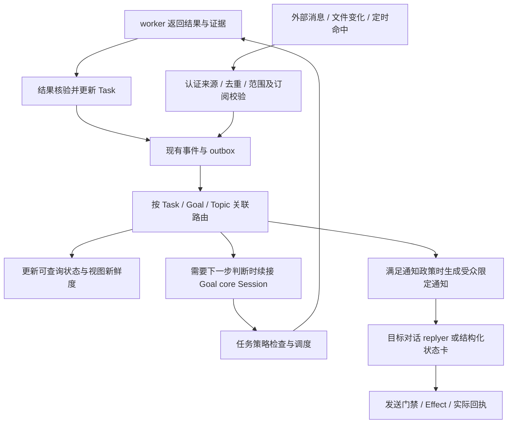

# 多频道话题、Session 与后台协作

日期：2026-11-01（America/Caracas）。**设计建议，尚未实现或运行验证。** 用户提出识雨可能同时参与 N 个频道及多人私聊，需要明确线程合并、分离、后台推进、worker 完成和外部触发。本篇补齐业务关联层；沿用用户已确认的 DSH 原生 Session 优先、A 方案和运行仪表盘，不将下述具体策略写成已经确认的宿主能力。

[会话与仪表盘](<../运行仪表盘与Session复用.md>) · [多人协作](<公司多人协作与群聊注意力.md>) · [派工时序](<Core派工与对话时序.md>) · [订阅](<时间与事件订阅.md>) · [公共契约](<跨模块契约.md>)

## 1. 四种身份及职责

| 概念 | 稳定身份与职责 | 关系 |
|---|---|---|
| 渠道会话 | 现有 ConversationKey：连接账户、平台会话/原生 thread、会话类型及受众范围；定位输入和发送目的地 | 一个群或私聊可以讨论多件事；原生 threadId 只是平台路由信息 |
| 逻辑话题 Topic | 识雨用于组织同一讨论的稳定标识、来源事件/引用、业务对象/任务关联和修订记录 | 一个话题可关联多个渠道会话，同一渠道会话可有多个话题；关联不扩大读取或外发权限 |
| Goal / Task / Assignment | 既有目标、工作事项与执行实例；控制真正的工作推进、授权、依赖及结果核验 | 多个话题可以关注同一个 Task；Task 不因聊天换地方就重建或转移归属 |
| DSH Session | 原生模型历史、上下文投影、压缩与恢复的载体 | 按角色、业务绑定和可见范围复用；同一话题在不同受众下可以有多个 Session |

Topic 放在既有 ConversationService 的路由与绑定职责中，维护必要元数据和引用，不另建会话日志、任务引擎或模型循环。关系是多对多，但不要求为每个组合立即创建 Session；只有实际需要生成或判断时才创建/恢复对应原生会话。

话题身份可长期保留，活跃对话和模型上下文可以休眠、压缩、封存或按范围重建。归档聊天不会默认取消后台任务；恢复话题不等于重新授权已停止任务。用户命令“先别发消息”“暂停这个任务”“停止识雨”必须分别映射到通知、任务与全局控制范围。

## 2. 关联、拆分与合并

**首版优先做可追溯关联和按需拆分，自动硬合并保持关闭。**

| 场景 | 建议行为 |
|---|---|
| 同群从订单 A 转到订单 B | 根据明确引用/订单号等建立或切换话题；有独立上下文需要时创建新的回复绑定，A 的任务继续 |
| 私聊询问群里某项工作的进度 | 关联同一 Task，生成该私聊主体获准读取的状态视图；不复制群的全部历史 |
| 多个群讨论同一订单 | 关联同一业务对象和工作事项；各群继续独立回复、保留历史与送达记录 |
| 一个讨论分出两项独立工作 | 创建子话题及必要的新 Task；原 Task 仅在其范围确实改变且校验通过时修改，不复制已经执行的效果 |
| 两个话题被确认是同一件事 | 先建立关联；若确需合并目录身份，记录规范 topicId、别名和来源映射，保留原事件引用和修订；原 Session 不拼接 |
| 误关联或误合并 | 撤销/修订映射，重算后续可见上下文与通知路由；已发出的消息及外部效果独立核对，不能靠拆分记录假装撤销 |

关联优先使用平台 replyTo/thread、经核对的任务/订单标识、明确指代和已登记关系。仅语义相似不足以合并两个事项；模糊“那个订单”先在获准候选中判断，仍不清楚时局部澄清。必要的语义判断可先复用用户指定的 DSV4.1F，不因此引入新的决策模型或常驻话题 Agent。

话题关联需要范围校验。跨工作区不因同名对象关联，供应商与私聊的关联图本身也可能是敏感信息；界面只显示当前用户获准知道的节点和关系。关联或合并不产生新 Mandate，也不自动合并 Task、预算、订阅或负责人。

同一输入包含多个请求时，可显式分解到不同话题/任务并保留父事件引用。多人对同一 Task 给出冲突指令时，核对负责人、授权来源和当前版本，再由既有 core/策略处理；不能因为来自最新话题或最新消息就覆盖原工作范围。

合并/拆分时记录绑定修订并使受影响的未发草稿重新核对路由；并发新消息按确定的修订受理。已在执行的 Assignment 维持原 Task 与权限，除非另有有效任务变更。这样整理讨论结构不会重复派工或悄悄重定向待发消息。

## 3. 背景信息如何同步

**业务状态更新与模型上下文更新分开。** Task 状态、核验结果、目标修订及获准记忆由现有权威组件保存。Topic 只引用它们，不为每个聊天复制一套可独立修改的事实。

1. 经核对的变化发布带来源、对象版本和因果关系的事件；来源观察、模型推断与已核验结果保持区分。
2. 程序根据既有任务/话题关系和订阅，找出受影响的回复绑定。记录哪些来源发生变化或标记视图过期，不立刻向所有 Session 追加正文和唤醒模型。
3. 某对话下一次需要回答时，按当前主体、受众、用途重新读取：话题短摘要、相关 Task 状态、必要新变化、未答问题及获准来源引用。每个 Session 只接收它需要的最小更新。
4. 已在生成中的回复按自己的来源版本检查是否过期：与依赖无关的变化不取消生成；会改变价格、交期、授权或答案的变化使相应草稿失效。发送前再做最终校验。

背景更新默认是按需读取；满足明确通知政策的重要完成、阻塞或风险变化才主动推送。不同服务的版本分别记录，不声称一次读取具有全局原子性。发现游标缺口时重新读取获准的当前快照并说明历史缺口，不伪造漏掉的过程。

Session 内的历史说明、旧摘要不是最新业务权威。状态修订以带版本的更新明确替代旧值；下一轮使用当前视图，不能让历史中的旧报价覆盖新核验结果。撤权、删除和受众变化需要移除受影响材料及派生摘要。若当前宿主无法可靠裁剪有效投影，可重建的 replyer/临时上下文才使用新的受限 Session，以合法材料重建并记录绑定变化。承载 Goal 权威日志的专用 Session 必须保留，或经过已验证的原生迁移流程；无法满足时停止受影响的模型请求，不能只换业务绑定就宣称目标已迁移。原生日志清除仍按保留政策单独核对。

## 4. worker 完成、外部触发与后台推进

worker 返回“完成”只是待核验结果；Task 只有满足 completionSpec 才进入 succeeded。程序能确定的后继条件直接走既有调度，需要权衡、计划或变更时才唤醒所属 Goal 的 core；单纯播报核验结果无需额外调用 core。后台由任务与事件推动，聊天窗口关闭不影响获准工作；DSH 宿主退出仍会暂停核心执行，不宣称进程退出后模型继续运行。

外部触发携带真实来源与 cause，不伪装成某个用户发话；其正文不能扩大权限。没有关联对象的事件先走来源受限的接纳与关联判断，不广播到所有 Session。暂停、撤权、预算耗尽和未知外部效果仍阻止不合资格的续跑；收到新事件不能自动恢复用户已暂停的 Goal。

通知目的地在接纳请求或登记订阅时确定：原请求者、明确关注者、允许的群/thread、消息类别和静默规则。仅因两段讨论有关联，不把一段私聊的结果自动发到所有相关群。对同一结果按各目的地生成不同的受限视图；中间进度可以聚合或静默，关键完成/失败/待处理事项按政策及时投递。通知受理、草稿生成、模型已见、平台已送达和用户已读分别记录，不能互相推定。

复用既有事件接纳、SubscriptionDelivery、Effect/outbox 与原生 Agent inbox。通知按来源结果版本/事件、目的地和通知用途识别同一意图；路由修订用于核对当前派发资格，不能因重连或合并话题就清空已送达去重记录。新的修订通知显式关联被替代版本，受控重发另有原因。不能靠 sessionId 获得外部消息的“恰好一次”保证；发送 unknown 先核对，不盲目补发，识雨自己的发送回声不能形成无限触发环。

## 5. Session 复用与并发粒度

| 角色 | 绑定建议 |
|---|---|
| core | 原 Goal 专用 Session；没有持续 Goal 的内部事项使用既有临时 core 路线，不把整个公司的决策塞入一个无限历史 |
| worker | 原 Assignment 专用受限 Session；完成或等待时可释放模型槽与非必要驻留资源，恢复先校验实例资格和已有结果；租约、独占设备及 unknown 效果仍按执行协议核对 |
| replyer | 简单会话沿用 conversation + scope；出现独立话题时细化为 conversation + topic + 当前可见范围的稳定绑定，不逐消息换 Session |

跨群的同一 Topic 可以共享合法业务引用，但 replyer 的私聊与群 Session 继续分开。低频绑定保存原生历史，活动 Agent 按需创建/恢复与释放，具体宿主生命周期接口须适配验证；N 个对话不等于 N 个持续调用模型的 Agent，也不保证支持无限并发。

有独立话题后，回复失效应局部作用于该话题绑定；全会话撤权、成员或受众变化仍使所有受影响绑定失效。**现有 conversationGeneration 与 Effect 契约还需配套扩展作用域**，不能只在前端加 topicId 就声称支持独立并行。扩展验证通过前，同一渠道会话保守串行；随后按话题生成、按目标渠道能力有序发送，并对存在共同业务依赖的回复协调。

稳定系统规则、工具定义与当前绑定的历史前缀继续复用；变化以受限 context 追加，压缩沿 DSH 原生机制。不同话题不定时互拷摘要，不为追求缓存把无关或无权内容放到同一个请求。持久 Session 和服务端缓存寿命是两件事；休眠后仍可恢复业务上下文，不能据此保证缓存命中。

## 6. 仪表盘和最小实现范围

仪表盘提供两种查看方式：按频道/私聊看活跃话题与待答事项；按目标/任务看后台工作、关联对话及允许的通知目的地。展开话题可查看它关联哪些工作、最近何时更新背景、绑定哪个原生 Session；状态过期、等待依赖和发送待核对分别显示。默认先展示事实摘要，不创建第二套原生聊天记录浏览器。

最小实现先建立稳定的渠道/话题/任务/Session 引用、显式引用关联、结果核验后路由、按需背景读取与目的地限定通知，再做话题拆分和受限并发。自动语义硬合并、跨平台消息搬迁及全局常驻汇总 Agent 不进入首批。代码按现有 `outer/conversation`、`outer/ingress`、`control/subscriptions`、`views` 与 DSH 适配职责落地，不为每个逻辑名新建服务。

## 7. 验证与证据状态

沿用 V03/V04/V05/V10/V21/V23/V24，至少覆盖：

- 同一群交错两个订单，纠正 A 不取消 B 的独立草稿；真实共享依赖变化仍能使相关草稿失效。
- 私聊、内部群和供应商群关联同一 Task，查询与通知按各自权限裁剪，私聊正文与关联关系不越界。
- 同一 Task 被多个对话询问，只执行一次；worker 返回与核验完成可区分，未知状态不播报成功。
- 聊天归档后任务继续；任务暂停后外部事件不使其自动恢复；只静默通知不误取消工作。
- 合并/拆分与新消息、待发草稿、worker 返回同时发生，原效果不重放，目的地和当前绑定能核对。
- 事件重送、发送丢回执、宿主重启、游标缺口与自身回声，分别验证去重、unknown、恢复与防循环。
- 多频道同时活跃时公平调度，纯背景更新不产生模型请求；缓存、延迟与任务质量另作真实测量。

本轮证据为既有设计阅读和一致性评审；没有新增宿主能力实测、模型调用或真实渠道接入。具体 Topic 字段、原生投影裁剪能力和并发粒度仍需在实现切片中验证，不把建议伪装成已完成能力。
