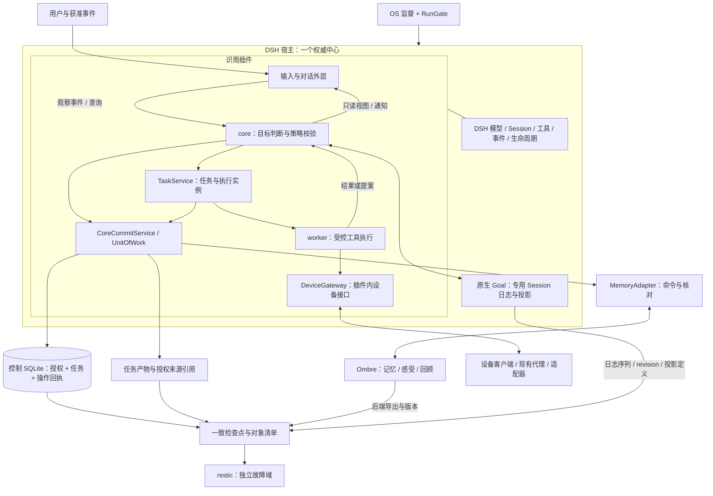

# 识雨完整架构方案 v1.1

[模块目录](<目录.md>) · [全架构复用方案](<复用方案.md>) · [跨模块契约](<跨模块契约.md>) · [技术选型与决策](<技术选型与决策.md>) · [验证与验收](<验证与验收.md>) · [交互全景图](<../图示/识雨全景架构-A.html>)

日期：2026-11-01（America/Caracas）。本版由原规划轮次的分工专题与总集成共同收敛。**A 方案、内外双层与只读双工是用户既有决定；本版技术组合和默认值是实施与验证基线，尚未通过本体运行验证。** 原规划轮次没有安装或启动识雨运行系统。

同日后续阶段决定：用户在健身房验收后批准识雨本体**开始实现**，按本基线分阶段落地。阶段授权与实现进度分别记录，见[总体架构](<../总体架构.md>)；本文各项“尚未实现/未验证”事实保持有效。

v1.1 按用户“直接用现成实现、可用部分复制复用”的要求完成全模块核查：DSH提供运行基础，Superagent按明确源码闭包复用，Ombre优先承接联合记忆能力，设备与备份使用现成组件。后续用户明确优先复用 DSH Session，并将本体界面定位为运行仪表盘，因此 replyer 改为受限原生 Session 优先，DS-Bot 旁路由原主方案转为条件备选。详见[运行仪表盘与 Session 复用](<../运行仪表盘与Session复用.md>)；[复用方案](<复用方案.md>)继续列出40模块及必要适配，业务运行验证尚未完成。

## 1. 目标、范围与完成定义

2026-11-01进一步细化对外运行面：见[连接、订阅与派工总方案](<连接、订阅与派工总方案.md>)。OpenClaw渠道层作为固定版本候选核查，桥接不等于第二个智能核心；core在既有授权内可自主提出声明式订阅。普通问答由IngressRouter进入裁剪视图/replyer快路，行动、目标或内层变更进入core；本文下述“对话影响内层”只描述需要持久变更的路径。通讯录与有来源的人际认识分别维护。HTML另增以组件和部署为中心的技术栈模式。

识雨是一个以用户持续目标为依据、能观察变化并主动推进任务的个人智能体。她在明确的数据空间维护自己的状态，能查明当前能力、任务、资源和故障，能在限定范围内恢复，并把工作交给多个设备执行。主动性来自持续目标、事件与时间条件，不能用无限后台对话或无约束工具调用替代。

本版完整覆盖原图 12 区域、40 模块。每个模块都有主方案、接口与所有者、数据与权限、失败处置、复用技术、验证门槛和替换条件；跨模块协议由本文配套契约统一。下一步可以先用合成数据与替身工具验证，再对固定 DSH、模型、设备及备份逐项做真实适配。

本版不追求：多主状态复制、任意插件的同进程强隔离、通用远控平台、训练新的基础模型、让云端语言模型承担机器人实时控制、无人值守修改运行中的自身源码。后续只有在明确收益和验证证据下才扩展这些范围。

## 2. 核心架构选择

| 问题 | v1.1 主方案 | 选择理由 |
|---|---|---|
| 识雨在哪里运行 | DSH 插件内单一权威中心；首验证以本机 macOS 的 DSH Web profile 为主 | 保留已选 A，界面和宿主进程生命周期分开，复用宿主功能 |
| 什么交给宿主 | 模型调用、Session、工具链、事件触发、插件生命周期、现有 MCP / POSIX SSH 适配 | 减少重复开发，并明确版本适配面 |
| 什么必须由识雨定义 | 领域映射、目标的授权与预算、只读视图裁剪、恢复核对和设备任务语义 | 复用目标、任务与记忆实现，只补识雨特有规则 |
| 权威状态存哪里 | 控制任务账本复用 Superagent 的 SQLite 事务实现；Ombre单独拥有记忆与感受主副本 | 同一后端内原子提交；跨服务保存命令/回执并核对，不双写相同权威记忆 |
| 记忆怎么起步 | 优先验证 Ombre 完整服务；Mem0为替代后端，SQLite/FTS5为对照与回退 | 先复用已实现的情绪记忆、检索、浮现与回顾，再验证必要的清除、来源和版本适配 |
| 如何主动工作 | 事件和到期目标触发，程序先检查策略、预算、新鲜度，再调用 core | 无任务时不消耗模型推理，避免主动循环反复打扰 |
| 目标由谁管理 | DSH 原生 Goal；每个持续目标使用专用 Session，控制库保存 GoalBinding | 原生 revision / phase 为唯一目标生命周期权威；本地不另造一套 Goal 状态机 |
| 如何执行 | 局部复用 Superagent Engine、事务/effects/outbox、worker生命周期；实际工具执行使用DSH | 保留Task / Assignment / Effect的公开边界，补unknown、停止与授权复核 |
| 如何表达 | 受限 DSH 原生 Session / Agent 优先；仅注入裁剪 ReadView，默认 tools=[]，发送前核对会话代次 | 复用历史、恢复与压缩；外层不能直接写内层，generation 不导致每条消息重建 Session |
| 用户如何查看运行 | DSH 原生运行仪表盘显示当前状态、工作阶段、目标/任务、最近活动与 Session 详情 | 从真实运行事件和回执投影，基础展示随首个切片建立；资料工作台完整保留 |
| 多设备如何接入 | DeviceGateway复用DSH SSH/MCP、浏览器与CUA，按平台接现成客户端/SDK | 不重写通用客户端；只补能力/设备身份、共享资源与效果核对 |
| 如何恢复 | OS进程管理、后端各自一致导出、共同恢复清单与restic独立备份 | 成熟工具负责托管、导出、备份；识雨核对停用、删除、来源版本和未知任务 |

以上均为可替换的验证基线，具体版本、成熟度与切换门槛见[技术选型与决策](<技术选型与决策.md>)。不因选择 DSH 而自动整包采用 DS-Bot 或 DSH-Superagent。

## 3. 部署与逻辑边界

设备接口逻辑位于插件内；图中的设备区域表示外部执行边界，不要求独立网关服务。worker 可以使用本地或远端执行器，但它的领域角色位于任务执行侧，不被放进只读对话外层。模型数量由路由配置决定，不为六个状态模块各开一个模型。

首验证用独立 DSH profile / 数据范围、loopback Web 界面和固定版本运行时；后台宿主由 launchd 托管。macOS 用户级服务依赖用户登录、设备唤醒和网络，不能据此承诺关机 / 睡眠期间在线。需要无人登录的持续服务时迁移同一 A 插件到 Linux systemd 宿主，设备仍远程接入；这不要求升级成独立识雨核心 B。

权威数据根不得使用 iCloud / 网络共享文件夹作为活跃 SQLite WAL 目录。生产空间建议单独本地加密卷并声明 reserve / quota；普通目录只能提供逻辑归属。DSH_HOME、Electron 外置数据、系统日志、OS Keychain 和备份目的地另列在运行清单中，不能以切换工作目录冒充完整迁移。

## 4. 三条业务主线

### 对话影响内层

用户消息 → 适配器鉴别来源并入 inbox → core读取相关状态 → 根据保存政策产生有版本Proposal → 程序校验并本地提交或登记后端操作 → 核对记忆服务已应用 → ViewService形成带各来源版本的视图 → replyer表达 → 发送前核对代次 → 记录回执。

原始消息、临时上下文与长期记忆分别保留。是否写入内层由规则、提案和受控提交决定；表达侧不能绕过该路径。用户改正事实、要求删除或暂停任务会产生明确命令，不依赖模型“记住下次不要做”。

### 持续目标主动推进

到期目标或新事件 → 程序去重、合并、检查暂停和预算 → core 判断是否有值得执行的工作 → 创建 Task、绑定有效 Mandate → Assignment 获取执行资格 → worker 使用注册能力 → 核验效果 → 提交状态与回执 → 必要时在允许的时机通知用户。

任务到期不等于立即执行；事件只提供事实，不提供行动授权。用户已明确允许的持续任务可在其范围内自主推进，不因每一次重试或合法子任务重复请求相同授权。范围扩大、能力变化或授权到期则停止在对应边界。

DSH Goal 使用原生 active / paused / blocked / complete 与 revision；控制库只保存目标引用、授权范围和停止原因。取消或到期先关闭本地派发，再核对原生停止结果。Goal 日志与控制库不共享事务，失败保留 unknown 并核对；原生 continuation 每轮仍经过识雨准入。

### 故障恢复与接续

健康探测分类故障 → 请求 / 连接级有界重试，缓存损坏按权威来源重建 → 宿主失效由 OS 监督与 RunGate 处理 → 读取持久任务和新 hostEpoch → 对 unknown 效果核对 → 重新开放可执行任务。

备份恢复另产生新的 installationGeneration，并进入 quarantine / reconcile。旧授权、旧任务租约和旧发送队列不直接恢复执行；先应用最新删除与撤权清单并核对外部事实。缺少最新控制记录时，只开放不含业务正文的诊断与人工恢复入口，阻断 ReadView、模型上下文注入和对外业务读取。

检查点必须同时覆盖控制库、Ombre 原生导出和目标专用 DSH Session 日志，保留各组件版本、日志序列与投影定义。逐库导出不自动形成共同时间点；没有全写入静默证据就标为需核对。恢复 Goal 默认 disarmed，核对 revision、暂停/撤销与授权后才允许接续。

## 5. 六部分内层的具体分工

| 部分 | 方案主线 | 权威更新要求 |
|---|---|---|
| 记忆 | 复用Ombre持久记忆、混合检索与浮现；保留授权来源引用 | 保存/修正/遗忘/清除为具名内部操作；后端回执核对后再报告完成 |
| 关系 | 稳定实体、渠道身份与别名映射，关系断言带来源与时间 | 合并身份需证据与可回退记录；同名不能自动视为同人 |
| 情绪 | 共用Ombre情绪记忆、feel及记忆衰减；短时ToneView不再默认自建 | 情绪显著性不证明事实可信，也不扩大行动权限 |
| 认知 | 复用Ombre回顾/I与Letta筛选策略；来源、假设与矛盾明确标记 | 回顾结果先成为可核对候选；跨日见证不等于独立事实证据 |
| 人格 | Ombre I承接自我认识候选；DSH提示装配稳定Profile与用户偏好 | I与稳定配置分开；配置经受控发布与回退，不由外层直接改写 |
| 能力 | 直接使用DSH工具/技能registry、filesystem provider与加载器 | 识雨只补来源版本、验证、启用/撤销和当前任务范围 |

core 与只读视图是这六部分的组织与访问职责，不是新增的内层状态类别。全部具体字段、算法边界、验收数据和备选路线由[内层方案](<03-DSH宿主进程/01-识雨插件/02-内层-六部分状态/README.md>)及其六个子模块定义。

## 6. 数据、权限与自知状态

控制SQLite复用Superagent事务与仓储代码，在宿主内DB WorkerThread执行短事务和具名命令；模型不拿数据库句柄，网络与推理在事务外。本后端状态、回执与outbox原子提交。Ombre拥有记忆正文/感受及其索引，识雨只保存必要操作、授权、引用和核对材料，不同时维护第二份可独立修改的同义记忆。单库FTS5只在对照/回退配置启用。

`commitSeq`表示控制账本提交，`stateVersion`表示已发布的组合投影，各后端版本或来源摘要另记。跨服务操作按approved/dispatching/applied/unknown/rejected记录；没有实际效果证据就不报告“已经记住”。同一数据库原子性不跨越MCP或服务边界。缺所需幂等、来源校验或清除能力时，先做限定补丁和合成验证，不能把“薄适配”写成现有能力。对象写入和导出仍按后端原有机制，恢复清单关联它们的实际版本。

状态有三类：权威事实 / 领域记录、可重建索引与缓存、来自探测的临时运行事实。数据的逻辑所有者、实际路径、可读写范围和外发目的地分别声明。只有被明确配置的 provider、设备或备份目的地可接收相应数据；会话日志贡献与模型请求是不同外发路径。

运行状态视图至少含：版本与启动世代、目标 / 任务状态、空间容量及实际外置项、有效能力与最近探测时间、模型依赖健康与预算、索引水位、最后完整检查点 / 备份 / 恢复演练。未知就显示未知，不能用“配置过”替代“当前验证可用”。密钥只以引用出现。

外层只读是程序接口与注册策略保证；同一进程的受信插件不能被当作相互隔离的恶意代码。DSH 工具 restriction 不能单独构成隔离：自注册工具、executor 与通用 shell 入口也必须受准入和执行时授权约束。需要运行不可信扩展时使用受限独立进程；验证不通过前不装入权威宿主。

删除要求立即阻止再读取与再发送，索引、缓存、对象与备份的物理清除按状态跟踪。历史备份在到期前仍可能包含已删除数据，不能把应用层隐藏承诺成即时物理抹除；恢复必须重放独立删除记录。具体保留与清除设计见[数据空间](<06-预留空间/README.md>)和[独立备份](<07-独立备份/README.md>)。

## 7. 默认调度与资源边界

这些是合成验证起点，可通过后续测量调整；不是用户真实费用或作息授权。

| 参数 | v1.1 验证默认值 / 规则 |
|---|---|
| 模型并发 | 总数 3，后台 core 自动评估与 worker 合计最多 2，为显式对话保留 1 |
| core / worker / GUI | core 评估 1；worker Assignment 2；同一设备桌面独占 1 |
| 主动评估 | 同目标事件合并 1 秒；到期扫描 60 秒，扫描本身不调用模型；自动评估每目标最多 4 次 / 小时且间隔至少 15 分钟 |
| 冲突重评 | 自动 CAS 冲突重新评估最多 2 次，仍冲突则等待 / 明确报错 |
| 视图与提案 | ReadView TTL 30 秒；健康样本 TTL 60 秒；合成 Proposal 到期 120 秒；撤权、删除与会话代次变化优先于 TTL 强失效 |
| 主动通知 | 未配置 quietHours / 渠道时不主动跨会话推送，聚合到下次交互；测试使用 22:00–08:00 America/Caracas 覆盖静默边界 |
| 真实模型 | provider、数据范围、费用 / 调用 / 时间限额及最大输出全部配置后才可启用，缺项不外发 |
| 设备动作 | 缺配对、scope、有效能力或核对方法时不自动执行相应有副作用动作 |
| 备份验收 | 1 GiB 合成数据集；RPO 15 分钟、RTO 30 分钟为演练目标，按完成的备份 capture 时刻和实际恢复校验测量 |

超限时优先保持用户对话、暂停和取消入口可用；延迟后台新任务，不删除权威状态腾空间。更具体的队列上限、租约、恢复退避、数据保留和容量阈值由各专题定义，并在[技术选型与决策](<技术选型与决策.md>)集中登记。

## 8. 复用与自建的界线

直接使用DSH公共能力、所选记忆后端、OS进程管理、设备SDK、现成schema校验、系统凭据设施和restic。DSH-Superagent按固定源码局部复制适配；DS-Bot的旁路闭包仅在原生Session有经验证的缺口后评估，Letta等合适策略片段按许可复用。保留源码来源、依赖闭包、必要补丁和上游测试；不继承与识雨无关的默认权限与副作用。

保留的自有逻辑集中在：识雨领域映射、当前授权与预算、状态视图裁剪、跨服务/设备结果核对、删除与恢复协调。事务内核、任务引擎、并发队列、模型循环和客户端优先从现成实现接入或复制；不能换个“薄层”名字后把它们重新开发。

引入额外系统必须说明：基线失败的测量证据、该系统能解决的问题、迁移 / 运维 / 权限成本、回退办法。向量库、工作流引擎、多主存储和独立核心 B 均按此原则启用。

## 9. 验证路线与进入下一阶段的条件

| 阶段 | 主要目标 | 完成后可判断什么 |
|---|---|---|
| G0：契约与覆盖 | 字段、角色权限、模块所有者、来源和版本映射一致 | 设计可进入最小实现验证；不等于模块已运行 |
| G1：本地合成单模块 | 替身模型 / 设备、临时本地数据验证合法 / 非法路径 | 状态机、权限、检索与基本任务规则是否成立 |
| G2：故障与合成端到端 | 重复、并发、进程退出、磁盘满、撤权、删除、旧回执 | 持久化与恢复闭环是否成立 |
| G3：固定 DSH 真实适配 | 固定提交、运行时 SQLite、工具准入、会话与生命周期 | 宿主可支撑所需契约，是否要启用备选适配 |
| G4：逐项启用外部依赖 | 显式模型预算、配对设备、独立故障域备份 | 真实效果、费用、平台限制与恢复目标是否满足 |

完整 V01–V27 矩阵包含前置条件、步骤、合成样本、判定标准、失败处置与证据文件路径，见[验证与验收](<验证与验收.md>)。本轮只交付计划，未运行这些实验。

下一阶段从本体插件基础、受限 DSH 原生 Session 与基础运行仪表盘开始，再按 G0/G1 与后续阶段验证 Superagent 事务/任务、Ombre 服务及组合边界。模拟 worker、持续目标与中断恢复通过后再逐项接入真实依赖。产品代码和模块测试按[本体文件树规划](<../识雨本体文件树规划.md>)落在实现包；独立候选实验仍位于 `测试/YYYY-MM-DD-主题/`，不将资料目录转成运行数据根。

## 10. 参数与升级门槛

规划不再等待数据库、队列或角色分工选型；当前主方案已给出。真实启用前仍需填写的参数是具体模型和费用上限、数据卷路径与容量、首台设备及能力范围、备份目的地与恢复凭据、通知渠道与静默时段。这些参数不阻塞合成验证。

若本地 SQLite 无法满足实测并发 / 延迟、需要多个独立写入中心或跨主机事务，再评估服务型数据库；若任务量与持久工作流复杂度超过复用的 Superagent Engine 的测量边界，再评估其他成熟工作流引擎。若必须在 DSH 退出后继续语义决策或隔离不可信插件核心，再评估 B。触发条件和成本见决策表，不以“形态更高级”代替证据。

## 11. 证据与交付状态

本轮证据包括官方文档、固定版本源码、复制依赖闭包与许可的限定检查，详见[复用核查目录](<../../research/2026-11-01-复用核查/目录.md>)；[前版来源目录](<../../research/2026-11-01-完整架构/目录.md>)保留历史取舍与基础证据。没有以图示检查、历史实验或模块 README 的存在宣称业务能力已实现。

交付校验覆盖 12 区域 / 40 模块映射、复用清单、27 项唯一验收编号、本地链接与表格；全景图按 v1.1 同步并经原生 Canvas 导出与视觉检查。范围、结果和浏览器检查限制见[本轮复用交付校验](<../../测试/2026-11-01-复用核查校验/结果.md>)。

本版的完整性以“每模块有主方案、公共协议统一、关键假设可被实验推翻、失败有退路”为准。验证失败可以修改局部选择；只有约束发生实质变化才需要整体改换架构。
