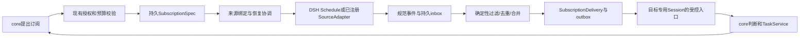

# 时间与事件订阅方案

[完整方案](<完整架构方案.md>) · [公共契约](<跨模块契约.md>) · [外部事件](<01-输入与事件/03-外部事件/README.md>) · [事件与定时](<03-DSH宿主进程/02-DSH运行底座/03-事件与定时/README.md>) · [核查证据](<../../research/2026-11-01-连接订阅与技术栈/订阅机制.md>)

日期：2026-11-01。设计补充，未实现、未安装或运行候选。本方案沿用 A、原生 DSH Goal / 专用 Session 与控制 SQLite；不增加独立智能核心。

**识雨可以给自己创建时间订阅和事件订阅。** core 在既有 Mandate 的来源、用途、期限与预算内，直接创建、修改、暂停、续期或退订声明式规则，由程序验证后生效，不默认每次询问用户。它创建的是“观察哪个已获准来源、何时/满足什么条件再通知目标”的数据；不能借此安装新监听代码、扩大连接权限或执行任意常驻脚本。

## 1. 五层职责与复用选择

| 层 | 负责什么 | 主方案 |
|---|---|---|
| 持久订阅定义 | 规则、目标、授权引用、期望启用状态、修订 | 控制 SQLite 的 SubscriptionSpec / 操作记录，复用现有事务与 outbox |
| 来源与监听器 | 时间到期、平台推送、本机通知、定期读取及游标 | 已注册 SourceAdapter；时间复用 DSH Schedule；源接口复用已有 SDK / MCP / OS watcher |
| 确定性判断 | 结构匹配、字段变化、阈值、合并、时间窗、去重 | 受限 FilterSpec + 来源原生过滤；无需模型读每个 tick |
| 持久受理与投递 | 接收 EventEnvelope、创建订阅命中与 IntakeReceipt | 已有 IngressService / 事务 outbox；订阅不再开第二消息队列 |
| Goal / Task | 判断事件是否值得行动，分配任务、核验、表达 | 现有 core / TaskService；Goal 生命周期仍由 DSH ctx.goals 独占 |

图中最后一条边仍受父授权、预算与循环保护。没有变化时不唤醒模型、不发送常规状态消息；用户明确要求固定日报时可按指定节奏触发，不强制要求数据发生变化。

**不引入第二套 OpenClaw Gateway / CronService 来调同一个 Goal。** OpenClaw 当前 Automations 已包含持久时间、事件与条件观察；它的来源世代、静默检查、有限租期与去重机制有复用价值。现阶段 DSH 已提供时间基础，控制账本已提供持久受理，复用这些公共接口比同时装两个宿主更直接。OpenClaw 的可提取片段及接入门槛见证据文档。

## 2. 自主创建和权限边界

SubscriptionService 是控制域职责，不是新的平台。它向 core 暴露下列**拟议识雨接口**，不冒称 DSH 已有同名 API：

- `create(spec, commandId)`、`update(id, expectedRevision, patch, commandId)`。
- `pause/resume/unsubscribe(id, expectedRevision, commandId)`；`get/list/history`。
- `preview(spec, sample)`：只做 schema、权限和匹配解释，不安装来源、不请求网络、不唤醒模型。

创建时校验 `subscription.manage:self` 或明确受托管理范围、`source.read`、目标评估权限；若触发行为包括通知或任务，另受现有 Mandate 的动作与数据外发范围约束。worker 可以提出订阅建议，实际变更通过受控命令；replyer 默认只读列表和状态。

| 请求 | 处置 |
|---|---|
| 已连接项目中监测获准 PR 的 CI，条件满足后回到同一 Goal | core 自主创建，继承来源范围/费用/期限，留下原因和回执 |
| 将同一订阅频率调低、缩小过滤范围或暂停/退订 | 在授权管理范围内直接执行，不重复询问 |
| 增加频率、延长期限或增加目标 | 重新计算父预算与范围；仍在既有授权内可直接更新，否则返回缺少的具体授权 |
| 增加邮箱账户、读取新文件根、打开公网 webhook、安装插件/二进制或常驻 watcher | 属于连接/部署/权限变更；有现成明确授权则执行对应流程，否则作为待授权方案，不能由订阅暗中完成 |
| 让模型生成 JS/shell 后直接登记为监听函数 | 首阶段不接受；确需新适配器时走普通实现与隔离验证，不把文本当可执行订阅 |

订阅授权不是事件正文能修改的字段。持续授权仍有效时，租期续约、重连、读取恢复游标和原范围内监听恢复由程序完成，不需要再次询问用户；凭据身份或资源范围变化则重新校验。源事件即使有签名，也只是可信传输身份下的外部数据。

## 3. SubscriptionSpec 与运行记录

| 字段 | 含义与约束 |
|---|---|
| subscriptionId / schemaVersion / revision | 稳定ID、schema版本、配置CAS；所有更新需expectedRevision |
| owner / createdBy / reasonRef | 经认证主体、提出角色和理由引用；不能由模型任意声明用户身份 |
| goalBindingId / target | 绑定既有Goal专用Session的受控评估入口，或已存在Task的等待条件；不新建第二Goal状态 |
| mandateRef / policyVersion / authEpoch | 父授权身份与版本；创建、命中派发、目标消费时重新校验 |
| sourceRef | 注册来源ID、固定adapter版本、连接/账户绑定、资源范围；凭据只用引用 |
| trigger | time、event、condition 三种声明；time保存DSH scheduleRef与规则快照，event指定来源事件类型，condition指定已注册只读观察能力与比较条件 |
| filter | 来源支持的结构化过滤参数；本地白名单字段的eq/in/changed/threshold等小型谓词，禁止任意代码、任意SQL与无界正则 |
| delivery | 目标、合并键、debounce、有效期、重放/错过政策；触发只产生事件，不直接拼接高权限prompt |
| limits | maxActive、maxPolls、maxMatches、maxEvaluations、费用/调用/时间限额及有效期；从父预算分配而非创建一份无限新预算 |
| desiredState | active / paused / retired / expired；用户/授权停用状态持久保存 |
| ruleRevision | 匹配/触发语义的修订；名称改动、暂停/恢复和连接重建不增加它，也不重置去重 |
| startPolicy / endPolicy | from_now或受限replay；Goal完成/暂停/取消时的处置；默认目标停止即停止新派发 |

时间定义的实际执行权威为 DSH Schedule；SubscriptionSpec 中的 timing 快照用于请求、审计和显示，`scheduleRef{id,expectedUpdatedAt}` 指向其规范记录。不能让控制库和 DSH 同时各跑一只同义定时器。纯轮询/协议续约可以由 SourceAdapter 的既有计时机制驱动，`clockOwner` 必须唯一；若切换为 util-time 到期适配，先注销旧绑定再切换。

独立保存运行事实，不让模型修改它们：

- `SourceBinding`：原生handle、bindingGeneration、安装/启停状态、租期、最后成功探测、重试时间、cursor及gap；同来源/账户/资源的监听可共享，订阅各自有权限与过滤。
- `SubscriptionActivation`：subscriptionId、activationGeneration、当前有效规则修订和派发资格；单订阅暂停、退订、恢复或有效规则替换时递增，其他共享订阅不受影响。
- `SubscriptionDelivery`：subscriptionId、ruleRevision、activationGeneration、sourceBindingId、sourceGeneration、eventId/occurrenceKey、matchedAt、投递状态与目标回执。
- `SubscriptionOperation`：create/update/retire的commandId、期望修订、原生调用结果及unknown；跨DSH/外部来源与控制库不宣称原子。
- `ObservationState`：最后成功观察的版本/摘要、阈值边沿状态和对应游标；读取失败不更新为“无变化”。

订阅状态和运行状态分开：active定义可能处于 provisioning / listening / degraded；retired定义可能仍有 cleanupPending。前者表明应当做什么，后者表明现在实际做到哪一步。

三个版本维度不能合并：`ruleRevision` 标识规则语义；`activationGeneration` 标识单条订阅当前的派发资格；`SourceBinding.bindingGeneration` 标识共享原生来源绑定。事件/回调中的 `sourceGeneration` 是捕获的 `SourceBinding.bindingGeneration`，是同一值的事件字段名称，不再维护第四个独立计数器。来源原生handle更换、账户/资源绑定替换、重新认证或整个来源停用后重建才增加bindingGeneration；同一身份/handle的租约续期不增加它，停用一条共享订阅也不增加它。

回调受理检查sourceBindingId与捕获的sourceGeneration仍属于当前来源；订阅派发事务另检查当前ruleRevision、activationGeneration、期望状态及授权。已持久接纳的业务事件不因连接重建而被删除，能否继续匹配由当前授权与恢复政策决定。代次均由程序持久推进，值不复用：规则A→B→A、订阅active→paused→active、来源绑定A→B→A分别得到新ruleRevision、activationGeneration、bindingGeneration，拒绝各自旧操作；无需为单订阅暂停让其他订阅失去合法回调。

## 4. 三种触发的实际路径

### 时间订阅

直接调用固定 DSH `ctx.schedule.create({title,prompt,timing,target},actorSessionId?,signal?)`，更新用 `edit` 与 `expectedUpdatedAt`；Cron/RRULE直接使用宿主已有库。

**源码已确认：Schedule 并不是任意函数 callback 注册器。** 它通过 `agent.followup(message)` 把 schedule 来源的文本送入 Agent inbox，等待 Session flush 后再记 schedule receipt。这里采用专用 schedule-ingress Agent：在 setup中安装受控pre-step、tools=[]，验证本程序拥有的schedule映射及原生来源身份，将发生次序转成EventEnvelope并持久接纳，然后reject该步骤，避免为一个定时tick直接调用模型。

prompt只携带固定格式的订阅标识/修订引用；不把模型填写的任意prompt当授权。时间入口只有程序能创建；正文自报scheduleId不能证明它来自合法时间源。该接缝须V24实际验证。若固定API无法可靠暴露来源/发生次序或崩溃补偿，改用同包util-time + 现有控制账本到期扫描的窄适配；不保留两个并行生效的调度权威，不另写Cron/RRULE。

DSH flush、schedule receipt、业务inbox是不同提交。创建或投递后丢回执标unknown，重启用原生schedule记录/历史、固定标记、专用目标和业务去重记录核对，不能盲目再create。发现同一订阅多份原生任务时隔离重复项并核对，不任意删除其他宿主任务。

### 事件订阅

优先连接已有push/watch接口：任务结果、健康状态、获准文件变化、已连接平台webhook。SourceAdapter将原生身份/序号映射为EventEnvelope，保留原始事件ID。监听器只采集和规范化，不自由调用模型。

Cordis `ctx.on` 只提供进程内监听与disposer，不自动持久化订阅、事件或游标；退出后根据SubscriptionSpec重建。文件watch不是完整审计流，溢出/休眠/丢通知产生gap并重扫获准范围。高频设备控制仍在设备本地，本方案只订阅高层结果。

### 条件订阅 / 轮询

没有push接口时，周期调用**已注册只读观察能力**，用结构化结果确定是否变化。例如“某CI从运行中变成结束”“文件集合修订变化”“某资源恢复可用”。先使用平台服务端过滤，剩余判断用有限的声明式谓词；不逐tick让模型判断“要不要行动”。

网络请求、分页和摘要计算在数据库事务外；短事务保存成功观察状态、接受的事件、命中记录和新游标。错误/超时更新健康失败与有限退避，不能写成false条件。条件成立产生事件后，core仍可判断无需行动；条件本身不直接授权副作用。

## 5. 游标、去重、合并与恢复

来源游标是**不透明令牌**，只按来源协议传回，不按字符串或数值排序。只有某页/批次已持久接纳，才推进该批次的读取游标；目标模型处理未完成不妨碍游标推进，因为未完成工作已在inbox/outbox。不能先更新游标再写事件。

事件去重使用稳定的 `sourceNamespace + account/resourceScope + nativeEventId`，同一来源重连不改变这个业务身份；sourceGeneration另用于拒绝旧来源回调，activationGeneration用于拒绝旧订阅派发，不能借换代次清空去重。每个订阅命中使用 `subscriptionId + ruleRevision + acceptedEventId`，不包含activationGeneration或bindingGeneration；暂停后恢复不能把同一事件变成第二次命中。时间命中使用规范的计划发生时刻与规则修订，不能用收到时间或DSH随机消息ID；同一订阅误建两个schedule也不能因此执行两次。无原生稳定ID的源由adapter给明确的快照版本键；内容哈希仅辅助，不能把两次合法相同动作当成同一事件。

cursor过期、truncated、无重放、队列溢出都记录gap，保留起止范围及可核对状态；按来源权威数据重扫，不宣称“持久inbox保证上游事件零丢失”。支持背压的webhook在入箱事务完成后才返回成功；满时拒绝新请求让来源重试，不驱逐已接纳记录。通知源不支持背压则明确丢失窗口。

订阅暂停或失效时阻断派发，已接纳事件保持可审计；恢复默认检查当前状态并合并一次，不自动补做每次错过动作。触发已变为Task后，pause/unsubscribe不能假装已撤回外部效果；按Task暂停/取消/unknown核对。

## 6. misfire与防循环

| 情况 | 默认政策 |
|---|---|
| 重启、睡眠跨多个周期 | latest：合并最近一次/一次当前状态复查，沿用DSH recurring语义 |
| 明确“不补过期提醒” | skip：超过graceWindow的发生次序只记错过，不唤醒core |
| 要求每次补齐 | 只有来源/adapter宣告bounded_replay并有持久发生记录才接受，按上限限速；当前原生DSH周期路线不保证all |
| 条件长期为true | 默认边沿触发或变化触发；恢复未变不反复唤醒，周期性提醒需显式level+冷却 |
| 同一对象短时多通知 | 在允许窗口合并，保存事件范围/计数；取消、错误回执等独立语义事件不随意合并 |

防循环必须在确定性层执行：

1. 传播rootEventId、causationId和有限subscriptionPath；默认同一因果链不得再次触发同一订阅，链深最多8。
2. 订阅控制域自身的create/update/status事件默认不作为其来源；真正需要观察控制变更时用明确白名单并禁止自触发。
3. 同一Goal的自动评估仍服从既有节流、模型总并发及父预算；一次命中不另发独立无限token预算。
4. 更新名称、重连或改变查询顺序不重置匹配去重；来源受理校验bindingGeneration/sourceGeneration，订阅派发校验ruleRevision/activationGeneration，分别拒绝旧回调和旧派发资格。
5. 设置单次、有效期、每小时命中和每次批处理上限；预算耗尽进入paused/degraded，通知一次变化而非告警风暴。

这些控制不能只写在提示词中。事件可以携带“请再订阅另一个来源”等文字，但它只作为观察，不获得create权限。

## 7. 生命周期、退订和安装权限

创建：受控提案 → 确认父范围/预留预算 → 事务保存provisioning意图与绑定Effect → 在事务外注册已有来源/DSH Schedule → 核对原生记录 → 记录listening。接口返回区分已受理与已生效。源在注册返回前送来验证挑战时，由绑定准备阶段处理，只确认连接，不启动模型。

暂停/退订：先在控制库关闭该订阅的匹配/派发资格并递增其activationGeneration，撤销该订阅的监听引用；返回本地停用回执，物理清理另记确认。共享SourceBinding仍可为其他活动订阅接纳事件，其bindingGeneration不因本次单订阅停用而变化；仅最后一个有效引用释放后才停用/清理原生监听，此时推进bindingGeneration拒绝该来源旧回调。独占timer/原生subscription可随最后引用释放清理，不能退订一个Goal就拆掉其他Goal的连接。远端撤订失败保留cleanupPending并有界重试；有限租期到期是孤儿上限，不等于已经收到撤订成功。异步清理必须携带捕获的bindingGeneration并核对原生handle，不能删除恢复后建立的新绑定。

恢复：读取停用意图 → 校验当前Mandate/连接身份 → 核对原生handle与bindingGeneration → 恢复游标/租期 → 处理gap与已受理待派发 → 以新的activationGeneration发布该订阅可派发。active持久状态下仅进程重启，不凭重启清空去重或擅自改为用户恢复；暂停状态须经有效resume命令才能恢复。共享来源仍存活时直接恢复引用，不重置其bindingGeneration。授权撤销、Goal停止、凭据重新绑定或版本不兼容均不自动复活。原生Goal的armed/continuation也不能越过每轮订阅准入。

新监听器安装与订阅定义分开。已准入adapter可以为现有来源建立逻辑watch；安装依赖、扩大OS权限、常驻外部命令、变更公网入口/连接账号需要对应实施权限。无新权限时先选择已连接push来源或获准只读轮询；缺能力明确记录waiting_dependency，不临时生成脚本绕过。

## 8. 首轮验证规格与例子

以下为合成验证初值，真实预算由既有授权给定：每Goal最多5个活动订阅、全局20个；过滤谓词最多16项/深度3；条件轮询最短60秒且不低于provider配额；无变化时0模型调用。文件合并500ms；每来源100个待处理事件沿用已有事件模块；总输入队列和模型并发仍由全局方案限制。单次订阅租期不得超过父Mandate，远端续约和本地有效期分开。数值不是新增费用授权。

例一：用户已授权“跟进此PR的CI并在结束后总结”。core自行创建事件订阅，范围只含该PR/当前head，比较具体check身份和状态，目标是原Goal；CI结束触发一次核心评估。换head是新观察，重复webhook不重建Task，权限撤销后晚到事件不派发。

例二：已授权“每天上午九点整理项目进度”。core创建带IANA时区的DSH日历订阅，按明确日报规则触发，即使状态不变仍可做规定报告；预算不足或Goal暂停时不调用模型。

例三：“等设备恢复可用再继续”。复用已注册health事件；无push才以允许频率读取设备健康。恢复可用只唤醒原Task核对当前租约和未知效果，不直接重放上次点击/发送动作。

## 9. 验收与剩余未知

本专题不增加独立编号，扩充现有V03/V04/V10/V13/V14/V21/V23/V24：

- V03/V14：相同原生事件重复100次仅有一条有效命中；乱序、cursor过期、溢出、休眠和失败观察有可见gap/错误，无静默跳过。
- V04/V10：允许范围内core自主创建无需人工逐次确认；越账户/目录/目标、超期与预算扩大拒绝；事件正文无法授权；父撤权后零新增派发。
- V13/V14：无变化轮询和续租0模型调用；真实观察调用计来源预算，条件出错不当false；自触发链被截断。
- V14/V24：create丢回执、schedule flush与业务入箱之间崩溃、重复handle、DSH重启、ruleRevision变化后晚到回调均可核对；专用schedule入口不启动模型或工具。
- V21/V23：暂停/退订/Goal终态在重启后保持；本地停用与远端物理停止分别显示；unknown效果不随退订丢失。两个订阅共享SourceBinding时暂停其中一个，另一个继续接纳/派发且bindingGeneration不变；前者恢复后旧activationGeneration不可派发，同一事件不重复命中。规则A→B→A、启停A→B→A和来源A→B→A各自拒绝旧代次，晚到清理不能删除新handle。
- V24：确认固定DSH原生调度时序/来源字段及每种实际连接的游标和撤订语义；不满足即按本文窄替代切换，不能假定所有MCP/SSH工具均支持事件订阅。

已知未验证：Schedule专用ingress接缝的精确崩溃恢复；各来源重放窗口；当前DSH对实验性MCP Events协议的兼容性。功能不满足时先用已有provider的push/只读poll，不整体安装OpenClaw或自建通用事件平台。

