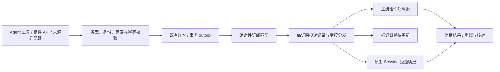

# 统一事件接口与发布订阅

日期：2026-11-02（America/Caracas）。**设计补充，尚未实现或运行验证。** 用户提出 Agent 和非 Agent 组件都能发布、订阅事件，并希望接口方便 AI 使用。本篇将已有 EventEnvelope、接纳、订阅和投递职责组织为统一接口；具体 API 名称与字段仍为建议，不声称 DSH 已提供同名服务。

[公共契约](<跨模块契约.md>) · [时间与事件订阅](<时间与事件订阅.md>) · [多频道与后台协作](<多频道话题与后台协作.md>) · [宿主事件接缝](<03-DSH宿主进程/02-DSH运行底座/03-事件与定时/README.md>) · [既有来源核查](<../../research/2026-11-01-连接订阅与技术栈/订阅机制.md>)

## 1. 当前已有的基础与缺口

既有设计包含 EventEnvelope/IntakeReceipt、来源适配、控制账本中的持久接纳、SubscriptionSpec/Delivery、Effect/outbox、DSH 原生 Agent inbox 和进程内事件唤醒。已研究的宿主版本提供的是组合接缝；既有静态核查不能代替本轮安装宿主的运行验证。

缺口是统一的事件类型目录、Agent/组件对等参与的发布订阅入口、通用目标描述，以及从发布到各订阅者消费的可查询回执。本次在既有服务上补这些职责，不增加第二个消息平台、独立数据库、Agent 框架或通用脚本系统。

## 2. 谁可以发布、谁可以订阅

| 发布者 → 订阅者 | 示例 | 处理方式 |
|---|---|---|
| 组件 → 组件 | 文件适配器报告变化，索引组件标记数据待更新 | 注册的组件处理器消费，无模型调用 |
| 组件 → Agent | 结果核验组件确认某 Task 完成，所属 Goal 需要下一步判断 | 受控路由至原生 Session，重新校验目标状态与预算后续接 |
| Agent → 组件 | Agent 提交有来源的观察或报告执行阻塞，程序校验、记录并更新获准视图 | 事件表示观察/报告，不直接改成已核验业务事实 |
| Agent → Agent | worker 报告需要澄清，由 core 判断下一步 | 通过既有 Task/Goal 关联投递，不把任意 agentId 当无限委派入口 |

“都能参与”不表示拥有相同权限。运行时为组件和 Agent 绑定可信身份及事件范围。core 可在有效 Mandate 内管理订阅；worker 可通过受限接口发布本 Assignment 的报告、按已授予范围登记等待，必要时由控制服务代办。replyer 保持默认零工具，程序将获准事件投影到其上下文；不为了统一接口向所有角色开放完整发布/订阅工具。

## 3. 方便 AI 使用的接口

Agent 使用结构化工具，可信组件使用同一服务的类型化 API。下表为拟议接口；身份、scope、父预算和目标绑定由运行时注入或核对，不让模型靠填写字段自行授予权限。

| 接口 | AI 可以表达什么 | 程序负责什么 |
|---|---|---|
| `events.types` | 查找当前可见的事件及其用途 | 返回类型说明、schema、例子、可过滤字段、允许发布者、可信度含义和投递能力；只显示获准目录 |
| `events.publish` | 发布一个已允许类型的结构化事件，附来源引用 | schema、身份/类型发布资格、大小、来源范围和去重校验；运行时为同一发布操作保留稳定幂等键，返回受理回执 |
| `events.subscribe` | 订阅类型、对象条件、有效期、一次/持续及接收方式 | 校验来源和目标权限、限额、持久登记规则，并明确起始游标/回放策略 |
| `events.subscriptions` | 查看自己的订阅及处理状态 | 返回期望状态、实际绑定状态、命中/投递/消费结果、失败原因和 gap |
| `events.update` | 在原范围内改条件、暂停或恢复 | 按 expectedRevision 校验变更，沿用已有 ruleRevision / activationGeneration 规则 |
| `events.unsubscribe` | 停止一条订阅 | 立即关闭新的派发资格，共享来源和远端清理分别核对 |

例如 Agent 可以请求：“订阅这个 Task 的已核验完成事件，只处理一次，在本 Goal 中继续；截止到今晚。”解析后仍是有限的结构化条件，而不是保存一段会反复执行的自由文本 prompt。自然语言解析只是输入便利层，订阅本身是声明式数据。

事件目录使用有版本的 schema 和少量明确类型。`agent.observation.reported`、`worker.result.reported` 与 `task.succeeded` 表达不同事实：Agent 可在获准范围报告观察/结果，只有拥有 Task 状态并完成核验的组件才能发布 `task.succeeded`。事件名称不能把模型判断升级为权威事实；业务命令仍走既有 Task/Commit/Effect 接口。

模型无需生成 callback、JS、SQL 或正则来订阅。条件沿用白名单字段和受限比较运算。新增事件类型通过 schema 登记与版本审核进入目录；Agent 的自定义信号限定在获准命名空间和已登记 schema 中，不能发布同名系统事件或安装新处理器。

## 4. 订阅目标与接收方式

SubscriptionSpec 的目标由原来的 Goal/Task 扩展为明确的联合类型，字段在实施时统一到公共契约：

- **组件目标：**已注册且有明确版本、权限和恢复语义的 handlerRef；目标可为视图、索引、任务协调或健康组件。模型不能提供函数体或指向任意 URL。
- **Agent 目标：**角色及现有 Goal / Assignment / 受众限定话题绑定。解析为相应原生 Session，不使用重启后失效的 Agent 进程句柄，也不向任意宿主私人 Session 投递。

接收方式与目标身份分开：

| 方式 | 含义 |
|---|---|
| 组件处理 | 调用获准处理器，按该组件的消费结果确认；无需模型 |
| 更新背景 | 标记相关视图过期或保存待读取事件引用，下一次生成时读取；不立刻往可执行的 Agent inbox 塞消息 |
| 续接判断 | 经当前权限、暂停状态、实例资格与预算校验，将受限事件内容交给对应原生 Agent；按需唤醒模型 |

发消息到渠道是后续的 Effect，不能把“订阅命中”直接等同于“允许给人发消息”。需要通知时沿用话题/任务的目的地与用途规则。一个事件可扇出到多个独立订阅，每条订阅有自己的投递记录。同一 deliveryId 的并发处理实例竞争有效消费资格；故障恢复允许至少一次尝试，重复或迟到调用靠稳定 deliveryId、提交资格与既有 Effect 幂等规则控制，unknown 先核对。不承诺处理器永远只运行一次，也不因此要求整条订阅的所有事件串行。

“等待事件”用一次性订阅加已有 Task 等待条件表达，等待时不占用模型槽。匹配后仍校验 Assignment 是否有效；旧实例已经失效时不能恢复它的执行资格。没有事件、没有有意义变化时保持安静。

## 5. 可靠性与事件边界

业务事件默认持久受理；UI 动画、可合并的进度等临时信号明确标为非持久，允许丢失且不能驱动唯一的业务完成判定。进程内通知用于及时唤醒，不能代替账本与恢复扫描。

- **身份和载荷：**沿用 eventId、type、schemaVersion、source、actor、时间、业务关联、payloadRef 与隐私范围；补齐因果链和原始声明者/受理组件的区别。模型不能覆盖认证身份。privacyClass 只是分类标签，还须引用既有来源数据范围和权限策略，在订阅、匹配、投递及读取时核对。大内容保留引用，读取载荷与派生摘要时重新校验当前受众；订阅目录和回执元数据也按范围裁剪。
- **发布与状态提交：**控制库内的业务状态变化和待发布记录使用同一已有事务。DSH Session/Goal、外部来源或其他后端与控制库不共享事务，记录原生版本/操作并核对，不能先发布“已完成”再等真实结果。
- **去重与重试：**同一发布者作用域的幂等键对应同一载荷摘要，同键异内容拒绝。投递沿用 subscriptionId + ruleRevision + eventId；activationGeneration 用于派发资格，不使暂停恢复后重复命中。允许至少一次尝试，消费方按稳定 deliveryId 幂等；失败有界重试并进入可检查的失败记录，不拖住其他订阅者。
- **回执分层：**发布 accepted、匹配、目标受理和业务消费完成分别记录。Session flush 或模型收到事件不是 Task 完成；Agent 目标由运行协调器核对处理结果，不能由模型随口说“已处理”就确认下游效果。外部效果 unknown 先核对，不盲重试。
- **时序：**按来源/业务对象版本维持所需顺序，不承诺全局所有事件有共同顺序；先后依赖由消费者核验。过期、乱序、丢失游标和有限保留窗口明确显示，不静默声称补齐历史。
- **建立订阅时的竞态：**订阅建立时固定接纳水位并覆盖后续事件；需要已有结果时显式选择有界回放或“当前状态＋后续变化”。当前快照与订阅建立之间用水位、版本对账避免漏掉完成事件。原生来源没有回放/一致快照时说明缺口，不能承诺零遗漏。
- **取消和恢复：**退订关闭新派发资格，已在执行的处理与外部效果按既有取消/核对协议处理。重启核对订阅、未确认投递、原生请求映射与当前权限，不重播全部历史；Agent 目标同一事件不因再次分发而重复追加用户式消息。
- **防循环与背压：**沿用 rootEventId/causationId、订阅链与深度限制，识雨发送回声不成为新授权。每主体/来源/订阅有队列、扇出和预算上限，区分可合并进度与不可丢的业务结果；不因订阅数量增加获得无限模型并发。

## 6. 实施位置与验证

统一接口落在本体控制域，协调已有 events 契约、subscriptions、控制账本和 DSH 适配；入口适配负责规范化外部来源，业务接纳与去重只有一处权威。Agent tools 与组件 API 共用这一实现。初期采用已规划的宿主进程内事件、SQLite 事务/outbox 和恢复记录，不另部署 Kafka、Redis 或另一套 Agent inbox。

仪表盘在任务/话题详情展示事件类型、来源、订阅目标、最近命中、投递/消费阶段、失败和待核对情况。敏感载荷不进入普通日志；查看仪表盘不产生发布或模型调用。

沿用 V03/V04/V10/V14/V21/V23/V24，增加四类发布/订阅组合、类型发现与范围裁剪、伪造权威事件拒绝、一事件多订阅、同订阅并发抢占、订阅建立与完成竞态、重启后重复投递、退订后的晚到事件、慢/坏消费者隔离、更新背景零模型调用，以及暂停/预算耗尽不被事件绕过。

本轮仅依据既有设计与固定源码核查记录补接口设计，没有安装消息服务、创建真实订阅、运行事件系统或调用模型。当前宿主的 Session 投递/恢复、组件处理接缝及具体工具 schema 仍需实施验证。
