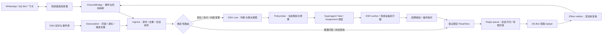

# 对外连接、主动订阅与派工方案

日期：2026-11-01。状态：架构细化与限定源码核查，未实施运行系统。补充 v1.1 的渠道、订阅、会话和人物关系设计；既有 A 形态、外层只读和三角色边界不变。

## 1. 本次补齐什么

上一版完成了职责和技术复用清单，但对“消息怎样进来、谁排队、谁决定、谁派发、什么时候主动醒来”的表达仍不够具体。本篇作为这些问题的总入口；图示新增独立技术栈视图，而不仅在原图副标题中放项目名。

| 问题 | 当前方案 | 详细方案 |
|---|---|---|
| 多渠道连接 | 核查 OpenClaw 渠道实现，连接器负责账号、消息与发送；DSH 保持唯一智能核心，桥接与路由明确分开 | [渠道核查](<../../research/2026-11-01-连接订阅与技术栈/渠道连接.md>)、[OpenClaw 候选](<../../技术候选/OpenClaw.md>) |
| 自主创建订阅 | core 在现有授权与预算内提出声明式订阅，程序校验并持久登记；时间/事件命中再唤醒决策 | [时间与事件订阅](<时间与事件订阅.md>) |
| core 与派工 | core 负责语义判断、计划与委派意图；确定性程序负责路由、授权、资源调度和状态迁移 | [Core 派工与对话时序](<Core派工与对话时序.md>) |
| 聊天队列 | 每会话有序、跨会话有限并发；对话、任务、外发各有队列职责；普通问答有只读快路 | [Core 派工与对话时序](<Core派工与对话时序.md>) |
| 通讯录与关系 | 控制库保存已验证人物/账号/端点与联系偏好；Ombre 可选保存对人的认识 | [通讯录与人际关系](<通讯录与人际关系.md>) |

## 2. 一条完整运行链

控制命令如暂停/取消先经可信来源验证后直接生效，不能排在普通生成队列尾部等模型。来源未知、请求含糊或读视图不足时，快路返回澄清或升级 core；replyer 没有创建任务、订阅或长期记忆的写权限。一个输入可以触发受限的后台观察，但不要求每次闲聊串行经过两个模型。

core 产生“做什么、为何做、完成条件、依赖与候选能力”的意图；TaskService 与确定性调度器核对授权后分配 Assignment，获取预算和资源槽，再通过 DSH 创建/继续 worker。某个 worker 空闲不等于应该派活，目标未解除暂停也不会因新消息自动恢复。

## 3. 对外表现由哪些部分组成

当前优先验证OpenClaw统一渠道侧车，保留QQ/飞书官方高层SDK作为对照：前者节省跨平台连接、配对、格式与投递机制的重复组合，后者可减少宿主与接管补丁。固定源码存在before_dispatch接管与Gateway send接口，但hook异常和部分分支可能回落原处理；必须补接管覆盖、失败关闭与启动门禁，才符合“DSH唯一决策中心”。这属于有限适配问题，尚无运行证据判断两路线总成本。WhatsApp插件走Web/扫码，QQ为官方Bot账户，不能由此承诺个人QQ好友控制或Meta商业API能力。详见渠道核查。

连接层解决“在哪收发、是哪一个账号与会话”；表达层解决“对这个受众说什么、怎样说、何时发”。后者使用稳定 Profile、获准的关系/记忆视图、当前任务证据和渠道能力，生成 text / reply / card / media 等表达计划。渠道支持的卡片、引用、编辑、撤回、流式发送逐项声明，不能假设三个平台一致。

初期优先整条回复发送；已经发送的消息不能因新会话代次自动视为撤回。typing、reaction、流式片段同样是外部动作，必须限定目的地和频率。后台进展可合并成一条通知；无变化的订阅保持安静。普通对话、任务通知和主动联系使用不同的目的与授权来源，但最终都经过统一发送回执账本。

## 4. 自主性如何落到实际机制

例如用户授权“关注这个项目的发布，发现新版本后告诉我”，core 可以自行创建对应事件订阅或轮询规则，指定来源、过滤条件、到期、频率和通知位置。现成 webhook 能用就用；没有推送能力才用有预算的轮询。订阅匹配、去重和无变化检查由程序完成，只有需要理解、计划或表达时才调用模型。

识雨也可以在执行目标时创建“等待下载结束”“等待某任务回执”“明早继续”的临时订阅。完成、取消或到期后自动清理。新增账号、安装新监听器、扩大数据读取或联系新的收件人，需要对应范围已被授权；订阅定义本身不能制造这些权限。

## 5. 接入验证的新增切片

继续使用既有 V01–V27 编号，新增以下子场景，不另起重复验收体系：

| 原验收项 | 新增可判定场景 |
|---|---|
| V02 / V07 | 同名跨平台不误合并；QQ Bot openid 不当普通 QQ 号码；端点与人物分开；群成员退出使可见范围和订阅失效；拆分身份后旧视图不可复用 |
| V03 / V14 | 重复 webhook、重启补触发、游标丢失、DST/时区、暂停后迟到事件；每订阅/来源事件只登记一次 trigger；无变化不唤醒模型 |
| V04 / V05 | 两个渠道账号中的同名群不串线；快路无写工具；新输入使旧草稿失效；慢任务不堵住对话；平台发送未知时不盲目重放 |
| V10 / V12 | core 在原授权内自主创建订阅成功，扩大范围拒绝；取消发生于触发后/派发前仍拦截；订阅不能通过自触发链无限放大预算 |
| V21 / V22 | 恢复订阅定义、游标、触发记录及渠道绑定；缺凭据或原账号未登录时保持不可用；恢复后先核对目标暂停、订阅版本与未知发送 |
| V24 | 固定 OpenClaw/渠道包是否有受支持的外部运行时入口；若需桥接，确认一次入站、一次出站与零第二 Agent 决策；断连重连、回执和上下文隔离实测 |

这些均为待执行计划。本轮实际完成的是文档、源码证据与图示交付检查，不进行渠道登录或发送消息。
