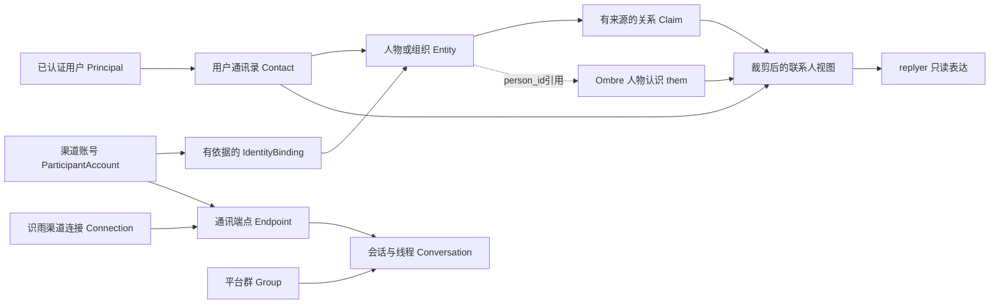

# 通讯录与人际关系

[完整架构](<完整架构方案.md>) · [关系模块](<03-DSH宿主进程/01-识雨插件/02-内层-六部分状态/02-关系/README.md>) · [跨模块契约](<跨模块契约.md>) · [来源核查](<../../research/2026-11-01-连接订阅与技术栈/通讯录关系.md>)

更新：2026-11-01。基于v1.1，属于进入验证的设计补充；未实现、未连接真实通讯录、未发送消息。逻辑职责归`relationship`、`links`和`views`，不新增独立自主核心。

## 1. 方案结论

识雨需要两种互相引用的能力：**通讯录告诉她“这个人有哪些已知账号、怎么联系”；人际关系告诉她“我与这个人有什么联系、依据是什么、有哪些沟通偏好”。** 两者不能混成一份模型印象，也不必各自部署服务。

- 通讯录、渠道身份、通信端点和通知偏好：复用现有控制SQLite、事务仓储和渠道SDK/Directory接口；TypeScript仅补字段映射、版本、消歧和策略。
- 人物经历、感受与认识：继续优先验证Ombre记忆服务；`them`条件启用，认识正文不在识雨重复保存第二份。关系断言和独立证据判断沿用现有Claim方案。
- 真实群组、会话和通讯录分组分别建引用；一个人可以有多个账号、一个账号可以出现在多个会话。群组不是某个人的别名。
- 首版从用户手工指定、已收到且获准保存的身份、已授权渠道目录开始。**没有“接入平台就获得全部好友/手机通讯录”的承诺。** 不造CRM、社交图平台或新图数据库。

技术栈短标签：**TypeScript＋SQLite＋渠道原生Directory/SDK＋Ombre them（条件启用）**。vCard/CardDAV是后续导入或既有通讯录连接选项，不是第一阶段新增服务器。

## 2. 数据所有者与基本对象

以下是逻辑对象，不要求一对象一张新表。通用字段沿用`revision/sourceRefs/validFrom/validTo/scope/status`。本地记录按v1.1局部事务提交；Ombre操作使用MemoryOperation核对结果，不宣称跨库原子性。

| 对象 | 保存什么 | 关键字段与约束 |
|---|---|---|
| Principal | 已认证用户或服务的安全主体 | 沿用`principalId/authenticatedBy`。它决定授权，不由联系人卡片或人物印象生成 |
| Contact | 某用户通讯录中一张可编辑卡片 | `contactId, ownerPrincipalId, entityId, userLabel?, sourceRecordRefs[], status`。Contact引用既有Entity；删卡片与删除全部记忆是不同范围 |
| ParticipantAccount | 某平台上的对方账号 | `accountId, provider, identityNamespace, identityType, externalSubjectId, accountKind, observedNames[], status, lastVerifiedAt`。唯一键为provider＋namespace＋identityType＋subjectId，不能只用昵称、邮箱或手机号 |
| IdentityBinding | 账号与人物/组织实体的关联依据 | `bindingId, accountId, entityId, basis, verificationRef, assurance, validFrom/To, status`；`assurance=claimed/user_attested/control_proved/provider_asserted`。等级描述证据，不直接授予权限 |
| ChannelConnection | 识雨使用哪个连接账号收发 | 引用链接模块的`connectionId, provider, connectorAccountRef, credentialRef, namespace, capabilityVersion`。OpenClaw的配置accountId映射到connectorAccountRef，不能混成对方accountId |
| CommunicationEndpoint | 经某连接向哪里发送 | `endpointId, connectionId, targetKind, targetRef, routeRef, supportedActions, reachability, verifiedAt, sourceRefs`。targetKind为direct/group/thread；routeRef是受控平台地址，不让模型拼接自由字符串 |
| Group | 平台群、组织或用户本地分组 | `groupId, kind(platform_chat/org/contact_list), providerNamespace?, externalGroupId?, displayName, membershipCoverage`。本地通讯录分组没有天然发送端点 |
| GroupMembership | 在特定群内出现或已确认成员关系 | `groupId, accountId/entityId, role?, sourceRef, observedAt, validFrom/To, assurance`。收到一条群消息只证明该次发言，不证明拿到全量成员名单 |
| ConversationRef | 一段消息上下文及话题 | `conversationId, connectionId, platformConversationId, groupId?, threadId?, participantRefs, conversationGeneration`。线程/话题明确；参与者集合可能不完整 |
| RelationshipAssertion / Claim | 人与人、组织、项目之间有来源的关系或判断 | 复用现有subject/predicate/object、sourceRefs、时间和认识状态；“用户说是同事”与“渠道返回同组织成员”分别保留 |
| CommunicationPreference | 向谁、为哪些目的、如何通知 | `preferenceId, ownerPrincipalId, contactId?, endpointId?, purpose, preferredRoutes[], quietHours?, timezone?, frequencyBudget, allowFallback, sourceRef, version`。偏好影响路由，发送资格仍由Mandate决定 |

`identityNamespace`由适配器给出，例如issuer、tenant、应用或连接范围；没有平台保证时保守保留应用/连接范围。`identityType`区分open_id/user_id/union_id等平台ID类别；标准化SDK可能回退ID类型，须在原始事件/SDK边界保留类型，不能只拿归一化senderId字符串。类型不可确认时标unknown、暂停跨渠道合并与特权绑定，不按前缀猜。同一个字符串在不同应用、租户或类型里不认作同一账号。多个连接读取同一平台全局ID的去重，也需要该平台保证而非猜测。

## 3. 用户本人和联系人的区别

识雨的主要用户先由DSH或本机已认证控制入口确定，再关联其本人Contact/Entity。卡片上的“我”、某账号自报“我是主人”、相同头像或昵称都不能建立Principal。

用户可以明确说“这两个账号都是我”来提出联系人归并；若该账号要执行控制命令、读取私密资料或接收私人主动通知，还须在已认证控制入口登记对应权限，并验证渠道账号控制关系。复用平台登录/配对能力；跨渠道证明只证明当前控制，不证明永远同一自然人。没有可复用验证接口时，绑定可保持user_attested供通讯录整理，不能自动升级为控制身份。

同样，用户说“这个QQ是张三的”可保存有来源绑定，供明确任务使用；不能据此让该QQ继承张三另一账号的权限。公司客服、家庭共享号码、机器人账号标为shared/org/service，不能强制归属于唯一自然人。

## 4. 联系人从哪里来，如何同步

| 输入方式 | 默认处理 | 不做的推断 |
|---|---|---|
| 用户明确新增或编辑 | 保存本地Contact和字段来源；若指定账号，创建待核验或用户确认的绑定 | 用户备注不覆盖平台ID，不自动修改远端通讯录 |
| 已接收消息 | 为路由保存最小观察身份；是否长期加入Contact按保存政策决定 | 发过消息不等于朋友、可信联系人、持续营销/主动联系授权 |
| 渠道目录查询 | 按connection/namespace读取现成SDK结果，保存受限目录快照，经core命令更新长期映射 | 名单可能只是allowlist、配置项、已见对象或当前API可见子集 |
| 用户授权导入文件 | 后续选用成熟vCard解析器/原生导入，先预览字段、来源与重复候选 | UID、同名、同电话只能帮助对齐记录，不构成跨平台本人证明 |
| 既有系统/云通讯录 | 有明确需求后接现成平台API或CardDAV客户端；先只读同步 | 设备客户端安装不等于授予通讯录权限；读取不等于授权写回 |

现查OpenClaw有可选`self/listPeers/listPeersLive/listGroups/listGroupsLive/listGroupMembers`，通用接口没有统一分页游标。WhatsApp配置目录只列配置allowFrom/groups，live群目录取当前账号参与群，不能称完整联系人列表。详细渠道实现由[来源记录](<../../research/2026-11-01-连接订阅与技术栈/通讯录关系.md>)说明；实际首个外部平台以链接模块所选SDK为准，不为了目录再启第二个完整聊天宿主。

飞书原生SDK已有高层频道接口和rawClient目录访问；其senderId可能在open_id/user_id/union_id之间回退。受信适配器可用includeRawInMessage保留原身份类型后裁剪，字段完整性须验证。QQ本轮未核实完整目录枚举API，先用已授权消息中的身份与用户指定联系人，不用“没有目录API证据”阻断基本联系能力，也不承诺全部好友自动导入。

识雨包装目录结果为`DirectorySnapshot{connectionId, namespace, kind, sourceMode(config/live/observed/import), coverage(complete/partial/unknown), queriedScope, fetchedAt, sourceVersion?, entries, truncated, error?}`。这是拟定适配结果，不声称上游已有这些字段。只有该渠道能证明某范围枚举完成，才标complete；query过滤、limit截断、权限不足、超时和无游标接口均不能被当全量。

同步规则：

1. 每个来源保留外部recordId/namespace/sourceVersion与上次成功快照；无稳定ID的记录使用导入批次内身份，跨批次匹配只提候选。
2. 用户自定义称呼、平台显示名、导入姓名、群内昵称分字段保存；界面展示优先用户称呼，其次当前上下文平台名，再来源名。模型猜测不覆盖正式名称。
3. 改名更新别名有效时间，稳定账号ID不变；历史消息保留当时来源身份，不能以现昵称重写过去说话人。
4. 部分名单中缺席只标未见或过期，不能删除。仅完整同范围快照或可信删除事件可以停用对应来源记录；仍不自动删除用户本地卡片和独立来源事实。
5. 断连、撤销目录权限时，标来源unavailable并停止刷新。已有联系人按明确保存政策保留或清除；不得从旧缓存声称当前可联系。
6. 重新连接必须核对相同namespace与账号，不能将新连接拿到的相同短ID接到旧人物。未验证覆盖度不通过重复抓取伪装完整同步。

## 5. 同名消歧、跨渠道合并与拆分

**相同显示名、手机号、邮箱、头像、经常同时出现，都只能产生匹配候选。** 账号变更和重新分配要按平台证据处理；身份认证平台也不普遍保证email/name稳定唯一。验证事实来源与认识来源分别保存。

合并流程：显示候选卡片及来源、账号作用域、最近验证时间 → 用户在明确语境下指定同一人，或平台给出可信的同一主体映射 → core核对readSet/collectionVersion → 建立可撤销EntityMergeRecord → 保留原始accountId和事件actorId → 重建读取投影。**同一控制证明先建立账号控制关联，不单独证明两张人物卡片属于同一自然人**；一个人可同时控制共享、组织与服务账号。已有明确用户指示且目标唯一时直接按该指示处理，不逐项重复确认；目标仍歧义时先完成独立查询，再请求选择。

合并不合并权限、发送授权、黑名单或所有会话上下文。授权仍绑原principal/账号/端点；更严格的停联限制在候选重算阶段继续生效。两个个人绑定冲突时拒绝静默覆盖；共享账号保留独立类别。

拆分恢复合并前映射；将每条关系/记忆按原sourceRefs重新归属。无法区分的条目标contested，暂停跨人综合与自动发送，等待来源核对。Ombre them没有被证明具备等同的原子人物merge/split：本地先关闭旧映射的对外视图，再通过可核对操作更新映射/认识，不伪造跨服务一次成功。必要时重新建立独立person_id，旧认识进入撤回核对，不能只改显示名就宣称纠正完成。

## 6. 人际关系、人物认识与记忆如何协作

| 内容示例 | 权威位置 | 使用边界 |
|---|---|---|
| 张三的飞书应用内账号ID、可用会话 | 本地账号/端点目录；平台为来源 | 寻址与路由，不证明信任或亲密 |
| “张三是我同事”，由用户说明 | RelationshipAssertion/Claim＋sourceRefs | 用户陈述，有时间范围，不自动获取组织权限 |
| 上次一起解决过的问题、相关情绪痕迹 | Ombre记忆/feel | 为连续交流供材料；只取本次授权范围 |
| “他通常喜欢先看结论” | them认识或独立Claim，关联证据 | 区分本人明确要求与推断；可以被用户检查与纠正 |
| “工作日用飞书，私人事情用QQ” | 明确CommunicationPreference | 作用于相应purpose；不授权跨平台泄露工作或私人内容 |
| 当前账号是群管理员 | 平台角色观察＋有效期 | 仅平台当时角色；不意味着识雨管理员 |

不建设“亲密度越高权限越大”的分数系统。若以后需要互动频率、最近联系等统计，标为可重建的行为统计，不能把它当信任证据或自动联系授权。

Ombre them是条件组件：人物认识与正文留在Ombre；本地保存entityId↔person_id、来源及版本引用。它的`recall/surface`会更新提及计数、清除待阅纠错/改名通知，因此由core内部操作生成快照；replyer和普通ViewService读取不得暗中调用这些有写路径。默认关闭，直到可审阅、身份关联、删除、快照分离通过V07/V16。未通过时用现成记忆＋本地有来源Claim满足必要关系功能，不新增另一套人物记忆服务。

## 7. 群组、会话与隐私边界

一个平台群对应Group；不同话题/线程有各自ConversationRef。用户本地“同事”通讯录分组仅是筛选集合，不能一键被解释为广播收件人。组织成员关系也不等于某群成员。

群内消息来源由channelConnection、groupId、threadId和actorAccount组成。可见成员列表只在平台授权范围读取，保存完整度和时间；群加入/退出/身份角色变化触发视图复核。私人联系人备注、别处的私聊和其他群关系不默认进入当前群的ReadView。

群回应限定当前会话及用户允许披露的材料。向一个群发送“给张三”的消息不等于给张三私信；@某人也不改变整群可见的受众。读取目的、人群和数据外发范围必须共同满足，不能因为张三在群里就把他的私聊背景带入。

## 8. 主动联系与通知偏好

识雨可以主动建议联系，也可以在已有授权内实际联系。具体路径复用`Task/Mandate → Effect → 渠道发送 → Receipt`，不让关系模型直接发消息。

1. **确定目的。** 事件或持续目标触发，关联明确Mandate。对用户本人的提醒使用其已配置的通知目的地；替用户联系第三方需用户明确请求或覆盖接收方、目的、内容边界及有效期的持续授权。
2. **确定目标。** 将“张三”解析到唯一Contact、Account和Endpoint；不让模型仅凭昵称命中就发送。当前聊天的直接回复优先原ConversationRef，不任意另找其私信渠道。
3. **检查资格。** 端点当前可达、平台允许此发送方式、身份未撤销、联系人未被阻止、目标范围在Mandate内。平台窗口/次数限制由渠道能力实时提供，通知偏好不能绕过平台规则。
4. **应用偏好。** 目的匹配、渠道优先级、时区、安静时段、频率预算、是否合并摘要；默认只向选定端点发送一次逻辑通知。时区未知使用已配置用户时区并标默认，不根据手机号猜。
5. **冻结并复核。** Effect绑定recipientBindingVersion、endpointVersion、preferenceVersion、policyVersion和内容范围；发送前再核对。等待期间身份合并/拆分、改端点、退群或停联，旧Effect失去派发资格。
6. **核对结果。** 区分平台受理、送达和已读。超时unknown不能自动换另一个渠道重发；只有证明未发送且fallback范围已授权，才按既有策略改路由。无持续授权时只准备建议或草稿，不因“很久没联系”自行给第三方发信。

通知偏好是可编辑数据；联系人备注可以说“只收邮件”，实际使用须记录谁设置以及适用目的。收到对方的停止联系要求应立即暂停相应主动联系，交core登记，并使未发Effect失效。既有明确授权在范围内持续生效，无需每次提醒重复确认。优先级、情绪强度、熟悉程度都不能自行越过安静时段或停联设置；紧急例外须由用户事先定义。

## 9. 删除、停联、解绑与恢复

| 用户动作 | 本地处理 | 对外/后端范围 |
|---|---|---|
| 从通讯录移除 | 删除或隐藏该Contact及用户专属备注；保留范围由实际指令决定 | 不自动删除远端通讯录，也不把其他合法记录默认为已清除 |
| 解绑某平台账号 | IdentityBinding失效，停用依赖端点，撤销相关读取/发送资格 | 保留不含正文的最小操作回执；原始历史身份不改写为另一个人 |
| 不要再联系此人 | 停联策略立即生效，取消未发Effect | 不等于删除已存在记忆；策略清楚显示仍保留的范围 |
| 删除此人的信息及派生认识 | tombstone立即阻断，反向依赖定位Contact/Account/别名/关系/Claim/Ombre桶/缓存/草稿 | 普通Ombre归档不算清除；按统一删除任务报告实时副本和备份阶段 |
| 删除远端通讯录或撤回已发消息 | 独立外部Effect，检查平台能力及明确授权 | 本地删除不能代表远端、对方副本或历史备份已删除 |

删除会取消目录来源的自动重建资格。为避免重同步复活，同步器只保留获准的最小source record ID墓碑；即使该ID形式随机，也按可能关联个人的标识管理。若该ID也在清除范围内，则停用该来源/集合的自动导入，直到用户显式重新选择，而不是偷偷留内容hash继续匹配。不能同时承诺“删除一切可识别信息”与“无限期精准识别并屏蔽同一号码”；选择与剩余元数据必须可见。

停联与完整清除可能有不同保留需求：若用户要求继续阻止联系，可明确保留最小阻止规则；若要求连该标识也清除，则默认关闭对应来源的主动联系/自动导入，不能从缓存复活身份。

备份恢复先应用最新删除/停联/解绑记录，再恢复联系人视图与派发；缺少最新记录时保持隔离。清除范围内的别名、电话、原始摘要和可重识别哈希不得藏在诊断日志或来源目录中。合并拆分记录涉及被删内容时也清理，只留允许的非内容回执。

## 10. 内部接口与可见产品界面

以下是逻辑API设计，尚未实现；写入全部由具名内部命令完成。外层可以提交用户编辑意图和观察事件，不能持有数据库或直接写Ombre。

| 接口 | 输入和返回 |
|---|---|
| QueryContacts | 查询、owner/scope、用途、limit → 卡片摘要＋来源完整度/时间；默认不返回全部联系方式 |
| ResolveRecipient | contactRef/账号引用/原会话、purpose → resolved/ambiguous/unavailable＋候选端点；仅解析不发消息 |
| RefreshDirectory | connection、kind、scope、query/limit → DirectorySnapshot；受控目录刷新，不隐式全量抓取 |
| ProposeContactChange | 明确字段、来源、readSet → Proposal/CommitReceipt；本地变更和远端写回分别呈现 |
| BindAccount / Merge / Split | 目标ID、证明或用户指示、版本 → 变更回执＋受影响视图/任务；不串改权限 |
| SetCommunicationPreference | 接收方/目的/端点范围、规则和来源 → 版本；使不兼容旧Effect失效 |
| PreviewContactAction | 目的、收件人、内容范围、Mandate → 具体路由/受众/允许状态；存在充分授权时可直接进入派发 |
| RequestContactErasure | 删卡片/解绑/停联/信息清除的明确范围 → deletionJobId与实际阶段 |

界面以“人”和“群组”两个列表起步。联系人详情呈现：称呼、账号与验证状态、可用联系渠道、用户备注、关系依据、通知偏好、最近同步时间。人物认识单列为可纠正内容，不能冒充资料字段；未知或冲突明显展示。编辑本地称呼不弹出远端同步承诺；合并前展示将关联哪些账号、拆分后展示哪些认识待重核。

所有联系动作显示具体接收方与渠道；必要确认发生在目标歧义、范围缺失或已有规则要求时，而非一律每次确认。可追溯来源通过受限查看展示，不把私聊全文默认铺在通讯录中。

## 11. 分阶段验证与退出条件

| 阶段 / 编号 | 可验证交付与通过条件 |
|---|---|
| 本地模型 V02/V07 | 30张合成卡片、50个多命名空间账号、同名/共享号/改名/群昵称；身份误合并0，账号与连接accountId混淆0，群ID不作人ID |
| 目录适配 V02/V23 | 一个具备目录能力的真实候选＋假目录失败器；partial/limit/错误不触发删除；重复刷新无重复卡片；不支持能力返回unsupported而非空全量 |
| 合并拆分 V07 | merge→派生认识→split后按原来源隔离，权限不扩大，旧未发Effect阻断；Ombre中断保留unknown并可核对 |
| 发送 V05/V10 | owner提醒/第三方持续授权/同名歧义/退群/撤权/静音/未知送达，所有超范围发送为0，unknown不盲目跨渠道重发 |
| 删除恢复 V16/V22 | 联系方式、别名、them/Claim/视图及旧备份无复活；停导入后不重新建卡；报告真实后端清除阶段 |
| 语义 V25 | 100组人物关系与代词歧义，错误身份合并0；“甲说乙”来源归属≥0.95；模型只提候选，不用置信度绕过绑定证明 |

首版只启用一个已授权渠道和用户本人通知目标，再增加第三方联系人与第二渠道验证。没有目录能力也能用明确联系人和已观察身份工作；不为了覆盖率绕过平台限制。Ombre them未过门槛时保持关闭，通讯录和基本有来源关系仍完整可用。验证脚本与合成数据后续放入`测试/`，本轮未执行。
