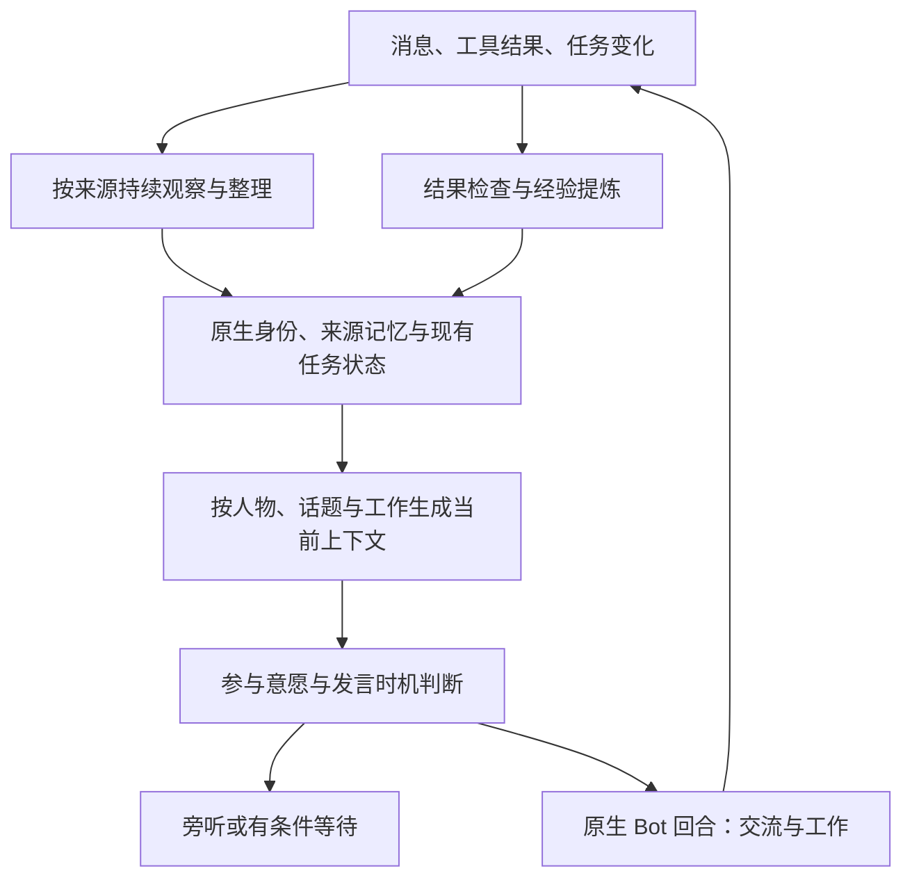

# DSCord 跨域长程工作与社交能力改进方向

本文保存 2026-11-06（America/Caracas）调研时点的研究判断与设计建议。该阶段读取两个指定聊天、固定源码、已有长测证据和一手论文，模型与行为实验记录来自当时已有证据。

同日后续，记忆分支已合入 main `93e7d99`，用户授权本聊天作为主线程开启 Goal，吸收 DS-Bot 为内核并推进多人、多 Agent 平台。新增范围与 0.3 系列核查见[内核化方案](DSCord内核化与DSBot0.3系列核查.md)。本文原始事实表保留研究时点的基线。

2026-11-07 的候选实现已接通来源观察、人物/项目视图、按需回顾、三动作参与、任务归属和原生上下文投影，并完成 96 条生活工作故事的执行。实际行为发现、修补及独立验收见[多人平台实施与验收](../apps/ds-group/多人平台实施与验收.md)。下文其他研究建议继续按各自范围评估。

[设计目录](目录.md) · [来源与核查范围](../research/2026-11-06-长程工作与社交能力/目录.md) · [原生 Bot 能力对照](../apps/ds-group/原生DSBot能力对照.md) · [健身房长程方案](识雨健身房长程互动升级方案.md)

## 1 判断与当前基线

目标可具体化为：同一个 Bot 在不同人、群、项目和工具之间切换，仍能辨认来源与当前事实，持续履行承诺，根据各方掌握的信息自然交流，并把成功经验用于后续工作。

当前主要瓶颈是这些能力之间的连接：已保存的信息怎样成为当前判断的依据，当前判断怎样约束实际行动，行动结果怎样反过来修正认识。发言模型、长期记忆和原生任务已有各自基础，完整行为仍需联合验证。

| 基线 | 已有证据 | 判断边界 |
|---|---|---|
| 主分支 `c2f329c` | 稳定身份、房间/引用来源、同一原生 Bot Session、全部原生工具；普通文本落库，定向消息进入处理队列 | 全量消息存储不等于全量语义旁听 |
| 记忆分支 `01b3318` | 来源、联系人、修订/撤回/有效期、语义检索、自动整理及逐步快照已有实现；原生压缩、重启、真实文件工作已有限定证据 | 本轮远端检查该提交尚未进入 main；不能当成默认部署现状 |
| 自然续篇历史结果 | 96 条消息、72 次实际 Bot 回复、4 次压缩、3 次重启；人工仍发现旧文件压过新更正、偏好执行不稳、附件盘点错误 | 完成执行，行为未整体验收通过；前段 208/240 和失败继续保留 |
| 发言决策分支 `8eee96c` | Decisions 的 22 个中文场景、2 个身份切换检查通过；最新聊天建议 LISTEN / WAIT / SPEAK | 测试时用较早的五类标签，三动作是后续讨论建议；产品未接入，未验证真实多人群聊 |

上述运行成绩来自指定聊天的历史证据。本轮重新检查了相应源码与报告，没有复跑，也没有把不同提交、provider 和测试口径合成一个通过率。记忆分支的后续普通版 CommandCode 授权只作为历史背景，本轮没有发起模型调用。

## 2 现在的难题与改进方向

### 2.1 看见消息、理解消息和形成长期记忆之间存在断点

**静态核查。** NodeStore 保存普通消息，只有目标包含本 Bot 才进入 inbox。记忆适配主要在原生会话收到输入时接纳该消息及随附历史；历史默认最近 40 条。即使已经补上未点名人类历史的整理，也不能据此断言长时间未被点名期间的所有消息均已进入该 Bot 的认识。

**改进方向。** 建立每个 Bot 的观察进度，消息接纳后持续推进话题状态，再按重要性决定长期保存。分别记录已接收、已形成上下文、待整理、已整理的位置。连续补充可合并，任务取消、纠正、依赖完成等事件优先处理。近期原文、话题摘要、长期记录各有用途；摘要保留原事件入口。

**难点。** 全量监听时消息量与 Bot 数会放大整理工作；对每条消息都运行完整模型会造成积压。需要测量各步骤的延迟和积压，而非只测发言分类的毫秒数。先在既有消息存储和记忆接口之间补增量接入，避免引入另一套事实存储。

### 2.2 信息能够保存和检索，仍可能选错当前依据

**历史实测。** 自然续篇多次出现 Bot 用自己早先生成的文件否定后来的人类更正。当前代码已有来源、有效期、撤回、修订和并列冲突；这些基础应继续复用。

**静态核查。** 当前冲突识别依赖相同 scope、subject 和 predicate，且只覆盖 stated / observation。语义等价但谓词不同、跨群同项目、草稿与决定的关联，仍依赖模型理解。检索相关性也不等同于事实成立。

**改进方向。** 按实体、属性、项目和适用时间组织当前主张，区分事实陈述、提议、确认、工具观察、转述与推断。为文件、摘要和任务计划保留所依据的事实版本；来源更正后，将相关派生产物标为待复核。回答和改稿时取得本次相关的当前值、冲突及旧稿来源。

不能用“最后一句总是正确”或“人类总高于工具”替代判断。对于文件是否存在，实际文件回执有决定性；对于场地是否已确认，生成草稿不能代替相关人的确认。不同人的冲突说法要保留归属，影响行动时再澄清。图式关系可以先在现有存储上表达，是否采用专门图数据库需要性能证据。

### 2.3 全局身份已具备，随场景工作的上下文仍偏粗

**静态核查。** `contextSnapshot()` 自动提供当前说话人最近 8 条事实和最近 8 个记忆指针。这个入口有助于偏好延续，但未按当前项目、待完成承诺、相关纠正和对话对象综合组织材料。未自动带入不代表库里不存在，也不代表工具不能查到。

**改进方向。** 为正式回合与发言判断分别生成有预算的上下文视图：当前人/群/话题、相关项目的当前决定、正在执行与等待的事项、适用偏好、冲突、少量原文证据、历史缺口。视图来自既有权威记录并带版本，不自行保存第二套可编辑事实。

个人稳定偏好可跨群适用，本群决议保留群/项目范围；临时要求覆盖本次表达，但不自动改成永久偏好。同一个 Bot 保留连续身份，同时拥有多个可恢复的任务焦点。DSH 原生 Session 继续复用，跨话题切换时显式加载相关状态。

### 2.4 人际关系清晰，需要超出“姓名与 ID 对得上”

**已具备的基础。** 稳定账号、同名区分、改名、来源主体和每个 Bot 的认识已进入记忆分支。

**待研究的增量。** 至少需要表达三类信息：项目中的角色与协作关系；两者共同经历和未了约定；各方知道、声称知道、尚未确认知道的事情。例如 Bot 同时在甲乙两个群，甲群改期后，它不能默认乙群成员已经得知；“看过消息”“明白”“同意”也不是同一状态。

关系具有方向、场景和时间。某人是项目负责人，并不意味着他在所有话题上都能代表另一人。信任可以针对特定经验或领域逐渐形成，不宜压成一个全局好感分。对情绪、意图和信念的推测保留依据和不确定性；一句抱怨不能成为永久人格结论。

这种信息不对称是 [FANToM](https://aclanthology.org/2023.emnlp-main.890/) 专门研究的评测问题。该论文支持把“谁知道什么”单列测试；其旧模型结果不用于断言当前模型的能力上限。

### 2.5 长程工作需要保持承诺、依赖和真实交付状态

**现状。** 原生 DS-Bot 已有目标、阶段任务、委派和技能提案能力；无需把它描述成没有任务系统。长测也已有跨任务文件与代码执行证据。但来源变化、自然对话承诺、跨 Bot 委派和实际交付尚未证明能持续一致，附件盘点错误仍存在。

**改进方向。** 从现有任务和工具记录生成工作视图，明确目标、负责人、相关人/群、当前步骤、完成证据、等待对象、触发条件和恢复入口。持久承诺在有实际任务时关联原任务，没有任务对象时作为轻量事项，再由原运行时承担推进。

工作恢复时保留“做到哪、为什么这样做、下一步、当前障碍、采用的文件版本”。区分产物生成、测试通过、已送达、对方确认；任何一步都不能凭总结中的“已完成”直接推定。新的更正使相关步骤进入复核，而非机械从头重做所有工作。

**跨域能力。** 除事实记忆，还需要经过验证的做法：适用条件、关键步骤、失败信号及结果检查。可在已有 learning/skills 机制上研究提取和使用效果。[Agent Workflow Memory](https://arxiv.org/abs/2409.07429) 在网页任务中验证过复用工作流程的价值；迁移到我们的代码、资料、文件和社交任务仍需实验。具体项目中的旧事实不能混入通用技能。

### 2.6 自然社交同时要求参与意愿、时机与表达意图

**已有方向。** 沿用最新聊天的 LISTEN / WAIT / SPEAK 三动作。系统错误、超时和上下文不足单列，不能伪装成主动旁听。

**改进方向。** 判断材料包含稳定兴趣与表达风格、当前实际工作阶段、可打断性、承诺紧迫度、对话对象、未答问题和他人已说的内容。忙碌程度来自原生任务和工具状态，同时允许 Bot 选择专注；仅有一句自述“我很忙”不足以说明实际注意力状态。

发言的价值可以是回答、追问、关心、认同、幽默或分享经历。理解对方是在求助、讨论、倾诉还是轻松闲聊，会影响表达形式。无需为每一种意图扩张顶层动作数量。

WAIT 要有等待原因、重评事件及有效期；普通错过的闲聊可以自然结束，不能空闲后批量补答。多个 Bot 对同一话题参与时，短暂协调先后，准备发送前核对相关新消息；持续观察不意味着并发写入同一个原生 Session。明确取消和在途改动沿用可靠控制路径，不被闲聊兴趣分数拦掉。

**关键例子。** Bot 喜欢游戏，正在赶报告：看到游戏话题可能旁听；等计算结果时可以接一句；有人补充与报告有关的新更正，应更新工作；之前答应稍后给的结论，则在结果就绪时跟进。相同兴趣在不同工作状态下应表现不同。

### 2.7 自然表现与长期改进需要独立评价

历史测试已证明“记住答案”和“在真实工作中使用正确”会分离。强制调用记忆工具的测试、自然协作、发言时机和交付正确性必须分别报告。

建议用 [LongMemEval](https://arxiv.org/abs/2410.10813) 的信息更新、时间、多会话推理和未知判断思路设计事实题；用 [SOTOPIA](https://arxiv.org/abs/2310.11667) 的交互情境思路评估澄清、协作、分歧处理和交流方式；以实际文件、工具回执和人工盲评核对结果。这些文献提供方法，不能代替本项目的中文多人测试。

需同时测量误插话、漏掉应答、过时回应、重复发言、偏好实际执行、承诺完成、无提示恢复、用户纠正次数和总成本。不要把闲聊频率高当成社交好，也不要把沉默率高当成正确。长期目标是同等难度下用户重复解释和监督的负担下降。

## 3 建议的组织方式

DSCord 负责消息来源、话题观察、上下文组装与发言协调；DS-Bot/DSH 保留身份、会话、任务、工具和记忆的原有责任。当前重点是贯通状态与证据。稳定人格是长期表达倾向，短期注意力是当前工作事实，二者分别更新。

[Generative Agents](https://arxiv.org/abs/2304.03442) 的观察、记忆、反思与计划组合可作架构参考；其沙盒内的可信社交表现不是现实工具工作可靠性的验证。

## 4 下一步建议及判定办法

**第一步：冻结问题基线。** 将现有失败整理为独立病例，记录当时的输入、实际读到的材料、检索、最终表达、工具与投递回执。先区分未观察、未保存、检索遗漏、读错依据、计划错误和执行错误，再决定修改位置。新版本复验使用独立身份/数据，避免旧测试后续事实提前泄露答案。

**第二步：优先验证当前事实与工作视图。** 在既有存储上表达当前决定、来源冲突、待复核产物和承诺/交付状态，并生成紧凑上下文。正式回复和轻量决策使用同源的事实视图，各自按预算裁剪。先看旧稿覆盖新更正、跨群偏好和盘点错误是否改善。

**第三步：以影子方式接通持续旁听与三动作判断。** 记录如果允许发言会在何时对谁说话，同时记录忙闲和上下文版本；先不通过自动插话改变对照语境。对各方信息不对称与忙闲变化作成对测试，再进入有限的真实群聊验证。

**第四步：做长程混合任务与经验迁移。** 结合已有健身房方向，在多人物、多群和多项目中安排打断、改口、协作、闲聊、压缩和重启。故事跨日、真实连续运行时长和故障恢复分别报告。最后换新任务检验学到的流程是否有效，避免只在熟悉剧本上越来越好。

建议先登记以下六组病例，数量与发布阈值在执行前确定。这是未运行计划。

| 病例 | 关键变化 | 需要看见的结果 |
|---|---|---|
| 旧稿与更正 | 先生成场地方案，再由相关人取消；其他 Bot 转述旧稿 | 当前行动使用新状态，保留来源；旧稿不充当新的独立证据 |
| 长时间未点名 | 连续超过现有近期窗口的讨论后再问早期约定 | 能证明约定曾被观察与整理；缺失时明确说明 |
| 同名与共同知识 | 同名账号、改名；一人缺席改期讨论；跨群再会合 | 不串人，不默认所有人已知；根据语境补充必要背景 |
| 忙闲与兴趣 | 同一句游戏话题，分别处于专注、等待结果、空闲阶段 | 参与策略有合理差异；任务改动仍及时进入工作状态 |
| 长任务中断 | 委派、文件变更、取消部分任务、压缩与重启 | 原身份与事项续接，采用正确版本，完成与送达依据可查 |
| 情绪与表达 | 同一人本次求方案、下次只倾诉；语言和简短偏好变化 | 表达适应当前意图，稳定偏好合理沿用；不强加工作计划 |

对照应保持主模型、输入历史和预算可比：现状、仅提示改进、增加当前视图、再增加旁听/协调，逐层定位收益。对关键案例补充“直接提供正确证据”的对照；若仍然答错，就应转向阅读推理、表达约束或模型能力问题，而非继续堆记忆。经验提炼另用保留任务验证，避免与上述改动一起上线后无法归因。

## 5 本轮范围与待决定事项

本轮只新增研究文档与来源索引，未合并两个研究/实施分支，未修改产品、依赖或宿主。当前建议的优先顺序是：**当前事实与工作连续性 → 持续旁听与注意力 → 社会认知和经验迁移的联合长测**。社会认知病例从第一步就应进入评测，以免后续把社交简化成话术优化。

待后续讨论的是首个实施切片的边界与验收阈值；本轮不把专用图数据库、另一套 Agent 框架或模型训练列为前置条件，也不把论文参考登记为已采用组件。

## 6 Anthropic 文章带来的方案调整

2026-11-06 用户提供《The components of agent memory》。文章以记录、笔记、知识组织和注入上下文描述记忆层次，并介绍用 dreaming 回顾、纠正和重组记忆。结合本文的问题，我建议把跨会话回顾纳入首个改进切片。以下具体适配属于本项目的设计推论。[原文](https://www.anthropic.com/research/components-of-agent-memory)

**沿现有接口扩展回顾范围。** 记忆分支 `01b3318` 的 `memory/native.mjs:102–161` 已按待整理来源执行自动 review，并检索相关旧条目。原生 `chat-index.js` 已为 `read_own_chat` 提供历史搜索、近期读取和锚点附近读取。下一步可增加按人物、项目或失败事项选择历史的回顾任务，检查早先结论是否仍成立，并把修正通过现有带版本的写入流程提交。DSCord 中尚未进入原生会话的旁听内容，需要继续连接消息存储的来源入口。

**把人物和项目认识组织成带证据入口的视图。** 在结构化来源记录之上，允许模型组织相关人的交流偏好、共同经历、未了约定，以及项目目标、决策理由和未解决问题。每个重要结论指向支持它的事件或工具结果。原始记录可核对谁在何时说过什么，外部事实继续由相应证据核对。当前任务状态从运行时读取，回顾重点保留决定的原因、经验和跨会话关联。模型在内容选择和组织上的自由度值得进入对照实验。

**用回顾过程检查认识的依据。** 官方 cookbook 展示了核对记录、更新过时信息和降低含糊结论确定性的流程。我们的首批病例可针对旧场地安排、被重复传播的草稿和语言偏好。某段记录缺少支持时，继续寻找它引用的原始来源，再决定如何修订。多人共同写入时使用现有版本校验和串行提交机制。[官方 cookbook](https://platform.claude.com/cookbook/managed-agents-cma-dreaming-with-a-dynamic-workflow)

**按预期收益安排后台工作。** Sleep-time Compute 研究了在查询到达前处理上下文，并分析问题可预测性与收益的关系。我们可以优先处理高频访问的人物、反复修改的项目，以及近期明确暴露的错误。取消和更正先进入当前工作状态，跨会话关联在原生运行时有余裕时整理，并记录整理的输入、耗时和实际后续收益。[论文](https://arxiv.org/abs/2504.13171)

首个实验建议固定相同历史与主模型，比较现有记忆、增加按需回顾、再增加人物/项目视图及精简上下文三组。原文查询能力保持一致。选择已有长测中“旧稿压过新更正”“记得偏好却执行不稳”“已交付却误报未交”三类失败，使用独立后续问题测量改进。记录原始答案、错误是否复发、检索与整理成本，以及未提示时是否主动使用正确依据。方案处于静态分析与待验证阶段。
