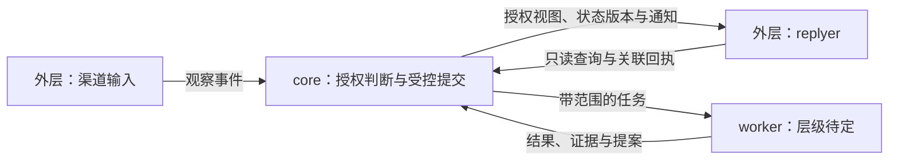

# 内外双工与角色边界

> 2026-11-01 状态更新：本文保留前期约束与比较依据；当前完整方案与已收敛的接口、技术选择以 [v1.0架构方案](<A方案全景/完整架构方案.md>)、[跨模块契约](<A方案全景/跨模块契约.md>)和[技术决策](<A方案全景/技术选型与决策.md>)为准。本文中的早期待定项不代表本版仍未给出主方案。

[返回设计目录](<目录.md>) · [总体架构](<总体架构.md>) · [主动运行、自愈与多设备](<主动运行、自愈与多设备.md>)

- **状态：用户约束已记录，角色映射与协议为讨论草案。**
- **实现：未实现；本文不授权接入服务或开放写权限。**
- **创建：2026-10-30；更新：2026-10-31（America/Caracas）。**

## 1. 用户已明确的约束

- 使用 `core / worker / replyer` 三个角色名称。
- 内层包含记忆、关系、情绪、认知、人格、能力。
- 外层负责表现、链接与串行 / 并行队列，对内部状态只读，不能主动记忆或干预内部。
- 内外需要双工通信，而不是只能从内向外单向传递。

**只读约束的是状态操作；双工描述的是消息流向。两者并不矛盾。**

这不预设三个角色对应三个进程、三个模型或三个常驻 agent。特别是 worker 的层级归属、能力范围和提交权限，仍需用户决定。

## 2. 角色分工候选

以下是助手建议，不是已确认实现。

| 角色 | 建议职责 | 建议权限边界 |
|---|---|---|
| core | 接收经历，组织内部处理，依据策略判断提案，并维护内部状态的一致性 | 内部权威状态的变更入口由 core 控制；具体内部执行器可另行实现 |
| worker | 承担明确委派的提取、检索、比较、评估或其他任务，返回结果与依据 | 按任务授予最小权限；计算出一个变更提案，不等于有权提交变更 |
| replyer | 基于获准读取的上下文与表达依据生成、组织对外回复 | 对内只读，不获得记忆、人设、情绪等内部状态的修改工具或存储凭据 |

如果将来某个 worker 负责真正写入，它必须是内部受控执行通道的一部分；不能借 worker 的名称，让外层间接获得任意内部写权限。外层能否发起某类 worker 任务，也必须受接口约束。

## 3. 分开“传消息”和“改状态”

### 对话与通知通道：可以双向

一种候选消息流：

```text
外层 / replyer ── 观察事件、只读请求、回执 ──→ core
外层 / replyer ←─ 上下文结果、状态视图、通知 ── core

core ── 有范围的任务 ──→ worker
core ←─ 结果、证据、变更提案 ── worker
```

外层送来的输入只能说明“发生了什么”或“请求了解什么”，不能自动成为“把内部状态改成什么”的权威命令。用户在对话中要求记忆或删除的信息，应交由内部按用户指引与数据政策处理，不由 replyer 绕过内部直接写库。

### 内部状态通道：外层无写权限

- 外层不直接新增、更新、合并或删除记忆。
- 外层不直接设置关系、情绪、认知、人格或能力状态。
- 不向外层透传一个可任意调用内部工具的通用执行入口。
- 不把可变的内部对象引用、数据库凭据或任意文件写权限交给外层。
- 即使提案来自另一个模型或 worker，也要经过相同的授权、校验与提交边界。

只读不应仅靠一句提示词保证；接口、存储访问和能力声明需要共同落实。

## 4. 协议设计候选

| 消息种类 | 方向 | 用途与边界 |
|---|---|---|
| 观察事件 | 外 → 内 | 携带对话来源、说话者、时间、正文引用；不附带必须执行的内部修改指令 |
| 只读请求 / 响应 | 外 ↔ 内 | 获取经过授权和范围限制的相关上下文，不直接枚举全部内部状态 |
| 状态视图 / 通知 | 内 → 外 | 内部主动提供可用于表达的信息；不是原始内部存储的完整副本 |
| 任务结果 / 提案 | worker → core | 带证据和影响范围的候选结果；仍不等于已提交 |
| 接收、完成与失败回执 | 双向 | 分别表示已收到、已处理、已发送或已提交，不能混为一个“成功” |
| 取消 / 超时通知 | 双向 | 取消的作用范围和已完成副作用要明确，不能用重试掩盖未知结果 |

消息名与字段还没有定稿。建议至少关联事件 / 请求身份、会话、来源、权限范围、状态版本与结果状态；队列重复投递时由接收方去重。

特别注意：**replyer 收到“消息已入队”，不能据此对用户说“我已经记住了”。** 只有内部明确返回保存结果，才能作出与结果一致的说明。

## 5. 只读仍需核查的边缘情况

1. **读接口的隐含写入。** 检索可能顺便增加激活次数、改变权重或触发学习。若这些改变属于内部权威状态，就不能默认为无副作用的只读；是否由内部自主处理访问事件需另定规则。
2. **队列与临时上下文。** 外层可以需要运行状态，但它们是否落盘、存放在哪里、保留多久，不能自动等同于长期记忆授权。
3. **不同会话读到的版本。** 内部更新后，已有回复任务可能仍使用旧视图；需要决定重取、继续使用或取消的条件。
4. **模型自己说过的话。** 回复文本与 worker 推测不是用户事实。回流内部时必须保留说话者与来源，避免生成内容被再次当作真实经历确认。
5. **双工不等于双方轮流同步阻塞。** 内部可以异步处理并推送结果；是否每条回复都等内部处理完成，还需延迟与一致性设计。

## 6. 建议验收条件

- 外层正常对话不需要内部状态写权限；尝试越权变更会被拒绝并可检查。
- 外层读取不会悄悄修改受保护的内部状态。
- 内外两侧都能发起允许的消息，且请求 / 响应能够正确关联。
- 观察事件重复投递不导致重复记忆；回复重试不造成重复发送。
- worker 输出被篡改、缺证据或越权时，不能直接提交内部状态。
- 接收成功、任务完成、消息发送与记忆提交的回执可区分。
- 临时上下文和队列的保留、清除策略可以被检查。

## 7. 待决定

- worker 是否只由 core 创建和调度？是否存在仅服务外层的 worker？
- core 的一次决定由规则、单个模型还是多个校验阶段组成？
- 哪些内部视图可被外层按需查询，哪些只能由内部推送？
- 哪些更新允许自动提交，哪些需要用户确认？
- 原始事件的保存范围、时间与删除方式是什么？

本文确定讨论边界，不将任何候选协议或权限实现写成已经落地。

## 8. 2026-10-31 候选带来的补充草案

本节依据 [DS-Bot](<../技术候选/DS-Bot.md>) 与 [DSH-Superagent](<../技术候选/DSH-Superagent.md>) 的限定源码核查整理。**它是助手建议，未确认选型、角色映射或实施；没有运行两个候选进行对比评测。** 当前基线仍是本文的设计约束，尚无要替换的已接入组件。

| 识雨需要细化的问题 | 可研究的机制 | 适配时保留的边界 |
|---|---|---|
| 内部工作时怎样及时回复 | DS-Bot 侧边对话读取主会话快照，独立生成回答 | 识雨须提供裁剪后的授权视图及版本；候选的会话快照不是识雨只读权限的现成实现 |
| 凭什么让 worker 开始工作 | DSH-Superagent 分开 Mandate、Ticket、Assignment | 分别记录授权依据、工作事项和一次执行；任务身份不直接授予内部状态写权限 |
| 新输入属于哪个任务 | DSH-Superagent 区分任务后续消息、仅上下文订阅与交回评估 | 同一消息有明确归属，不能被多个决策入口重复接单；补充信息不自动扩大原授权 |
| 模型判断如何变成可靠状态 | DSH-Superagent 的 Engine、事务与持久 effect 队列 | 将模型提出的判断交给程序校验和提交；它的任务 core 不是识雨六部分内层的替代品 |
| 失败之后怎样解释结果 | DS-Bot 命名请求的 uncertain 状态；DSH-Superagent 的任务恢复和 Outbox 回执 | 分清已受理、已执行、已提交、已发送和未知；不能从队列去重推导任意外部动作只执行一次 |
| 后台工作会不会拖慢对话 | DS-Bot 区分群发言与后台工作；DSH-Superagent 为人的追问留额外槽位 | 对话延迟与后台吞吐分别设目标，另外计算 token、进程及后台资源预算 |

沿用第 2 节的角色分工候选，可以进一步讨论以下数据流：



图中外层发出的观察事件和查询不带内部提交权。若 worker 产出记忆或其他内部变更建议，应先返回 core 的受控提交路径；任务执行成功、内部提交成功和消息发送成功分别记录。具体视图、字段、存储与模型仍待定。

### 建议进一步区分的运行语义

- **任务与会话分开：**会话重启或换段可以延续同一任务，不能因此丢失原授权范围，也不能重复认领同一事件。
- **模型判断与程序提交分开：**模型可以判断相关性、提出任务或变更；程序检查身份、策略、状态版本和允许的迁移。提交入口属于内部权限边界。
- **运行记录与长期记忆分开：**队列、日志、授权和回执即使需要落盘，也必须有独立保留范围；它们不能自动成为人格、关系或事实记忆。
- **暂停、取消、撤权分开：**停止接新任务、结束某次执行和撤销后续行动权限并非同一件事。DSH-Superagent 的运行中策略通知不等于立即强制停机，不能未经讨论直接继承其语义。
- **候选组合不等于整体接入：**DS-Bot 可优先用作回复视图和长上下文参考；DSH-Superagent 可优先用作任务授权和执行状态参考。两个项目都未证明满足识雨完整的外层只读与内层提交隔离。

下一项可判定的设计问题是：一个带来源的外部事件如何经过授权、形成任务、获得结果，最终分别向内部提交和向外层回执。候选文档列出的验证计划尚未执行，不创建运行模块或预选数据库。

同日用户进一步确定当前以 DSH 插件存在，并提出主动运行、自愈与多设备目标；比较后明确选择 A：核心运行于 DSH 插件内。相应方案见[主动运行专题](<主动运行、自愈与多设备.md>)与[A 方案全景图](<图示/识雨全景架构-A.html>)：主动判断和受控提交由内部承担，设备接入作为能力基础设施讨论，replyer 的外层只读约束保持不变。角色接口与 worker 的层级归属仍是草案，未实施。
