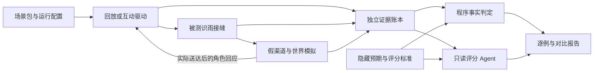

# 信息流 Lab 架构草案 v0.1

日期：2026-11-01（America/Caracas）。**设计建议，未实现、未运行。** 用户本轮要求规划 Lab，并明确可以接入 Agent 评分。承接[实验计划](<实验计划.md>)、[场景目录](<目录.md>)、[覆盖与拟验契约](<覆盖与拟验契约.md>)；不改变识雨 A 架构或 V01–V27 的权威。

## 1. Lab 的输出

一次实验应能回答：识雨看到了什么、为何这次处置有依据、实际改变了什么、谁收到消息、事情是否推进、哪里发生遗漏、耗时和费用多少。允许静默、@、追问等不同合理策略；固定的是世界事实、实际权限、证据与评分锚点，不是唯一对话脚本。

推荐六个逻辑部分，共用一份 RunManifest；不是六个新服务或六个自主 Agent。

| 部分 | 负责 | 复用与新增边界 |
|---|---|---|
| 场景包 ScenarioPack | 合成人员/订单/记忆、事件、噪音、角色知识、故障安排、允许结果 | 复用现有 S/FL 文档，补可机器读取的数据映射；不造通用场景编辑平台 |
| 实验控制 RunController | 冻结版本、选择 L1/L2/L3、时钟/到达计划、预算、启动停止与恢复实验 | Node 测试工具及薄驱动；有真实测试入口后按需用 k6；不另写通用调度器 |
| 世界模拟 WorldSimulator | 假渠道/工具/外部服务、模拟人员、真实模拟效果与独立回执 | 少量具名假端点与角色脚本，统一效果账本；不模拟一个理想 core 替它答题 |
| 被测接入 TargetAdapter | 将规范输入接到注意力判断或真实待验识雨组件，导出可观测事实 | Promptfoo provider、既有 DSH/队列/控制域接缝；每个组件标 real/stub/missing |
| 证据与评估 Evidence/Evaluation | 收集轨迹；程序判事实，Judge Agent 判行为质量，人工复核分歧 | JSONL/结构化断言、Promptfoo 评分能力、只读评审接缝 |
| 对比报告 Report | 逐例重放、差异、三张成绩单、费用分账与缺失证据 | 工具现有报告＋静态可读产物；首轮不建独立控制台 |

隐藏预期只进评估侧；未来事件只由驱动按时释放。世界侧掌握产生真实环境结果所需的事实，演员只获得自己可见的部分，不能看到标准答案。

## 2. 三种被测接缝

| 配置 | 输入接到哪里 | 真实/替身 | 能证明什么 |
|---|---|---|---|
| L1 语义 | AttentionGate 或待评决策接口 | 冻结问题与获准上下文；规则/候选模型；无真实任务引擎 | 四类判断与语言质量；不能证明业务动作实际完成 |
| L2 协议与负载 | 实际待验 Ingress、队列、控制、Task/Effect 接缝 | 固定合法/非法模型返回，假渠道/设备/后端；真实待验业务适配 | 已接入组件的去重、授权、取消、公平与恢复；不证明模型理解 |
| L3 组合 | 同一实际接缝＋真实模型绑定 | 被测模型真实，效果仍到假世界；按已准备的组件逐项开放 | 组合行为、主动策略、总耗时及费用；不证明真实平台接通 |

每次报告列组件清单：真实运行版本、补丁、替身、未接入项。适配器只翻译协议、驱动生命周期和采集事实，不能额外替识雨实现去重、权限、记忆、任务管理后再把成功记给识雨。没有真实接缝时标未准备；可做驱动自检，但不能填 L2 通过。

L1 的关注判断由对应模型承担；后续 S/E/X 决策只有在该被测对象确实负责时才计分。不能要求窄分类服务直接完成 worker 工作，也不能用分类正确冒充整个任务完成。

Promptfoo负责实验外层的候选/用例比较；一次provider调用可以封装一个case或run。群消息的内层到达由RunController或k6管理，不能把“等待一次provider返回再执行下一条测试”误当成持续群聊流。

## 3. 固定回放与响应式互动

两种模式共用场景事实、范围和评估接口，分开出结论。

### 固定回放 replay

供应商、员工和背景消息按冻结轨迹到达，独立于识雨答复速度。适合 L1 对照、FL03 竞态、FL04 持续负载、同场景不同模型对比。识雨输出仍完整记录，回放不假装能回答所有新提问。

### 响应式互动 interactive

外生事件仍按计划到达；由识雨行动引发的回应走因果链：

1. 识雨提交一次真实发送意图。
2. 假渠道记录原始尝试及实际受理/送达；故障可使回执丢失。
3. 只有实际收到消息的角色，取得其可见上下文和角色知识。
4. 角色脚本按冻结世界给出合理回应，作为新事件重新进入驱动。
5. 世界效果与双方各自知道的事实分别记录，评分在旁观察。

例如 FL01：负责人已经在群里承接，识雨不插话可以很好；无人承接时直接 @，负责人可按角色状态回应；识雨询问是否分批，供应商回答其已定义的能力与事实。不能不管识雨问什么都播放“标准下一句”。

首版演员采用确定性有限分支，依据“实际送达的对象、动作、业务语义和当前状态”选择；不用字符串完全相等匹配措辞。超出已覆盖的合理互动标 lab_unsupported，保留轨迹，扩充下一版；不算识雨失败，也不算通过。不在本轮临时改世界来迁就模型。

自然语言到分支经过具名InteractionObservation：原发送引用、实际收件人、候选业务对象、请求事实/回应意图、歧义状态。首版使用人工审定的常见释义映射与结构化发送数据；无法可靠归一就标模拟未覆盖，不让Judge暗中替演员选择答案。以后接语义解析器时单独固定版本、记录误差，不能把解析器错误算成识雨错误。

后续可以引入演员 Agent，负责理解/表达或在已有可能回应中选择。它只看到角色知识，事实提取和允许的世界变化由脚本/约束复核；不能新增交期、权限、订单或评分答案。若允许新的世界发展，其生成策略和随机种子须预先登记，并把结论标为探索式互动。

同一 seed 只能固定驱动与脚本随机性，不能保证真实模型相同输出。不同候选在互动中自然产生不同后续轨迹；比较共同初始世界、同等预算与业务结果，不要求下一句逐字一致。固定回放与互动的吞吐、样本数量及可重复性不得混报。

## 4. 世界状态、识雨状态与评估真相

| 状态 | 权威拥有者 | 示例 |
|---|---|---|
| 合成世界实际状态 | WorldSimulator | 假渠道实际上已经发送一次；供应商实际还没排车 |
| 识雨当前所知/任务/记忆 | 被测组件及其后端 | 发送回执丢失，所以 Effect=unknown；记忆尚未核对 |
| 允许结果、断言与评分标签 | 评估侧冻结 oracle/rubric | unknown 应保留；这次提醒是否多余；数据范围是否违反 |
| 演员知识与参与状态 | 角色上下文 | 负责人收到了 @，但不曾看见另一供应商的报价 |

识雨说“我已经发了”不能更新世界为已发；演员说“我批准了”也不能改可信权限表。必须看到真实模拟效果或已定义的合法控制事件。记忆测试的被测记忆库仍由所选真实后端或明确标记的后端替身持有，不让世界模拟器偷偷替它保存正确答案。

假端点在任何模拟拒绝之前记录请求、主体、目标、参数摘要、授权引用与观察结果。程序分别判“尝试了什么”“被测系统是否准入”“实际产生了什么”。测试恶意模型输出被生产门禁正确拒绝，应记防线有效；若被测系统已越权派发、只被假端点兜住，不能宣称被测门禁通过。

## 5. 一次运行的生命周期

RunController 状态建议：prepared → running → draining → collecting → evaluating → complete；中途可标 interrupted / lab_error。另存各项测评 pass/fail/inconclusive/not_run；运行完成不等于被测系统通过。

1. 冻结场景、组件、B0/R1合同、模型、问题、角色/评审策略、种子、负载、预算和阈值；计算摘要。
2. 校验接缝实际能力、数据可见范围和观察器，创建独立 runId/attemptId；保留原始失败运行。
3. 按 virtual 或 monotonic 配置注入；同一实验里明确各时间域，远端调用耗时仍是真实时间。
4. 通过明确屏障注入延迟、丢回执、崩溃、重送或撤权。控制命令使用独立受认证测试入口，不排在普通消息尾部。
5. 到时间/预算/资源上限后停止新工作，保存未确认成本、pending/unknown；有界排空，核对实际停止，不强行把未知写成取消。
6. 封存事件、状态摘要、真实模拟效果、费用和缺失范围；然后构造评审包并评分。
7. 生成报告。重跑是新 attempt，不能覆盖失败或只选最好一次。

故障默认只终止被测实例。驱动、假服务效果账本、成本观察与评估进程在故障域之外；若实验要故障它们，单独声明故障范围和恢复 oracle。重启换实例世代但保留业务 event/effect/operation 身份，查原结果，不把全部任务重新发送一遍。

**分支复位与崩溃恢复不同。** FL03从F1/D2启动A/B/C时，分支检查点需包含被测状态、世界/演员状态、待送达消息、驱动游标、业务时钟、随机流位置和各组件摘要。先停止注入、核对在途工作再封存，不承诺跨组件原子快照。新branchId拥有独立效果账本命名空间；不能只restore识雨，让上一分支已送达消息/去重记录污染下一分支。无法捕获目标状态时，从相同初始条件重演已验证前缀，记录实际差异。

## 6. 进程与权限边界

首个本地实现只需三个运行角色，不要求部署集群：

- **Lab 控制进程**：驱动、脚本世界、独立效果账本与采集，运行结束后封存证据。
- **被测进程**：固定测试 profile 的 DSH/组件或单一 L1 provider；只拿逐步释放的输入和获准工具结果。
- **评审进程/服务**：只读封存的 ReviewPacket；可用 Agent 检索证据，不能向被测进程或世界发业务指令。

同一目录下放几个文件不构成答案隔离。执行阶段要用受限进程/容器挂载或代理接口约束可读根、端点和凭据；具体实现须验证。若本地开发账号本身可读所有材料，则仅称 DEV 联调，不能称盲测。

Promptfoo的评分工作区继承行为须单独探针核查，不能假定agent-rubric默认拿到的就是只读证据目录；必要时把封存证据交给单独评分调用/进程。Node MockTimers不自动控制DSH子进程，业务Clock需在实际接缝注入。k6的VU用于并发注入，员工身份始终由事件封套携带。

评分、演员与被测系统不能共享会话或隐式记忆。持久化复用只保留各例明确的初始/跨天状态；案例切换重置本例实验根，不动真实识雨资料。审阅本地合成数据不代表获准外发到任意评分服务；执行时固定允许提供商与预算。

## 7. 证据与评分 Agent

关键关联：runId、attemptId、caseId/familyId、branchId、eventId、causationId、Task/Assignment/Effect/MemoryOperation、上下文/来源/授权版本及当时可见快照引用。独立记录实际收件人、送达、取消、原始调用尝试和结果，不能只有模型自述。

采集端也要有容量/磁盘边界和丢失计数；关键证据缺失则标不可判定或中止该测量，不能无声采样后报零违规。对比运行使用相同采集配置，另记观察开销，避免评分Agent在线查证争抢被测容量；首版评分在运行封存后进行。

静默也设ReviewPoint：按业务事件/故事里程碑保存截至此时的接纳、处理、待办与实际效果。它是观察窗口，不能变成“到点必须@”指令。没有输出且没有处理证据时，判未处理/不可判定，不能猜成有智慧的等待。

评估分三张成绩单：

1. **硬事实与边界**：身份/范围、写入、效果次数、旧回复、unknown、删除、时间/预算，由程序与独立账本判定。
2. **功能达成**：关键风险及时捕获、有效处理责任、实际任务里程碑、未完成项。可核对部分程序判，语义部分 Agent 给证据。
3. **行为质量**：主动性、相处连续性、提醒时机、重复干预、表达与协作，由 Judge Agent 按上下文评分，人工校准/复核。

Judge Agent 是可替换评审方，可以多家、多版本；不必和被测模型相同。具体输入、工具、输出与校准见[评分 Agent 与接口](<评分Agent与接口.md>)。它的分数不能抹掉程序发现的重复发送，也不能靠“没说话”得到全面高分。

## 8. 复用路线与需要补的最小部分

官方文档核查见[Lab架构工具依据](<工具依据-架构与评分.md>)；文档支持不等于本机集成通过。

| 工作 | 优先复用 | 薄适配内容 |
|---|---|---|
| L1候选调用与批量结果 | Promptfoo provider 与现有候选接缝 | 共同输入、范围、版本、四类结果映射 |
| 工具型评分Agent | Promptfoo agent-rubric；外部Agent服务走自定义断言/适配 | 生成只读证据包、结构化回收评分、分歧与费用归档 |
| 纯文本评分 | llm-rubric 等模型断言 | 轻量质量初筛；明确不等同于会查工具的Agent |
| 时间/协议/故障 | Node内置测试工具、显式生命周期控制 | 业务时钟注入、屏障、假端点和独立日志 |
| 持续到达负载 | 测试接口存在后使用 k6 arrival-rate | 事件映射、注入延迟、拒收/gap与指标关联 |
| 被测队列/任务 | DSH、p-queue、Superagent等既有复用路线 | 固定实际接缝及补丁，标记组件证据层级 |

不新增通用 Agent 框架、任务平台或监控服务。首版自行编写的内容主要是：场景数据映射、运行接缝、少量角色/端点脚本、证据包和领域断言。逻辑接口命名不表示必须各造一个服务。

## 9. 分步交付

| 切片 | 可审阅交付 | 判定范围 |
|---|---|---|
| M0／本轮 | 架构、接口、评分包结构、FL01纸面互动链 | 设计完成度；运行仍未准备 |
| M1／后续获准的本地协议 | 一条真实待验入口＋FL03/FL05，假模型/渠道，验证独立账本与崩溃保留 | 对接组件的L2协议；同步准备评分校准样本 |
| M2／本地负载 | FL04/P0，B0/R1并列，外生流不断，性能与费用计数正确 | 本地替身条件；不外推真实模型容量 |
| M3／有界语义与评分 | L1候选＋人工冻结校准集；接一个Judge，再做分歧复评 | 判断和评分可信度；均需具体模型预算 |
| M4／响应式组合 | FL01两分支、真实模型和待验组件、脚本演员与假端点 | L3自主协作；后续再考虑演员Agent |

M1/M2不必等待真实模型，M3的标签准备可并行。具体执行版本、宿主/模型接缝、隔离办法和预算待实施范围明确时冻结；当前不安装或运行。采用工具、实施完成与实验通过分别记录。

未来产物按需保留在本Lab根或实际执行日实验根：场景输入与独立评估材料、运行manifest、input/target/effect轨迹、状态摘要、判定结果、Agent评分及调用元数据、费用、逐例差异和报告。不为目录规划预建空代码/依赖目录。
