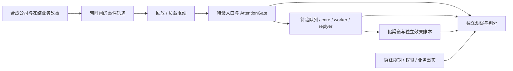

# 识雨信息流 Lab：设计与实验计划

日期：2026-11-01（America/Caracas）。状态：**设计建议，未实现、未运行**。本轮响应“是否应针对大量信息流构造测试 Lab”，完成用途、最小范围、复用路线与验收设计；不启动候选、模型或真实渠道。

[测试目录约定](<../README.md>) · [公司多人协作与注意力](<../../架构与设计/A方案全景/公司多人协作与群聊注意力.md>) · [既有种子测试集](<../2026-11-01-测试集设计/目录.md>) · [全局验证计划](<../../架构与设计/A方案全景/验证与验收.md>) · [工具核查依据](<../../research/2026-11-01-信息流Lab/目录.md>)

## 1. 要回答的问题

建议建立可重复回放的信息流实验环境。它同时回答：重要业务是否被识别、业务判断是否正确、多人权限是否守住、队列是否能持续工作、代价是否值得。分类准确率不能单独回答公司是否可用。

| 假设 | 对照与可能推翻假设的证据 |
|---|---|
| 注意力筛选能减少无用推理且保留关键业务 | 规则、规则＋Jev、规则＋Decisions、规则＋普通分类模型；漏掉重要消息或新增判断成本超过节省时，不证明收益 |
| 无关闲聊不影响正在进行的业务回复 | 同一故事分别不加噪音、加入闲聊、加入相关纠正；前两者业务结果应一致，纠正必须使对应旧回复失效 |
| 一个高流量群不拖垮其他人 | 保持其他会话输入不变，逐步增加单一供应商流量；观察查询、控制、core 和 worker 等待 |
| 多供应商可以共享计算而保持范围隔离 | 同名、相同短群 ID、混合群、离职撤权；检查模型输入、检索、派生摘要及外发全过程 |

Lab 只新增实验驱动、场景映射和独立判定。被测队列、控制账本和调度适配尽量接入既有复用路线，不能写一套行为理想的替身系统后宣称识雨架构已验证。

## 2. 三层实验，分别出结论

| 层次 | 被测内容 | 替身与真实部分 | 结论边界 |
|---|---|---|---|
| L1 语义离线回放 | 关注、业务变化、公开回复的判断 | 冻结的输入与获准上下文；规则或候选模型 | 能比较模型与问题设计；不能证明队列吞吐或真实渠道接通 |
| L2 协议与负载 | 隔离、队列、公平、背压、取消、恢复 | 真实待验适配器；确定性假模型、假渠道与独立效果账本 | 能验证已接入部件和边界；不能证明真实模型理解或外部服务延迟 |
| L3 有界组合 | AttentionGate 到任务/回复的完整路径 | 固定模型、待验 DSH/控制组件；发送仍到假端点 | 能定位组合误差与费用；真实 WhatsApp/QQ/飞书另按渠道计划验证 |

L1 的标注准备与 L2 的契约设计可以并行。L3 必须等依赖的边界检查通过，并明确实际模型预算和运行范围。现有 G1–G4 与 V01–V27 仍是权威验收编号，本 Lab 使用 FL 场景号，不冒称新增一套替代验收。

隐藏预期不能流入被测模型。L1 可单独接 AttentionGate，L2 用确定性模型输出替换它，L3 才组合；不要求先造齐整个识雨。

## 3. 复用成熟工具

| 职责 | 优先路线 | 仅需补的识雨内容 |
|---|---|---|
| 模型对比与结果导出 | Promptfoo；官方已提供 TypeSafe Jev 与 OpenAI Decisions provider | 相同语义问题、范围裁剪、输出归一化与独立标注；先核接口差异，必要时才用 custom provider |
| 本地协议断言与假时钟 | 当前 TypeScript/Node 技术栈及 Node 内置 test runner / MockTimers | 事件封套、显式故障屏障、状态与效果断言；以选定宿主支持的 Node 版本为准 |
| 真实入口的持续负载 | 接口存在后使用 k6 arrival-rate 执行器；当前无需先建 HTTP 服务 | 将合成事件映射到测试入口、鉴别注入端自身掉速；进程内最小回放先用薄驱动 |
| 被测队列及控制域 | 既有 p-queue/DSH inbox、Superagent 控制域与 SQLite 复用计划 | 明确采用哪个接缝、补丁及权威状态，不重复实现调度框架 |
| 证据与报告 | JSONL 轨迹、JSON/CSV 指标及工具现有结果页 | runId/eventId/版本关联、逐例差异、失败样本清单；先不搭独立控制台 |

以上是官方文档阅读后的设计建议，未安装、未固定运行版本、未声称集成成功。实施前固定 package/commit 与锁文件、许可证和输出/缓存路径；模型实际返回版本也要记录，不用 latest 别名作为可重复性保证。Jev/Decisions 作为被测对象时，不同时充当自己正确性的唯一裁判。

## 4. 合成公司、样本与拆分

起点为 10 名虚构员工，职责和委派显式配置；先设 3 家虚构供应商、内部群、员工私聊、供应商群与至少一个混合群，多项目、多订单。这是测试配置，不是对实际供应商数量的假设。扩容只改配置，不复制十套 core。

既有种子集 8 个场景、54 步全部为公开 DEV，复用 S02 身份/群隐私、S03 订阅、S04 聊天与任务、S05 未知效果、S08 时间/预算作为回归来源。现有文件保持独立，不改它们的答案；企业扩展记录来源场景及冻结摘要。

新增每个事件封套拟含：scenarioId、familyId、eventId、源事件 ID/revision、employee/supplier/project、connectionId、conversation/thread/replyTo、audience、occurredAt、scheduledArrival、实际 injectedAt/receivedAt、payload/附件可用状态、contextVersion。评估侧另存权限、业务事实、四类预期、允许结果集合、截止条件和故障脚本，不把这些字段送给模型。

四类预期分别是：是否关注、允许怎样改变内部状态、是否/向谁表达、允许什么动作。不能用单一“相关/无关”标签代替。歧义样本允许补查或澄清，政策待定时标 policy_pending，不能事后迁就候选输出。

先人工审定业务故事，再插入合成噪音，输出冻结轨迹；模型可以协助编写，但不能让自由发挥的模拟员工同时决定标准答案。文本、报价图片、语音转写及解析失败分层标记；提供正确转写的文本测试不代表音频链路已经通过。

按故事族划分 DEV/REG/HOLDOUT；同故事改名、换顺序、插噪音、翻译或不同种子留在同一集合。现有公开种子不能包装成保留集。保留集由独立流程保管，答案及未来步骤与被测过程隔离；只建一个同进程可读的 oracle 文件夹不构成隔离。

## 5. 最小场景与负载矩阵

| 场景 | 最小输入与独立预期 | 关联验证 |
|---|---|---|
| FL01 业务藏在闲聊中 | 同一延期故事插入 0%/80%/95% 无关消息；无 @ 的“明天到不了”仍被关注，闲聊不引发公开回复 | V05/V25 |
| FL02 语境改变答案 | 同一句话分别关联当前订单、没有订单、引用旧消息；分别判断，不能只靠关键词 | V07/V25 |
| FL03 连续刷屏与纠正 | 生成中插闲聊不取消；相关价格纠正、撤回、受众变化使对应旧草稿失效；迟到分类不得覆盖新版本 | V03/V05/V10 |
| FL04 单源洪峰 | 一个供应商占 80% 流量，其余员工继续查询和认证停止；有界等待、背压与 core 决策容量可见 | V05/V10/V23 |
| FL05 多人和跨供应商 | 冲突指令、同名、相同短群 ID、混合受众、撤权；私密合成标记不进入另一范围的请求/摘要/发送 | V02/V04/V13 |
| FL06 不确定与附件 | 分类超时、非法输出、解析失败、预算耗尽；不冒充无关，不无上限升级 core，保留可追踪的待处理状态 | V09/V13/V25 |
| FL07 重放与恢复 | 重送、乱序、分类后进程中断、发出但回执丢失；不重复逻辑效果，不把 unknown 报成功 | V03/V12/V21 |
| FL08 订阅和长期业务 | 无变化静默、业务变化唤醒、员工停止后重启；噪音不续命已停止目标 | V10/V14/V23 |

先扩写 FL01、FL03、FL04、FL05 四个可逐步审阅的故事，不先批量生成百万条缺少答案的数据。

负载选择：

- **P0 复用原基线**：20 会话、1,000 条短消息、总输入 10 条/秒、假模型 100 ms，沿用全局模型槽 3、后台最多 2、对话预留 1。见 V05；这不是公司生产 SLA。
- **P1 噪音配对**：固定业务轨迹与到达时间，仅增加噪音，比较业务漏报、等待、取消次数和总成本；另做固定总消息数的噪音比例对照，不能混淆两种实验。
- **P2 突发/偏斜**：在 P0 基础上只改一个轴，分别测单源 80%、10→25 条/秒的 60 秒突发和随后回落。队列上限不随流量悄悄放大；超载时明确拒收/重试及 gap，不要求无限承载。
- **P3 持续负载**：按已验证的承载率延长运行，观察内存、积压与预算趋势；实际时长、停止阈值在执行 manifest 冻结后才能判定，不用短突发替代持续运行。

80%、95%、25 条/秒均为建议探索参数，不是已观测公司流量。输入、模型延迟、附件比例、并发、噪音比例及会话数分别控制；不要同时改变所有轴然后归因于某个模型。

## 6. 时钟、可重复性和测量陷阱

业务时间可用假时钟推进，性能必须用单调实际时钟。来源事件时间、计划到达时间、实际注入/接纳时间及业务时钟分别记录；不能把虚拟一天的加速回放报告为真实吞吐。虚拟推进也不加速远端 API。

持续消息使用独立于答复完成的到达计划。若每次等识雨答完才投下一条，会使系统越慢、输入越少，掩盖排队。k6 arrival-rate 适合接口阶段；驱动若未能按时发出，应报告投递延迟/丢失迭代，不能算系统成功扛住目标流量。

使用显式屏障制造“发送前撤权”“效果完成但回执丢失”，不靠 sleep 猜竞态。固定种子只固定合成数据和故障安排，不保证远端模型确定性。正式重复次数与种子在执行前固定，保存全部轮次；同故事变体不能充当许多独立样本。

模型对比保持可见上下文及截断策略一致；同时比较相同输入条件和各方案实际端到端费用。冷/热缓存、重试、限流、取消但已计费分别报告。测在线延迟时不得把历史响应缓存当实际模型速度；规则全放行、全静默可作负面对照，不能作达标方案。

## 7. 判分与通过条件

| 维度 | 报告及首轮门槛 |
|---|---|
| 边界 | 已测场景内跨范围暴露、未授权效果、重复逻辑效果、失效后旧发送、unknown 伪报成功均为 0；看实际模型输入与独立效果账本，缺证据记不可判定 |
| 功能 | 冻结种子中的关键业务必须在逐例截止条件内到达处理路径并完成所需里程碑；仅升级 core 不算完成，永远静默或一律升级都不合格 |
| 语义 | 按交期、金额、取消、投诉等类别列漏报分子/分母，另列误唤醒、错误公开回复和不确定率；小样本只报告逐例错误，大集按独立故事族给区间，阈值在看保留结果前冻结 |
| 原性能基线 | 仅 P0 假模型/本地条件下，沿用 V05 接纳 P95≤500 ms、认证停止使新发送失效 P95≤1 s、至少 200 测量样本；排队上限原为每会话 20、总待处理 1,000 |
| 公平和恢复 | 分员工/项目/供应商报告最长等待、P95、队列峰值及洪峰后回落时间；新增测试的可承载率、等待上限与排空期限须先写入 manifest，不能在运行后挪门槛 |
| 成本 | 每千条原始入站总费用，分规则、筛选、core、worker、replyer、附件处理、重试；另列每个成功业务事件代价，不只看筛选 API 单价 |

捕获关键事件和完成业务分别计分；过截止时间才关注记为迟报，不能仅凭最终捕获率掩盖延迟。端到端时间从计划/实际入站分别报告，解析、排队、模型和发送分段显示，不隐藏附件时间。背景噪音的高占比不能用于冲高总体准确率。

任何硬边界失败阻断依赖它的下一层，保留最早失败和当时输入。通过有限样本只证明该配置与覆盖内的结果，不代表已证明所有公司输入可靠。企业扩展预期与旧“任意新消息推进 conversationGeneration”的文字差异，应先冻结拟验契约并保留对照，不能默默换标准。

## 8. 实施边界、产物与退出

后续获准执行时，以实际执行日创建测试目录或在本目录明确记录实施日期；代码、锁文件、依赖、缓存、数据和报告全部在测试实验根内。不要预建空模块。建议按需产生 cases 的输入轨迹、评估侧独立 oracle、src 薄驱动，以及 artifacts/runId 下 manifest、trace、效果账本、逐例差异、指标和失败种子。

manifest 固定：实际 OS/硬件/Node、被测源码与补丁、工具版本、模型返回版本、输入/预期摘要、策略/上下文版本、并发和队列上限、时钟与负载、预算/最长时长/停止条件。缺少运行环境或阈值时状态为未准备，不填通过。

首个实施切片建议为 L2 的 FL03/FL04/FL05 和 P0：只运行本地合成输入、确定性假模型与假端点，验证最容易被噪音放大的队列和隔离问题；并行准备 L1 的人工标注。之后才在明确预算下调用真实 Jev/Decisions，最后组合。真实模型输入仍先使用合成数据，真实平台账号与业务信息另属独立接入范围。

执行达到费用/时间/资源上限即停止新注入，记录 pending/unknown；优先收集独立账本与失败快照，再关闭本次进程、释放测试端口、清理可重建缓存和依赖。不得为让结果好看清空失败记录；未停止或未恢复的状态如实记录。

## 9. 本轮交付状态

新增本计划和工具来源记录，链接已有测试集与企业专题。未新增运行代码、依赖、数据库、模型请求或渠道发送；未改变候选采用状态。后续仍需冻结具体业务故事、人工预期、执行版本与有界模型预算；本计划不等于实验已经完成。
